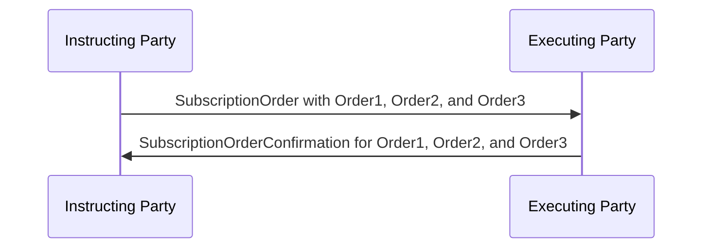

# Scenarios For Confirmations When 'Multiple’ Orders Specified in a Single Message — figure 70

[src-000095](../../../../../../../../evidence/omitted/ffbc05daa043e55c6bd0cc1a.md); direct-body paragraph P497; Word file/printed page 67.

[Original figure](../../../../../../../../evidence/omitted/a192a5a4ffd4926b962b32c7.md) · [Complete rendered page](../../../../../../../../evidence/omitted/cbf02220e3187f1ff663ee1b.md) · [Reusable flow](../../flows/flow-src-000095-p491-scenarios-for-confirmations-when-multiple-orders-specified-in-a-single.md)

## Source reconstruction

## Participant occurrences

| Occurrence | Literal label | Scoped participant |
| --- | --- | --- |
| I | Instructing Party | [instructing-party](../../../../../../../../shared/reference/participants/participant-src-000095-instructing-party.md) |
| E | Executing Party | [executing-party](../../../../../../../../shared/reference/participants/participant-src-000095-executing-party.md) |

## Ordered exchanges

| Step | Sender | Receiver | Literal message label |
| --- | --- | --- | --- |
| 1 | Instructing Party | Executing Party | SubscriptionOrder with Order1, Order2, and Order3 |
| 2 | Executing Party | Instructing Party | SubscriptionOrderConfirmation for Order1, Order2, and Order3 |

## Source qualifications and conditions

- P498 intentionally omits OrderInstructionStatusReport. P499 says waiting for all executions can delay confirmation of earlier trade dates. Source colours: Order1 green, Order2 cyan, Order3 red.
- Source bank icons denote named participants, not institutional identity of a functional role. Repeated instructing-party occurrences are distinct parties using the same role definition.
- Arrow direction and order follow the literal picture. Mermaid uses standard solid arrowheads rather than source open-head geometry; no additional synchrony, timing or network guarantee is inferred.
- Part1 message names/families do not establish exact versions; use maintained Part2/schema references.

## Rendering and visual review

Mermaid 12.3.0 parsed and rendered on 2026-11-09 with Mermaid browser API + Chromium 156.0.8078.81. [Rendered SVG](../../../../../../../../evidence/omitted/42fc6f1e7c4e5fcf37cd3548.md) · [Rendered PNG](../../../../../../../../evidence/omitted/46b769b2ab3de7c89a57cc75.md).

Every original figure inspected and compared directly with final rendered Mermaid PNG for participant occurrence, arrow direction, message label/code and order. Complete Word-page composition separately inspected in contact sheets for pages40–70; pages65–70 also inspected individually.

This bounded source reconstruction passed its recorded comparison.
