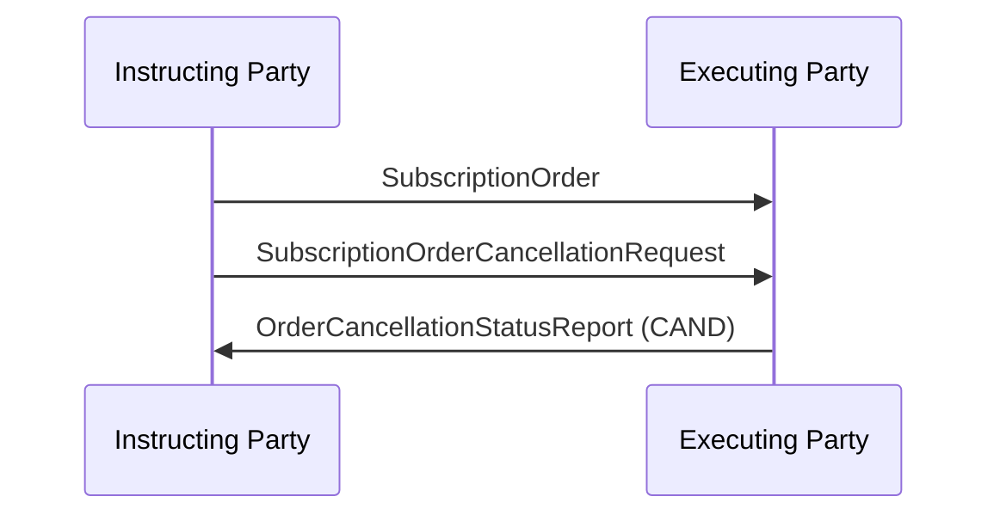

# Order Cancellation and Status  / Subscription  / Request and Status - Direct — figure 72

[src-000095](../../../../../../../../evidence/omitted/ffbc05daa043e55c6bd0cc1a.md); direct-body paragraph P518; Word file/printed page 69.

[Original figure](../../../../../../../../evidence/omitted/34a520055fe8eb7c406a0eae.md) · [Complete rendered page](../../../../../../../../evidence/omitted/efb573977a909b129c7fc9a4.md) · [Reusable flow](../../flows/flow-src-000095-p515-request-and-status-direct.md)

## Source reconstruction

## Participant occurrences

| Occurrence | Literal label | Scoped participant |
| --- | --- | --- |
| I | Instructing Party | [instructing-party](../../../../../../../../shared/reference/participants/participant-src-000095-instructing-party.md) |
| E | Executing Party | [executing-party](../../../../../../../../shared/reference/participants/participant-src-000095-executing-party.md) |

## Ordered exchanges

| Step | Sender | Receiver | Literal message label |
| --- | --- | --- | --- |
| 1 | Instructing Party | Executing Party | SubscriptionOrder |
| 2 | Instructing Party | Executing Party | SubscriptionOrderCancellationRequest |
| 3 | Executing Party | Instructing Party | OrderCancellationStatusReport (CAND) |

## Source qualifications and conditions

- P507–511: deadline and acceptance depend on SLA; executing party checks legality, initiator right and SLA permission. P517: cancellation possible and completed.
- Source bank icons denote named participants, not institutional identity of a functional role. Repeated instructing-party occurrences are distinct parties using the same role definition.
- Arrow direction and order follow the literal picture. Mermaid uses standard solid arrowheads rather than source open-head geometry; no additional synchrony, timing or network guarantee is inferred.
- Part1 message names/families do not establish exact versions; use maintained Part2/schema references.

## Rendering and visual review

Mermaid 12.3.0 parsed and rendered on 2026-11-09 with Mermaid browser API + Chromium 156.0.8078.81. [Rendered SVG](../../../../../../../../evidence/omitted/77443cccb35c8fdc84f541fd.md) · [Rendered PNG](../../../../../../../../evidence/omitted/f53ad1eeb59d3469758ff0f8.md).

Every original figure inspected and compared directly with final rendered Mermaid PNG for participant occurrence, arrow direction, message label/code and order. Complete Word-page composition separately inspected in contact sheets for pages40–70; pages65–70 also inspected individually.

This bounded source reconstruction passed its recorded comparison.
