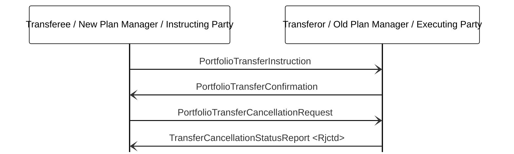

# Portfolio transfer cancellation rejected after execution

[src-000095](../../../../../../../../evidence/omitted/ffbc05daa043e55c6bd0cc1a.md); direct-body paragraph P804; BusinessTransactions / Portfolio Transfer Management / Cancellation / Rejected Cancellation – Already Executed; `/w:document/w:body/w:p[804]`.

[Unchanged original figure](../../../../../../../../evidence/omitted/3d4e62701b5440c88fd84fdc.md)

## Mermaid source reconstruction

## Actors and message directions

| Step | Sender | Receiver | Literal picture label |
| --- | --- | --- | --- |
| 1 | Transferee / New Plan Manager / Instructing Party | Transferor / Old Plan Manager / Executing Party | PortfolioTransferInstruction |
| 2 | Transferor / Old Plan Manager / Executing Party | Transferee / New Plan Manager / Instructing Party | PortfolioTransferConfirmation |
| 3 | Transferee / New Plan Manager / Instructing Party | Transferor / Old Plan Manager / Executing Party | PortfolioTransferCancellationRequest |
| 4 | Transferor / Old Plan Manager / Executing Party | Transferee / New Plan Manager / Instructing Party | TransferCancellationStatusReport &lt;Rjctd&gt; |

- [Transferee / New Plan Manager / Instructing Party](../../../../../../../../shared/reference/participants/participant-src-000095-transferee.md)
- [Transferor / Old Plan Manager / Executing Party](../../../../../../../../shared/reference/participants/participant-src-000095-transferor.md)

[Reusable flow, conditions, outcomes and source narrative](../../flows/flow-src-000095-p799-rejected-cancellation-already-executed.md)

## Source distinctions and limitations

- The source uses institutional pictograms for functional participants; native Mermaid lifeline boxes retain the labels without equating a functional role with one institution.
- Open source arrowheads are reproduced with native Mermaid open arrows. This visual notation choice does not establish additional transport or acknowledgement rules.
- The picture itself names messages without version numbers. Exact message references are matched separately through the supplied Part 2 headings; the mapping evidence and publication remain explicit.

## Rendering and visual review

Mermaid 12.3.0 parsed and rendered successfully using Mermaid browser API + Chromium 156.0.8078.81. [Rendered SVG](../../../../../../../../evidence/omitted/91e6848d80d5735c0ac30d61.md) · [Rendered PNG](../../../../../../../../evidence/omitted/c1a2718901769fb0d8f68b49.md).

The unchanged source image and final reconstruction were directly compared on 2026-11-09 (Europe/Warsaw): participant instances, message labels, sender/receiver endpoints, vertical ordering and open arrowheads. Result: **visual relationship fidelity pass**. Recorded source wording/order differences remain unresolved as described above. The renderer’s UTC date is 2026-11-09.

[Hash-bound review evidence](../../../../../../../../tracking/reviews/funds-sequences.json)

<!-- FUNDS-WORD-LOCATOR-START -->
## Word-rendered source page and composite review

[Word-rendered file page 96](../../../../../../../../evidence/omitted/3ffded7acb10c780e9eb2941.md) was inspected in complete-page context on 2026-11-09. The asset identity also matches by SHA-256. The original image contains the displayed substantive figure; no additional external labels or omitted drawing objects were observed in its page surroundings. The two-panel message5 overview intentionally spans pages314–315 (figures146–147), linked separately.

This whole-page check complements the prior detailed original-image versus reconstruction review. Known local Word header-field errors are excluded from business evidence. [Hash-bound page-context review evidence](../../../../../../../../tracking/reviews/funds-second-half-word-context.json).
<!-- FUNDS-WORD-LOCATOR-END -->
