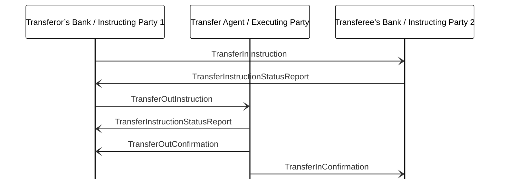

# Two-owner asset transfer — SLT market practice

[src-000095](../../../../../../../../evidence/omitted/ffbc05daa043e55c6bd0cc1a.md); direct-body paragraph P836; BusinessTransactions / Individual Asset Transfer / Two Account Owners – Direct – SLT Market Practice; `/w:document/w:body/w:p[836]`.

[Unchanged original figure](../../../../../../../../evidence/omitted/4dc7b0deac5fdc7989010694.md)

## Mermaid source reconstruction

## Actors and message directions

| Step | Sender | Receiver | Literal picture label |
| --- | --- | --- | --- |
| 1 | Transferor’s Bank / Instructing Party 1 | Transferee’s Bank / Instructing Party 2 | TransferInInstruction |
| 2 | Transferee’s Bank / Instructing Party 2 | Transferor’s Bank / Instructing Party 1 | TransferInstructionStatusReport |
| 3 | Transferor’s Bank / Instructing Party 1 | Transfer Agent / Executing Party | TransferOutInstruction |
| 4 | Transfer Agent / Executing Party | Transferor’s Bank / Instructing Party 1 | TransferInstructionStatusReport |
| 5 | Transfer Agent / Executing Party | Transferor’s Bank / Instructing Party 1 | TransferOutConfirmation |
| 6 | Transfer Agent / Executing Party | Transferee’s Bank / Instructing Party 2 | TransferInConfirmation |

- [Transferor’s Bank / Instructing Party 1](../../../../../../../../shared/reference/participants/participant-src-000095-transferor-s-bank-instructing-party.md)
- [Transfer Agent / Executing Party](../../../../../../../../shared/reference/participants/participant-src-000095-transfer-agent.md)
- [Transferee’s Bank / Instructing Party 2](../../../../../../../../shared/reference/participants/participant-src-000095-transferee-s-bank-instructing-party.md)

[Reusable flow, conditions, outcomes and source narrative](../../flows/flow-src-000095-p828-two-account-owners-direct-slt-market-practice.md)

## Source distinctions and limitations

- The paired confirmations share the same vertical position in the source picture. Separate Mermaid rows are for legibility and do not establish an order between these two confirmations.
- The picture sends TransferInInstruction from the transferor’s bank to the transferee’s bank and the first status back; P829–P830 specify the opposite two directions. The original arrow directions remain visible. No inferred correction is applied.
- P830 and P832 specify Accepted (PACK), but the picture’s two status labels have no status qualifier.
- The source uses institutional pictograms for functional participants; native Mermaid lifeline boxes retain the labels without equating a functional role with one institution.
- Open source arrowheads are reproduced with native Mermaid open arrows. This visual notation choice does not establish additional transport or acknowledgement rules.
- The picture itself names messages without version numbers. Exact message references are matched separately through the supplied Part 2 headings; the mapping evidence and publication remain explicit.

[issue-000034 — Investment Funds source wording/order distinctions](../../../../../../../../tracking/issues.md)

## Rendering and visual review

Mermaid 12.3.0 parsed and rendered successfully using Mermaid browser API + Chromium 156.0.8078.81. [Rendered SVG](../../../../../../../../evidence/omitted/cb128957529f7fb7296ceb48.md) · [Rendered PNG](../../../../../../../../evidence/omitted/0e4f50787fd137f0febd5bb5.md).

The unchanged source image and final reconstruction were directly compared on 2026-11-09 (Europe/Warsaw): participant instances, message labels, sender/receiver endpoints, vertical ordering and open arrowheads. Result: **visual relationship fidelity pass**. Recorded source wording/order differences remain unresolved as described above. The renderer’s UTC date is 2026-11-09.

[Hash-bound review evidence](../../../../../../../../tracking/reviews/funds-sequences.json)

<!-- FUNDS-WORD-LOCATOR-START -->
## Word-rendered source page and composite review

[Word-rendered file page 99](../../../../../../../../evidence/omitted/d6f26492793ab5d3c8b2dca0.md) was inspected in complete-page context on 2026-11-09. The asset identity also matches by SHA-256. The original image contains the displayed substantive figure; no additional external labels or omitted drawing objects were observed in its page surroundings. The two-panel message5 overview intentionally spans pages314–315 (figures146–147), linked separately.

This whole-page check complements the prior detailed original-image versus reconstruction review. Known local Word header-field errors are excluded from business evidence. [Hash-bound page-context review evidence](../../../../../../../../tracking/reviews/funds-second-half-word-context.json).
<!-- FUNDS-WORD-LOCATOR-END -->
