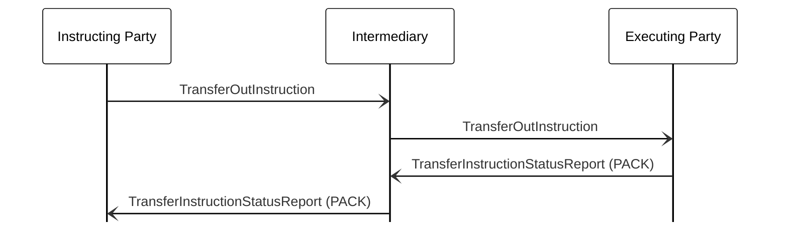

# Unsolicited transfer instruction status — intermediary

[src-000095](../../../../../../../../evidence/omitted/ffbc05daa043e55c6bd0cc1a.md); direct-body paragraph P885; BusinessTransactions / Individual Asset Transfer / Request for Transfer Status and Transfer Status  / Status - Intermediary; `/w:document/w:body/w:p[885]`.

[Unchanged original figure](../../../../../../../../evidence/omitted/24e054ac4b77a2b53a4a9879.md)

## Mermaid source reconstruction

## Actors and message directions

| Step | Sender | Receiver | Literal picture label |
| --- | --- | --- | --- |
| 1 | Instructing Party | Intermediary | TransferOutInstruction |
| 2 | Intermediary | Executing Party | TransferOutInstruction |
| 3 | Executing Party | Intermediary | TransferInstructionStatusReport (PACK) |
| 4 | Intermediary | Instructing Party | TransferInstructionStatusReport (PACK) |

- [Instructing Party](../../../../../../../../shared/reference/participants/participant-src-000095-instructing-party.md)
- [Intermediary](../../../../../../../../shared/reference/participants/participant-src-000095-intermediary.md)
- [Executing Party](../../../../../../../../shared/reference/participants/participant-src-000095-executing-party.md)

[Reusable flow, conditions, outcomes and source narrative](../../flows/flow-src-000095-p881-status-intermediary.md)

## Source distinctions and limitations

- The source uses institutional pictograms for functional participants; native Mermaid lifeline boxes retain the labels without equating a functional role with one institution.
- Open source arrowheads are reproduced with native Mermaid open arrows. This visual notation choice does not establish additional transport or acknowledgement rules.
- The picture itself names messages without version numbers. Exact message references are matched separately through the supplied Part 2 headings; the mapping evidence and publication remain explicit.

## Rendering and visual review

Mermaid 12.3.0 parsed and rendered successfully using Mermaid browser API + Chromium 156.0.8078.81. [Rendered SVG](../../../../../../../../evidence/omitted/1f0c63cd84c11dc2ad42b5d3.md) · [Rendered PNG](../../../../../../../../evidence/omitted/ab38b7d762004f4a7c80a4e9.md).

The unchanged source image and final reconstruction were directly compared on 2026-11-09 (Europe/Warsaw): participant instances, message labels, sender/receiver endpoints, vertical ordering and open arrowheads. Result: **visual relationship fidelity pass**. Recorded source wording/order differences remain unresolved as described above. The renderer’s UTC date is 2026-11-09.

[Hash-bound review evidence](../../../../../../../../tracking/reviews/funds-sequences.json)

<!-- FUNDS-WORD-LOCATOR-START -->
## Word-rendered source page and composite review

[Word-rendered file page 103](../../../../../../../../evidence/omitted/8f6ea3151a0bf6b10d4c42f3.md) was inspected in complete-page context on 2026-11-09. This occurrence was located by direct full-page comparison of the original image, message labels and heading context; no asset-hash match is claimed. The original image contains the displayed substantive figure; no additional external labels or omitted drawing objects were observed in its page surroundings. The two-panel message5 overview intentionally spans pages314–315 (figures146–147), linked separately.

This whole-page check complements the prior detailed original-image versus reconstruction review. Known local Word header-field errors are excluded from business evidence. [Hash-bound page-context review evidence](../../../../../../../../tracking/reviews/funds-second-half-word-context.json).
<!-- FUNDS-WORD-LOCATOR-END -->
