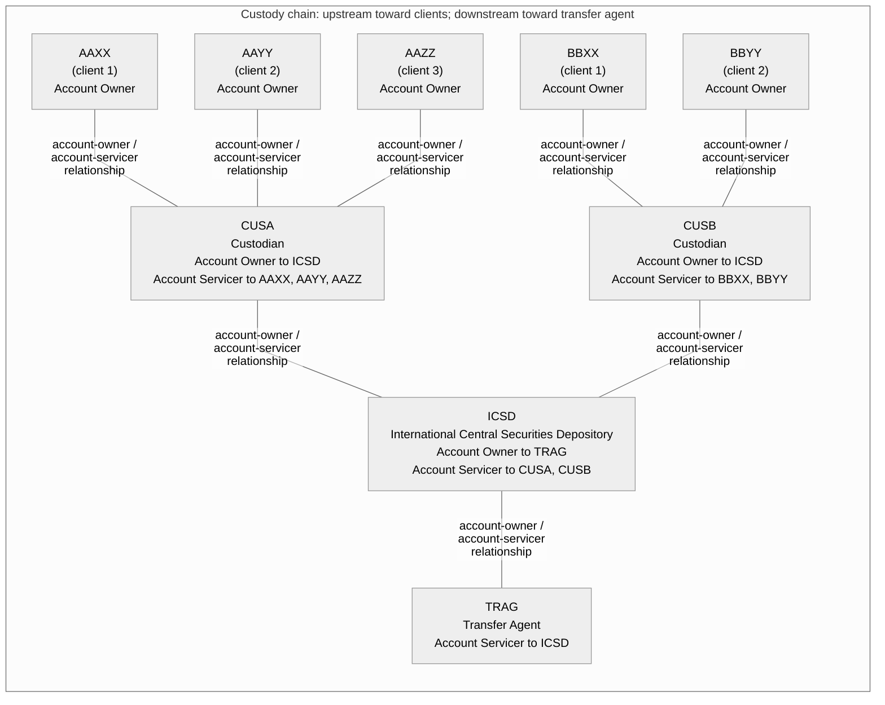
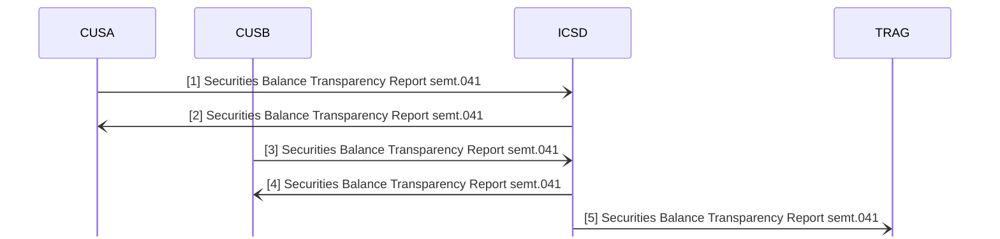

# Transparency of holdings — custody-chain example 1

[src-000095](../../../../../../../../evidence/omitted/ffbc05daa043e55c6bd0cc1a.md); direct-body paragraph P5812; Business Examples / Transparency Of Holdings / SecuritiesBalanceTransparencyReport semt.041.001.02 - 1.

[Unchanged original image](../../../../../../../../evidence/omitted/b3d49d124456185b29813a6c.md)

## Mermaid source reconstruction

## Complete label inventory

| Scoped diagram entity/block | Literal labels and values |
| --- | --- |
| ICSD | ICSD International Central Securities Depository Account Owner to TRAG Account Servicer to CUSA, CUSB |
| TRAG | TRAG Transfer Agent Account Servicer to ICSD |
| CUSA | CUSA Custodian Account Owner to ICSD Account Servicer to AAXX, AAYY, AAZZ |
| AAXX | AAXX (client 1) Account Owner |
| AAYY | AAYY (client 2) Account Owner |
| AAZZ | AAZZ (client 3) Account Owner |
| CUSB | CUSB Custodian Account Owner to ICSD Account Servicer to BBXX, BBYY |
| BBXX | BBXX (client 1) Account Owner |
| BBYY | BBYY (client 2) Account Owner |

## Relationships and numbered messages

| From/container | To/contained entity | Source relation |
| --- | --- | --- |
| CUSA | ICSD | account-owner / account-servicer relationship |
| AAXX | CUSA | account-owner / account-servicer relationship |
| AAYY | CUSA | account-owner / account-servicer relationship |
| AAZZ | CUSA | account-owner / account-servicer relationship |
| CUSB | ICSD | account-owner / account-servicer relationship |
| BBXX | CUSB | account-owner / account-servicer relationship |
| BBYY | CUSB | account-owner / account-servicer relationship |
| ICSD | TRAG | account-owner / account-servicer relationship |

| Sender | Receiver | Numbered source message |
| --- | --- | --- |
| CUSA | ICSD | [1] Securities Balance Transparency Report semt.041 |
| ICSD | CUSA | [2] Securities Balance Transparency Report semt.041 |
| CUSB | ICSD | [3] Securities Balance Transparency Report semt.041 |
| ICSD | CUSB | [4] Securities Balance Transparency Report semt.041 |
| ICSD | TRAG | [5] Securities Balance Transparency Report semt.041 |

## Source callouts and distinctions

- [1] CUSA reports a breakdown of account CUSA1111 into the three accounts it services for clients.
- [2] ICSD reports the holding in CUSA1111 that it services for CUSA, enriched with place of safekeeping; it echoes the clients’ holdings enriched with agent codes.
- [3] CUSB reports a breakdown of account CUSB1111 into the two accounts it services for clients.
- [4] ICSD reports the holding in CUSB2222 that it services for CUSB, enriched with place of safekeeping; it echoes clients’ holdings enriched with agent codes.
- [5] ICSD reports a breakdown of omnibus account 11111111 into CUSA1111 and CUSB2222, each further broken down into that custodian’s client accounts.
- The source’s [3] CUSB1111 differs from [4] and [5] CUSB2222; both labels are preserved (issue-000040).
- The source marks upstream in the custody chain toward the client side (left), and downstream toward the transfer agent (right).
- Hollow blue Account Owner markers and filled orange Account Servicer markers are expressed as labelled relationship edges and node role labels. These are roles in specific relationships; each custodian and ICSD occupies both roles at different links. No cardinality or ownership key is inferred.

[issue-000040 — source example contradictions; issue-000042 — unavailable definition/schema](../../../../../../../../tracking/issues.md)

## Participants and reusable flow

[Source narrative, conditions, report directions, example values and table evidence](../../flows/flow-src-000095-transparency-example-1.md)

- [account-owner](../../../../../../../../shared/reference/participants/participant-src-000095-account-owner.md)
- [account-servicer](../../../../../../../../shared/reference/participants/participant-src-000095-account-servicer.md)
- [custodian](../../../../../../../../shared/reference/participants/participant-src-000095-custodian.md)
- [icsd](../../../../../../../../shared/reference/participants/participant-src-000095-icsd.md)
- [transfer-agent](../../../../../../../../shared/reference/participants/participant-src-000095-transfer-agent.md)

## Rendering and visual review

Mermaid 12.3.0 parsed and rendered using Mermaid browser API + Chromium 156.0.8078.81. The original image (enlarged where needed) and final render were directly compared on 2026-11-09 for all labels, literal values, cardinalities, containment, relation endpoints, numbered message directions and callouts. Visual reconstruction fidelity: pass, with explicit notation differences and unresolved source contradictions above. Full Word-page/composite checks are separate.

[Rendered SVG](../../../../../../../../evidence/omitted/3b5dc287dcaacd052cee9ff1.md) · [Rendered PNG](../../../../../../../../evidence/omitted/b0254b2566310627cb6d3085.md) · [Hash-bound visual-review record](../../../../../../../../tracking/reviews/funds-transparency.json)

## Numbered message-flow view

The source composite is split into the role-relationship view above and this numbered-message view. Client participants remain in the relationship view; the source does not draw report arrows from them. Source report numbers define the illustrated order, not an additional SLA timing rule. Native open arrowheads retain the source message-direction convention.

The numbered message view was also parsed, rendered, and directly compared with the same original: [Message-view SVG](../../../../../../../../evidence/omitted/10677c9236d9d8fa1cc852cf.md) · [Message-view PNG](../../../../../../../../evidence/omitted/3a6481e3cbcdf5366921ec75.md).

<!-- FUNDS-WORD-LOCATOR-START -->
## Word-rendered source page and composite review

[Word-rendered file page 285](../../../../../../../../evidence/omitted/3281114cb4c62fb4492a4882.md) was inspected in complete-page context on 2026-11-09. The asset identity also matches by SHA-256. The original image contains the displayed substantive figure; no additional external labels or omitted drawing objects were observed in its page surroundings. The two-panel message5 overview intentionally spans pages314–315 (figures146–147), linked separately.

This whole-page check complements the prior detailed original-image versus reconstruction review. Known local Word header-field errors are excluded from business evidence. [Hash-bound page-context review evidence](../../../../../../../../tracking/reviews/funds-second-half-word-context.json).
<!-- FUNDS-WORD-LOCATOR-END -->
