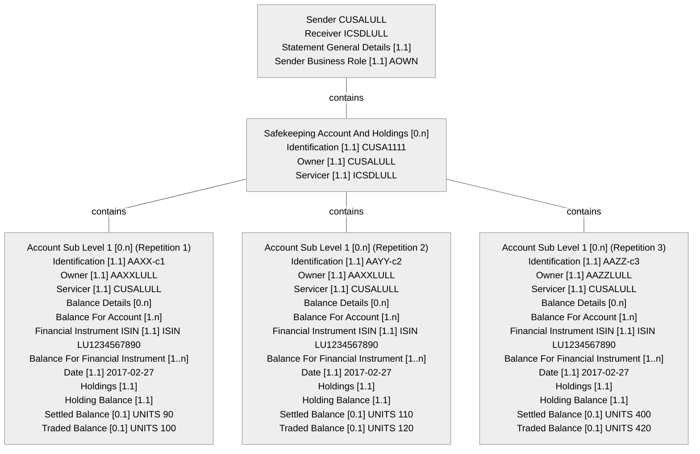

# Transparency example 1 — message 1 structure

[src-000095](../../../../../../../../evidence/omitted/ffbc05daa043e55c6bd0cc1a.md); direct-body paragraph P5825; Business Examples / Transparency Of Holdings / SecuritiesBalanceTransparencyReport semt.041.001.02 Message 1.

[Unchanged original image](../../../../../../../../evidence/omitted/e2326f1b83398fc3d39e32c6.md)

## Mermaid source reconstruction

## Complete label inventory

| Scoped diagram entity/block | Literal labels and values |
| --- | --- |
| M | Sender CUSALULL Receiver ICSDLULL Statement General Details [1.1] Sender Business Role [1.1] AOWN |
| S | Safekeeping Account And Holdings [0.n] Identification [1.1] CUSA1111 Owner [1.1] CUSALULL Servicer [1.1] ICSDLULL |
| L1 | Account Sub Level 1 [0.n] (Repetition 1) Identification [1.1] AAXX-c1 Owner [1.1] AAXXLULL Servicer [1.1] CUSALULL Balance Details [0.n] Balance For Account [1.n] Financial Instrument ISIN [1.1] ISIN LU1234567890 Balance For Financial Instrument [1..n] Date [1.1] 2017-02-27 Holdings [1.1] Holding Balance [1.1] Settled Balance [0.1] UNITS 90 Traded Balance [0.1] UNITS 100 |
| L2 | Account Sub Level 1 [0.n] (Repetition 2) Identification [1.1] AAYY-c2 Owner [1.1] AAXXLULL Servicer [1.1] CUSALULL Balance Details [0.n] Balance For Account [1.n] Financial Instrument ISIN [1.1] ISIN LU1234567890 Balance For Financial Instrument [1..n] Date [1.1] 2017-02-27 Holdings [1.1] Holding Balance [1.1] Settled Balance [0.1] UNITS 110 Traded Balance [0.1] UNITS 120 |
| L3 | Account Sub Level 1 [0.n] (Repetition 3) Identification [1.1] AAZZ-c3 Owner [1.1] AAZZLULL Servicer [1.1] CUSALULL Balance Details [0.n] Balance For Account [1.n] Financial Instrument ISIN [1.1] ISIN LU1234567890 Balance For Financial Instrument [1..n] Date [1.1] 2017-02-27 Holdings [1.1] Holding Balance [1.1] Settled Balance [0.1] UNITS 400 Traded Balance [0.1] UNITS 420 |

## Relationships and numbered messages

| From/container | To/contained entity | Source relation |
| --- | --- | --- |
| M | S | contains |
| S | L1 | contains |
| S | L2 | contains |
| S | L3 | contains |

| Sender | Receiver | Numbered source message |
| --- | --- | --- |

## Source callouts and distinctions

- The source callout describes CUSA1111 as the sender’s omnibus account for underlying clients AAXX, AAYY and AAZZ.
- Each financial-instrument balance may repeat per ISIN held in the indicated client account; this example has only one ISIN. The three callouts print AAXX-c1, AAYY-c2 and AAYY-c3, although the third actual account box is AAZZ-c3.
- The second account’s picture owner is AAXXLULL. P5820 instead associates AAYY with AAYYLLUU; later P5837 uses AAYYLULL. All literal claims are retained (issue-000040).

[issue-000040 — source example contradictions; issue-000042 — unavailable definition/schema](../../../../../../../../tracking/issues.md)

## Participants and reusable flow

[Source narrative, conditions, report directions, example values and table evidence](../../flows/flow-src-000095-transparency-example-1.md)

- [account-owner](../../../../../../../../shared/reference/participants/participant-src-000095-account-owner.md)
- [account-servicer](../../../../../../../../shared/reference/participants/participant-src-000095-account-servicer.md)
- [custodian](../../../../../../../../shared/reference/participants/participant-src-000095-custodian.md)
- [icsd](../../../../../../../../shared/reference/participants/participant-src-000095-icsd.md)
- [transfer-agent](../../../../../../../../shared/reference/participants/participant-src-000095-transfer-agent.md)

## Rendering and visual review

Mermaid 12.3.0 parsed and rendered using Mermaid browser API + Chromium 156.0.8078.81. The original image (enlarged where needed) and final render were directly compared on 2026-11-09 for all labels, literal values, cardinalities, containment, relation endpoints, numbered message directions and callouts. Visual reconstruction fidelity: pass, with explicit notation differences and unresolved source contradictions above. Full Word-page/composite checks are separate.

[Rendered SVG](../../../../../../../../evidence/omitted/8fbd91335990a0e590130181.md) · [Rendered PNG](../../../../../../../../evidence/omitted/23aa95a5f39dd57a54e7c7a0.md) · [Hash-bound visual-review record](../../../../../../../../tracking/reviews/funds-transparency.json)

## Internal nesting retained in compact blocks

Within each depicted account, Balance Details contains Balance For Account. That block contains Financial Instrument ISIN and Balance For Financial Instrument. In figure144, the latter contains Date and Holdings; Holdings contains Holding Balance, which contains Settled Balance and Traded Balance. In figures145–147 the financial-instrument balance is deliberately collapsed by the source, so no internal fields are supplied by inference. Account Sub Level 2 repetitions belong to their shown Account Sub Level 1 parent; distinct repetitions retain distinct identifiers.

<!-- FUNDS-WORD-LOCATOR-START -->
## Word-rendered source page and composite review

[Word-rendered file page 292](../../../../../../../../evidence/omitted/38205c4e83e7f4892aba4373.md) was inspected in complete-page context on 2026-11-09. The asset identity also matches by SHA-256. The original image contains the displayed substantive figure; no additional external labels or omitted drawing objects were observed in its page surroundings. The two-panel message5 overview intentionally spans pages314–315 (figures146–147), linked separately.

This whole-page check complements the prior detailed original-image versus reconstruction review. Known local Word header-field errors are excluded from business evidence. [Hash-bound page-context review evidence](../../../../../../../../tracking/reviews/funds-second-half-word-context.json).
<!-- FUNDS-WORD-LOCATOR-END -->
