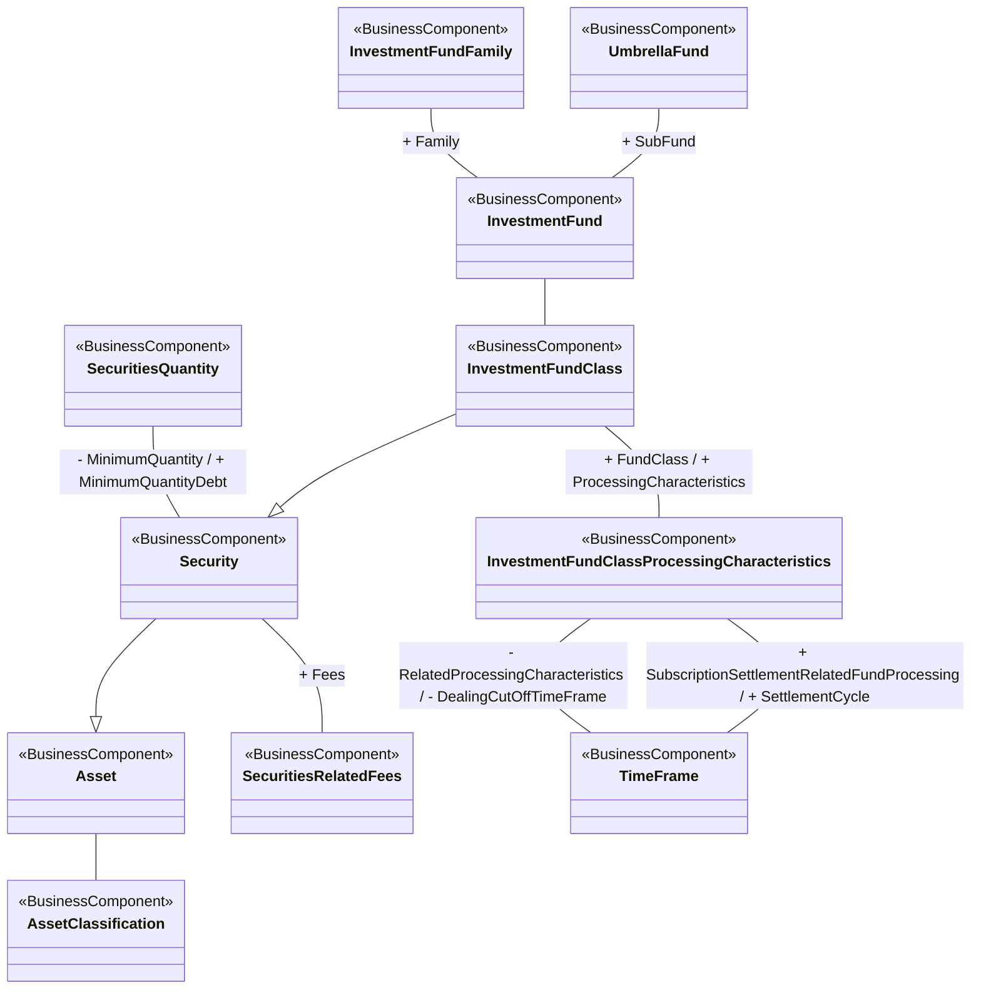

# Investment fund, fund class and processing characteristics

[src-000097](../../../../../../../../../evidence/omitted/3ea6002607634c1b65cb5c88.md), FundAndFundClass!A1:V28; xl/drawings/drawing2.xml; anchor 1. Original image SHA-256: d399076b02c481705dc9b111f43771a362b72aa0243d24b033b1b4bacda4be33.

[Original complete figure](../../../../../../../../../evidence/omitted/c7a15bf845da163863c401f6.md) · [Rendered Mermaid SVG](../../../../../../../../../evidence/omitted/d0d6e63a365812eb234db1d7.md) · [Rendered Mermaid PNG](../../../../../../../../../evidence/omitted/f67589d36bea8946628005e2.md)

## Source reconstruction

## Entities and relationships

Fund family and umbrella fund each link InvestmentFund, which links InvestmentFundClass. Fund class specializes Security; Security specializes Asset. Security also links minimum quantity and fees. Fund class connects processing characteristics, and two distinct associations connect those characteristics to TimeFrame: dealing cut-off and settlement cycle. Package labels appear only on some source nodes and are preserved only where printed.

All 11 visible node occurrences and 11 relationship lines are retained. No numeric multiplicity is shown in this source view, so none is inferred. The entity register preserves every visible package label, including explicitly absent or truncated labels. Package names are recorded there rather than adding enclosing boxes absent from the source. Association labels retain literal +/− prefixes and combined end names. Their re-layout position is not additional navigability evidence. The native class inheritance marker is reserved for the source’s hollow-triangle generalizations. Source editor/navigation icons are omitted as interface decoration; no business entity or relationship is excluded.

## Complete relationship register

| From node | To node | Source relationship kind | Visible source label(s) | From-end multiplicity | To-end multiplicity |
| --- | --- | --- | --- | --- | --- |
| Asset | AssetClassification | association | (unlabelled in source) | not printed | not printed |
| Security | Asset | generalization: subtype to supertype | (unlabelled in source) | not printed | not printed |
| SecuritiesQuantity | Security | association | - MinimumQuantity / + MinimumQuantityDebt | not printed | not printed |
| Security | SecuritiesRelatedFees | association | + Fees | not printed | not printed |
| InvestmentFundFamily | InvestmentFund | association | + Family | not printed | not printed |
| UmbrellaFund | InvestmentFund | association | + SubFund | not printed | not printed |
| InvestmentFund | InvestmentFundClass | association | (unlabelled in source) | not printed | not printed |
| InvestmentFundClass | Security | generalization: subtype to supertype | (unlabelled in source) | not printed | not printed |
| InvestmentFundClass | InvestmentFundClassProcessingCharacteristics | association | + FundClass / + ProcessingCharacteristics | not printed | not printed |
| InvestmentFundClassProcessingCharacteristics | TimeFrame | association | - RelatedProcessingCharacteristics / - DealingCutOffTimeFrame | not printed | not printed |
| InvestmentFundClassProcessingCharacteristics | TimeFrame | association | + SubscriptionSettlementRelatedFundProcessing / + SettlementCycle | not printed | not printed |

## Entity definitions and precise workbook locators

| Visible label | Source package / stereotype | Definition evidence |
| --- | --- | --- |
| Asset | not printed in figure / BusinessComponent | [FullBusinessModel!A258:D258](../sheets/02-fullbusinessmodel/tbl-0003.md) — Tangible items of value to a business. |
| AssetClassification | not printed in figure / BusinessComponent | [FullBusinessModel!A281:D281](../sheets/02-fullbusinessmodel/tbl-0003.md) — Other classification type of the security, ie, other than ISO 10962. |
| Security | Securities / BusinessComponent | [FullBusinessModel!A4659:D4659](../sheets/02-fullbusinessmodel/tbl-0025.md) — Financial instruments representing a sum of rights of the investor vis-a-vis the issuer. |
| SecuritiesQuantity | not printed in figure / BusinessComponent | [FullBusinessModel!A4350:D4350](../sheets/02-fullbusinessmodel/tbl-0023.md) — Quantity of a security. |
| SecuritiesRelatedFees | DICO_BusinessComponents / BusinessComponent | [FullBusinessModel!A4459:D4459](../sheets/02-fullbusinessmodel/tbl-0024.md) — Fees related to securities trades. |
| InvestmentFundFamily | DICO_BusinessComponents / BusinessComponent | [FullBusinessModel!A2351:D2351](../sheets/02-fullbusinessmodel/tbl-0013.md) — Group of investment funds under the same fund management company. |
| UmbrellaFund | Securities / BusinessComponent | [FullBusinessModel!A5263:D5263](../sheets/02-fullbusinessmodel/tbl-0028.md) — In securities, a collective investment scheme that has a contractual or a corporate form. When it has a contractual form, a fund is constituted under either the law of contract or under the trust law and thus it is not a legal entity. In its corporate form, a fund is a legal entity and is structured as a company. It has several distinct sub-funds which in effect are traded as individual investment funds. |
| InvestmentFund | DICO_BusinessComponents / BusinessComponent | [FullBusinessModel!A2263:D2263](../sheets/02-fullbusinessmodel/tbl-0013.md) — Distinct pool of financial instruments managed by a single investment policy. May or not be part of an umbrella fund. The pool is issued in at least one investment fund class. |
| InvestmentFundClass | Securities / BusinessComponent | [FullBusinessModel!A2281:D2281](../sheets/02-fullbusinessmodel/tbl-0013.md) — Security that is a sub-set of an investment fund, and is governed by the same investment fund policy, for example, a dividend option or valuation currency. |
| InvestmentFundClassProcessingCharacteristics | Securities / BusinessComponent | [FullBusinessModel!A2312:D2312](../sheets/02-fullbusinessmodel/tbl-0013.md) — Processing characteristics linked to the instrument, ie, not to  the market. |
| TimeFrame | not printed in figure / BusinessComponent | [FullBusinessModel!A5077:D5077](../sheets/02-fullbusinessmodel/tbl-0027.md) — TimeFrame or period concept that allows definition of a period as number of days before or after a defined activity. |

## Participant and flow navigation

This is a conceptual entity model, not a message exchange diagram. A business component or relationship label is not automatically a functional participant or institution. [Message-set participant references](../../../participants.md) and [Message-set business flows](../../../flows/index.md) provide the independently sourced actor/process context. These references are navigational; source figure associations do not establish message direction.

## Rendering and visual review

2026-11-09: Mermaid 12.3.0 parsed and rendered successfully with Mermaid browser API + Chromium 156.0.8078.81. Compared complete source image with final Mermaid PNG: all visible entity labels, stereotypes, inheritance directions, plain associations and literal end labels reconciled. Verified parallel TimeFrame associations, switch-order/execution leg hierarchies, both tax associations, six labels on the single price/statistics line, account specialization and contextual party-role hierarchy. Printed package labels are preserved in the entity register; absent labels remain absent and the visibly truncated PlacementAgent label is explicitly retained. No numeric multiplicities are printed. [Renderer evidence](../../../../../../../../../work/investment-workbook-models/render-report.json).

