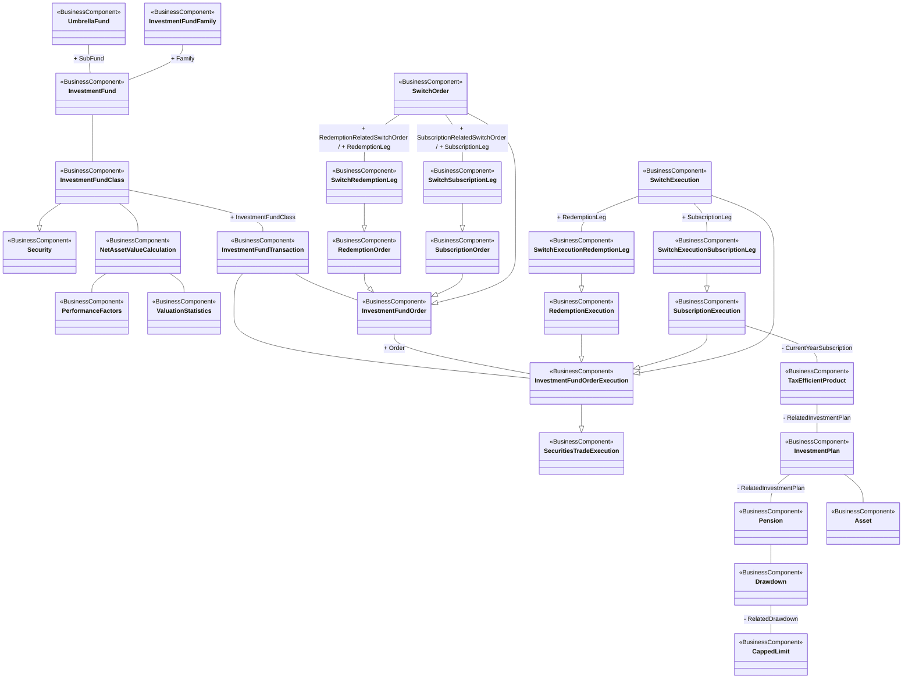

# Investment-fund orders, executions and plans

[src-000097](../../../../../../../../../evidence/omitted/3ea6002607634c1b65cb5c88.md), Order!A1:AI45; xl/drawings/drawing3.xml; anchor 1. Original image SHA-256: 81aa218b6f7b2f3371d0f6cf25c0e2204ac8fe5b8cf2cf29dedfd314f5a15586.

[Original complete figure](../../../../../../../../../evidence/omitted/d9ad89e13877be7cf6913aff.md) · [Rendered Mermaid SVG](../../../../../../../../../evidence/omitted/c40d9aaa449c847ba9b47498.md) · [Rendered Mermaid PNG](../../../../../../../../../evidence/omitted/d115ddf05115824c9d1e3748.md)

## Source reconstruction

## Entities and relationships

InvestmentFundClass links fund, net asset value calculation and investment-fund transaction. Order and order execution each connect that transaction; execution specializes securities trade execution. Redemption, subscription and switch orders specialize investment-fund order; their corresponding executions specialize investment-fund order execution. Switch legs have both their explicit parent generalization and separate switch association. Subscription execution links tax-efficient product, then investment plan, pension, drawdown and capped limit; the plan also links an asset. The figure supplies no package names or business-message direction.

All 28 visible node occurrences and 32 relationship lines are retained. No numeric multiplicity is shown in this source view, so none is inferred. The entity register preserves every visible package label, including explicitly absent or truncated labels. Package names are recorded there rather than adding enclosing boxes absent from the source. Association labels retain literal +/− prefixes and combined end names. Their re-layout position is not additional navigability evidence. The native class inheritance marker is reserved for the source’s hollow-triangle generalizations. Source editor/navigation icons are omitted as interface decoration; no business entity or relationship is excluded.

## Complete relationship register

| From node | To node | Source relationship kind | Visible source label(s) | From-end multiplicity | To-end multiplicity |
| --- | --- | --- | --- | --- | --- |
| UmbrellaFund | InvestmentFund | association | + SubFund | not printed | not printed |
| InvestmentFundFamily | InvestmentFund | association | + Family | not printed | not printed |
| InvestmentFund | InvestmentFundClass | association | (unlabelled in source) | not printed | not printed |
| InvestmentFundClass | Security | generalization: subtype to supertype | (unlabelled in source) | not printed | not printed |
| InvestmentFundClass | NetAssetValueCalculation | association | (unlabelled in source) | not printed | not printed |
| NetAssetValueCalculation | PerformanceFactors | association | (unlabelled in source) | not printed | not printed |
| NetAssetValueCalculation | ValuationStatistics | association | (unlabelled in source) | not printed | not printed |
| InvestmentFundClass | InvestmentFundTransaction | association | + InvestmentFundClass | not printed | not printed |
| InvestmentFundTransaction | InvestmentFundOrder | association | (unlabelled in source) | not printed | not printed |
| InvestmentFundTransaction | InvestmentFundOrderExecution | association | (unlabelled in source) | not printed | not printed |
| InvestmentFundOrder | InvestmentFundOrderExecution | association | + Order | not printed | not printed |
| InvestmentFundOrderExecution | SecuritiesTradeExecution | generalization: subtype to supertype | (unlabelled in source) | not printed | not printed |
| RedemptionOrder | InvestmentFundOrder | generalization: subtype to supertype | (unlabelled in source) | not printed | not printed |
| SubscriptionOrder | InvestmentFundOrder | generalization: subtype to supertype | (unlabelled in source) | not printed | not printed |
| SwitchOrder | InvestmentFundOrder | generalization: subtype to supertype | (unlabelled in source) | not printed | not printed |
| SwitchRedemptionLeg | RedemptionOrder | generalization: subtype to supertype | (unlabelled in source) | not printed | not printed |
| SwitchSubscriptionLeg | SubscriptionOrder | generalization: subtype to supertype | (unlabelled in source) | not printed | not printed |
| SwitchOrder | SwitchRedemptionLeg | association | + RedemptionRelatedSwitchOrder / + RedemptionLeg | not printed | not printed |
| SwitchOrder | SwitchSubscriptionLeg | association | + SubscriptionRelatedSwitchOrder / + SubscriptionLeg | not printed | not printed |
| RedemptionExecution | InvestmentFundOrderExecution | generalization: subtype to supertype | (unlabelled in source) | not printed | not printed |
| SubscriptionExecution | InvestmentFundOrderExecution | generalization: subtype to supertype | (unlabelled in source) | not printed | not printed |
| SwitchExecution | InvestmentFundOrderExecution | generalization: subtype to supertype | (unlabelled in source) | not printed | not printed |
| SwitchExecutionRedemptionLeg | RedemptionExecution | generalization: subtype to supertype | (unlabelled in source) | not printed | not printed |
| SwitchExecutionSubscriptionLeg | SubscriptionExecution | generalization: subtype to supertype | (unlabelled in source) | not printed | not printed |
| SwitchExecution | SwitchExecutionRedemptionLeg | association | + RedemptionLeg | not printed | not printed |
| SwitchExecution | SwitchExecutionSubscriptionLeg | association | + SubscriptionLeg | not printed | not printed |
| SubscriptionExecution | TaxEfficientProduct | association | - CurrentYearSubscription | not printed | not printed |
| TaxEfficientProduct | InvestmentPlan | association | - RelatedInvestmentPlan | not printed | not printed |
| InvestmentPlan | Pension | association | - RelatedInvestmentPlan | not printed | not printed |
| InvestmentPlan | Asset | association | (unlabelled in source) | not printed | not printed |
| Pension | Drawdown | association | (unlabelled in source) | not printed | not printed |
| Drawdown | CappedLimit | association | - RelatedDrawdown | not printed | not printed |

## Entity definitions and precise workbook locators

| Visible label | Source package / stereotype | Definition evidence |
| --- | --- | --- |
| UmbrellaFund | not printed in figure / BusinessComponent | [FullBusinessModel!A5263:D5263](../sheets/02-fullbusinessmodel/tbl-0028.md) — In securities, a collective investment scheme that has a contractual or a corporate form. When it has a contractual form, a fund is constituted under either the law of contract or under the trust law and thus it is not a legal entity. In its corporate form, a fund is a legal entity and is structured as a company. It has several distinct sub-funds which in effect are traded as individual investment funds. |
| InvestmentFundFamily | not printed in figure / BusinessComponent | [FullBusinessModel!A2351:D2351](../sheets/02-fullbusinessmodel/tbl-0013.md) — Group of investment funds under the same fund management company. |
| InvestmentFund | not printed in figure / BusinessComponent | [FullBusinessModel!A2263:D2263](../sheets/02-fullbusinessmodel/tbl-0013.md) — Distinct pool of financial instruments managed by a single investment policy. May or not be part of an umbrella fund. The pool is issued in at least one investment fund class. |
| Security | not printed in figure / BusinessComponent | [FullBusinessModel!A4659:D4659](../sheets/02-fullbusinessmodel/tbl-0025.md) — Financial instruments representing a sum of rights of the investor vis-a-vis the issuer. |
| InvestmentFundClass | not printed in figure / BusinessComponent | [FullBusinessModel!A2281:D2281](../sheets/02-fullbusinessmodel/tbl-0013.md) — Security that is a sub-set of an investment fund, and is governed by the same investment fund policy, for example, a dividend option or valuation currency. |
| NetAssetValueCalculation | not printed in figure / BusinessComponent | [FullBusinessModel!A2846:D2846](../sheets/02-fullbusinessmodel/tbl-0016.md) — Calculation of the net asset value for an investment fund/fund class. |
| PerformanceFactors | not printed in figure / BusinessComponent | [FullBusinessModel!A3270:D3270](../sheets/02-fullbusinessmodel/tbl-0018.md) — Performance factors of the investment fund / fund class. |
| ValuationStatistics | not printed in figure / BusinessComponent | [FullBusinessModel!A5357:D5357](../sheets/02-fullbusinessmodel/tbl-0028.md) — Statistical data related to the price change of a security. |
| InvestmentFundTransaction | not printed in figure / BusinessComponent | [FullBusinessModel!A2405:D2405](../sheets/02-fullbusinessmodel/tbl-0014.md) — Process of buying, selling, switching or transferring fund units. |
| SecuritiesTradeExecution | not printed in figure / BusinessComponent | [FullBusinessModel!A4578:D4578](../sheets/02-fullbusinessmodel/tbl-0024.md) — Transaction between two counterparties in which they agree to buy and sell a financial instrument. A trade transaction occurs with the matching of the two counterparties orders. There could be several trade transactions necessary to execute the trade. |
| InvestmentFundOrder | not printed in figure / BusinessComponent | [FullBusinessModel!A2354:D2354](../sheets/02-fullbusinessmodel/tbl-0013.md) — An investor's instruction to either subscribe or redeem an amount of money or its equivalent, for example other assets, into or out of an investment fund. |
| InvestmentFundOrderExecution | not printed in figure / BusinessComponent | [FullBusinessModel!A2376:D2376](../sheets/02-fullbusinessmodel/tbl-0013.md) — Creation/cancellation of investment units on the books of the fund or its designated agent, as a result of executing an investment fund order. |
| RedemptionOrder | not printed in figure / BusinessComponent | [FullBusinessModel!A3713:D3713](../sheets/02-fullbusinessmodel/tbl-0020.md) — Instruction from an investor to sell investment fund units back to the fund. |
| SubscriptionOrder | not printed in figure / BusinessComponent | [FullBusinessModel!A4862:D4862](../sheets/02-fullbusinessmodel/tbl-0026.md) — Order to invest the investor's principal in an investment fund. |
| SwitchOrder | not printed in figure / BusinessComponent | [FullBusinessModel!A4889:D4889](../sheets/02-fullbusinessmodel/tbl-0026.md) — Transfer from one investment fund/fund class to another investment fund or investment fund class by the investor. A switch is composed of one or several subscription legs, and one or several redemption legs. |
| RedemptionExecution | not printed in figure / BusinessComponent | [FullBusinessModel!A3709:D3709](../sheets/02-fullbusinessmodel/tbl-0020.md) — Execution of a redemption order. |
| SubscriptionExecution | not printed in figure / BusinessComponent | [FullBusinessModel!A4855:D4855](../sheets/02-fullbusinessmodel/tbl-0026.md) — Execution of a subscription order. |
| SwitchExecution | not printed in figure / BusinessComponent | [FullBusinessModel!A4880:D4880](../sheets/02-fullbusinessmodel/tbl-0026.md) — Execution of a switch order. |
| SwitchRedemptionLeg | not printed in figure / BusinessComponent | [FullBusinessModel!A4896:D4896](../sheets/02-fullbusinessmodel/tbl-0026.md) — Redemption leg, or switch-out, of a switch transaction. |
| SwitchSubscriptionLeg | not printed in figure / BusinessComponent | [FullBusinessModel!A4899:D4899](../sheets/02-fullbusinessmodel/tbl-0026.md) — Subscription leg, or switch-in, of a switch order. |
| SwitchExecutionRedemptionLeg | not printed in figure / BusinessComponent | [FullBusinessModel!A4883:D4883](../sheets/02-fullbusinessmodel/tbl-0026.md) — Execution of the redemption part, in a switch between investment funds or investment fund classes. |
| SwitchExecutionSubscriptionLeg | not printed in figure / BusinessComponent | [FullBusinessModel!A4886:D4886](../sheets/02-fullbusinessmodel/tbl-0026.md) — Execution of the subscription part, in a switch between investment funds or investment fund classes. |
| TaxEfficientProduct | not printed in figure / BusinessComponent | [FullBusinessModel!A5004:D5004](../sheets/02-fullbusinessmodel/tbl-0027.md) — Characteristics of a tax efficient product. |
| InvestmentPlan | not printed in figure / BusinessComponent | [FullBusinessModel!A2415:D2415](../sheets/02-fullbusinessmodel/tbl-0014.md) — Plan that allows investors to schedule periodical investments or divestments, according to pre-defined criteria. |
| Pension | not printed in figure / BusinessComponent | [FullBusinessModel!A3253:D3253](../sheets/02-fullbusinessmodel/tbl-0018.md) — Attributes of a pension. |
| Asset | not printed in figure / BusinessComponent | [FullBusinessModel!A258:D258](../sheets/02-fullbusinessmodel/tbl-0003.md) — Tangible items of value to a business. |
| Drawdown | not printed in figure / BusinessComponent | [FullBusinessModel!A1705:D1705](../sheets/02-fullbusinessmodel/tbl-0010.md) — Details of a drawdown tranche. |
| CappedLimit | not printed in figure / BusinessComponent | [FullBusinessModel!A481:D481](../sheets/02-fullbusinessmodel/tbl-0004.md) — Limits of the capped drawdown. |

## Participant and flow navigation

This is a conceptual entity model, not a message exchange diagram. A business component or relationship label is not automatically a functional participant or institution. [Message-set participant references](../../../participants.md) and [Message-set business flows](../../../flows/index.md) provide the independently sourced actor/process context. These references are navigational; source figure associations do not establish message direction.

## Rendering and visual review

2026-11-09: Mermaid 12.3.0 parsed and rendered successfully with Mermaid browser API + Chromium 156.0.8078.81. Compared complete source image with final Mermaid PNG: all visible entity labels, stereotypes, inheritance directions, plain associations and literal end labels reconciled. Verified parallel TimeFrame associations, switch-order/execution leg hierarchies, both tax associations, six labels on the single price/statistics line, account specialization and contextual party-role hierarchy. Printed package labels are preserved in the entity register; absent labels remain absent and the visibly truncated PlacementAgent label is explicitly retained. No numeric multiplicities are printed. [Renderer evidence](../../../../../../../../../work/investment-workbook-models/render-report.json).

