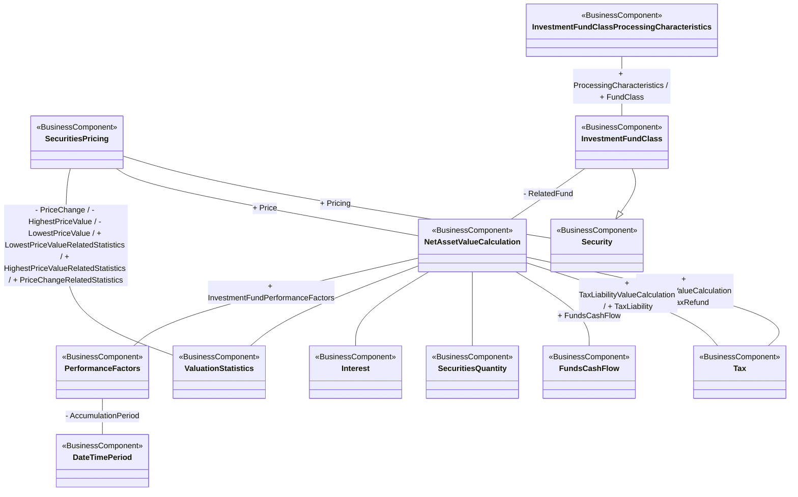

# Net asset value calculation and valuation context

[src-000097](../../../../../../../../../evidence/omitted/3ea6002607634c1b65cb5c88.md), NAV!A1:T33; xl/drawings/drawing4.xml; anchor 1. Original image SHA-256: 4407a6923c20c00cbeada8aa8838919dc8b65dd80b5edadb03672e2db39d9531.

[Original complete figure](../../../../../../../../../evidence/omitted/d43c349d72ac4aac239f7a4e.md) · [Rendered Mermaid SVG](../../../../../../../../../evidence/omitted/86ca4bec0a24d9ef7efa5a0d.md) · [Rendered Mermaid PNG](../../../../../../../../../evidence/omitted/3e2524c3bf04a3072b967fc4.md)

## Source reconstruction

## Entities and relationships

Net asset value calculation connects fund class, price, valuation statistics, tax-refund and tax-liability calculations as two separate tax associations, cash flow, quantity, interest and performance factors. Performance factors connect an accumulation period. The pricing-to-valuation-statistics line carries three labels at each end: they remain one visible line with all six labels, not six fabricated lines. InvestmentFundClass specializes Security and links processing characteristics.

All 12 visible node occurrences and 14 relationship lines are retained. No numeric multiplicity is shown in this source view, so none is inferred. The entity register preserves every visible package label, including explicitly absent or truncated labels. Package names are recorded there rather than adding enclosing boxes absent from the source. Association labels retain literal +/− prefixes and combined end names. Their re-layout position is not additional navigability evidence. The native class inheritance marker is reserved for the source’s hollow-triangle generalizations. Source editor/navigation icons are omitted as interface decoration; no business entity or relationship is excluded.

## Complete relationship register

| From node | To node | Source relationship kind | Visible source label(s) | From-end multiplicity | To-end multiplicity |
| --- | --- | --- | --- | --- | --- |
| SecuritiesPricing | Security | association | + Pricing | not printed | not printed |
| SecuritiesPricing | NetAssetValueCalculation | association | + Price | not printed | not printed |
| SecuritiesPricing | ValuationStatistics | association | - PriceChange / - HighestPriceValue / - LowestPriceValue / + LowestPriceValueRelatedStatistics / + HighestPriceValueRelatedStatistics / + PriceChangeRelatedStatistics | not printed | not printed |
| InvestmentFundClass | Security | generalization: subtype to supertype | (unlabelled in source) | not printed | not printed |
| InvestmentFundClassProcessingCharacteristics | InvestmentFundClass | association | + ProcessingCharacteristics / + FundClass | not printed | not printed |
| InvestmentFundClass | NetAssetValueCalculation | association | - RelatedFund | not printed | not printed |
| NetAssetValueCalculation | Tax | association | + TaxRefundValueCalculation / + TaxRefund | not printed | not printed |
| NetAssetValueCalculation | Tax | association | + TaxLiabilityValueCalculation / + TaxLiability | not printed | not printed |
| NetAssetValueCalculation | FundsCashFlow | association | + FundsCashFlow | not printed | not printed |
| NetAssetValueCalculation | SecuritiesQuantity | association | (unlabelled in source) | not printed | not printed |
| NetAssetValueCalculation | Interest | association | (unlabelled in source) | not printed | not printed |
| NetAssetValueCalculation | ValuationStatistics | association | (unlabelled in source) | not printed | not printed |
| NetAssetValueCalculation | PerformanceFactors | association | + InvestmentFundPerformanceFactors | not printed | not printed |
| PerformanceFactors | DateTimePeriod | association | - AccumulationPeriod | not printed | not printed |

## Entity definitions and precise workbook locators

| Visible label | Source package / stereotype | Definition evidence |
| --- | --- | --- |
| SecuritiesPricing | DICO_BusinessComponents / BusinessComponent | [FullBusinessModel!A4260:D4260](../sheets/02-fullbusinessmodel/tbl-0023.md) — Characteristics related to the price of the security. |
| Security | Securities / BusinessComponent | [FullBusinessModel!A4659:D4659](../sheets/02-fullbusinessmodel/tbl-0025.md) — Financial instruments representing a sum of rights of the investor vis-a-vis the issuer. |
| Tax | DICO_BusinessComponents / BusinessComponent | [FullBusinessModel!A4968:D4968](../sheets/02-fullbusinessmodel/tbl-0026.md) — Amount of money due to the government or tax authority, according to various pre-defined parameters such as thresholds or income. |
| InvestmentFundClassProcessingCharacteristics | not printed in figure / BusinessComponent | [FullBusinessModel!A2312:D2312](../sheets/02-fullbusinessmodel/tbl-0013.md) — Processing characteristics linked to the instrument, ie, not to  the market. |
| InvestmentFundClass | Securities / BusinessComponent | [FullBusinessModel!A2281:D2281](../sheets/02-fullbusinessmodel/tbl-0013.md) — Security that is a sub-set of an investment fund, and is governed by the same investment fund policy, for example, a dividend option or valuation currency. |
| NetAssetValueCalculation | Securities / BusinessComponent | [FullBusinessModel!A2846:D2846](../sheets/02-fullbusinessmodel/tbl-0016.md) — Calculation of the net asset value for an investment fund/fund class. |
| ValuationStatistics | DICO_BusinessComponents / BusinessComponent | [FullBusinessModel!A5357:D5357](../sheets/02-fullbusinessmodel/tbl-0028.md) — Statistical data related to the price change of a security. |
| FundsCashFlow | DICO_BusinessComponents / BusinessComponent | [FullBusinessModel!A1952:D1952](../sheets/02-fullbusinessmodel/tbl-0011.md) — Cash movements from or to a fund as a result of investment funds transactions, for example, subscriptions or redemptions. |
| SecuritiesQuantity | DICO_BusinessComponents / BusinessComponent | [FullBusinessModel!A4350:D4350](../sheets/02-fullbusinessmodel/tbl-0023.md) — Quantity of a security. |
| Interest | DICO_BusinessComponents / BusinessComponent | [FullBusinessModel!A2133:D2133](../sheets/02-fullbusinessmodel/tbl-0012.md) — Consideration, such as amount of money,  paid or received in exchange for an asset that has been invested, loaned or borrowed for a certain period. The interest is expressed as a fixed amount or percentage of the amount upon which the interest is applied. |
| PerformanceFactors | DICO_BusinessComponents / BusinessComponent | [FullBusinessModel!A3270:D3270](../sheets/02-fullbusinessmodel/tbl-0018.md) — Performance factors of the investment fund / fund class. |
| DateTimePeriod | DICO_BusinessComponentsDataTypes / BusinessComponent | [FullBusinessModel!A1363:D1363](../sheets/02-fullbusinessmodel/tbl-0008.md) — Time span defined by a start date and time, and an end date and time. |

## Participant and flow navigation

This is a conceptual entity model, not a message exchange diagram. A business component or relationship label is not automatically a functional participant or institution. [Message-set participant references](../../../participants.md) and [Message-set business flows](../../../flows/index.md) provide the independently sourced actor/process context. These references are navigational; source figure associations do not establish message direction.

## Rendering and visual review

2026-11-09: Mermaid 12.3.0 parsed and rendered successfully with Mermaid browser API + Chromium 156.0.8078.81. Compared complete source image with final Mermaid PNG: all visible entity labels, stereotypes, inheritance directions, plain associations and literal end labels reconciled. Verified parallel TimeFrame associations, switch-order/execution leg hierarchies, both tax associations, six labels on the single price/statistics line, account specialization and contextual party-role hierarchy. Printed package labels are preserved in the entity register; absent labels remain absent and the visibly truncated PlacementAgent label is explicitly retained. No numeric multiplicities are printed. [Renderer evidence](../../../../../../../../../work/investment-workbook-models/render-report.json).

