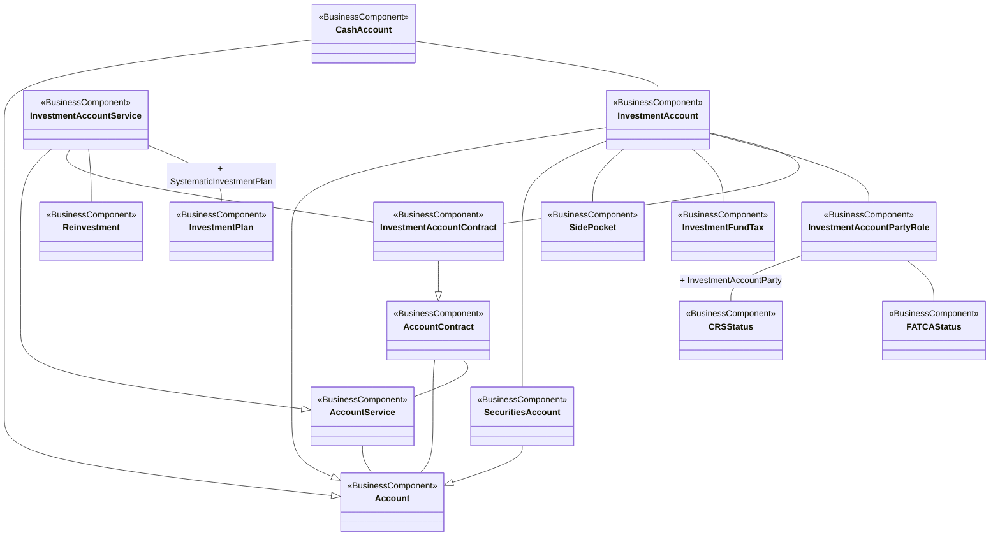

# Investment-account contracts, services and party status

[src-000097](../../../../../../../../../evidence/omitted/3ea6002607634c1b65cb5c88.md), Account!A1:V26; xl/drawings/drawing5.xml; anchor 1. Original image SHA-256: 854eaa7c6a778390082986095a1fd0e117e918f506fd51e648828edd04dcaab0.

[Original complete figure](../../../../../../../../../evidence/omitted/cacafca7ab689eeda04acff1.md) · [Rendered Mermaid SVG](../../../../../../../../../evidence/omitted/6c406a2ea6a998bea61990de.md) · [Rendered Mermaid PNG](../../../../../../../../../evidence/omitted/58dd3621564ea7e85becffed.md)

## Source reconstruction

## Entities and relationships

CashAccount, InvestmentAccount and SecuritiesAccount specialize Account. The account-contract-service triangle is retained. InvestmentAccountContract and InvestmentAccountService specialize their respective general concepts and connect investment account, reinvestment and systematic investment plan. Investment account links side pocket, investment-fund tax and investment-account party role. That role separately links CRSStatus and FATCAStatus. Tax-status associations do not identify a fixed institution or imply an account owner/servicer equivalence.

All 15 visible node occurrences and 19 relationship lines are retained. No numeric multiplicity is shown in this source view, so none is inferred. The entity register preserves every visible package label, including explicitly absent or truncated labels. Package names are recorded there rather than adding enclosing boxes absent from the source. Association labels retain literal +/− prefixes and combined end names. Their re-layout position is not additional navigability evidence. The native class inheritance marker is reserved for the source’s hollow-triangle generalizations. Source editor/navigation icons are omitted as interface decoration; no business entity or relationship is excluded.

## Complete relationship register

| From node | To node | Source relationship kind | Visible source label(s) | From-end multiplicity | To-end multiplicity |
| --- | --- | --- | --- | --- | --- |
| CashAccount | Account | generalization: subtype to supertype | (unlabelled in source) | not printed | not printed |
| InvestmentAccount | Account | generalization: subtype to supertype | (unlabelled in source) | not printed | not printed |
| SecuritiesAccount | Account | generalization: subtype to supertype | (unlabelled in source) | not printed | not printed |
| InvestmentAccountService | AccountService | generalization: subtype to supertype | (unlabelled in source) | not printed | not printed |
| InvestmentAccountContract | AccountContract | generalization: subtype to supertype | (unlabelled in source) | not printed | not printed |
| AccountContract | Account | association | (unlabelled in source) | not printed | not printed |
| AccountContract | AccountService | association | (unlabelled in source) | not printed | not printed |
| AccountService | Account | association | (unlabelled in source) | not printed | not printed |
| CashAccount | InvestmentAccount | association | (unlabelled in source) | not printed | not printed |
| InvestmentAccount | SecuritiesAccount | association | (unlabelled in source) | not printed | not printed |
| InvestmentAccount | SidePocket | association | (unlabelled in source) | not printed | not printed |
| InvestmentAccount | InvestmentFundTax | association | (unlabelled in source) | not printed | not printed |
| InvestmentAccount | InvestmentAccountPartyRole | association | (unlabelled in source) | not printed | not printed |
| InvestmentAccount | InvestmentAccountContract | association | (unlabelled in source) | not printed | not printed |
| InvestmentAccountService | InvestmentAccountContract | association | (unlabelled in source) | not printed | not printed |
| InvestmentAccountService | Reinvestment | association | (unlabelled in source) | not printed | not printed |
| InvestmentAccountService | InvestmentPlan | association | + SystematicInvestmentPlan | not printed | not printed |
| InvestmentAccountPartyRole | CRSStatus | association | + InvestmentAccountParty | not printed | not printed |
| InvestmentAccountPartyRole | FATCAStatus | association | (unlabelled in source) | not printed | not printed |

## Entity definitions and precise workbook locators

| Visible label | Source package / stereotype | Definition evidence |
| --- | --- | --- |
| AccountContract | not printed in figure / BusinessComponent | [FullBusinessModel!A59:D59](../sheets/02-fullbusinessmodel/tbl-0002.md) — Agreement between an account servicer and an account owner about the services linked to an account. |
| AccountService | not printed in figure / BusinessComponent | [FullBusinessModel!A103:D103](../sheets/02-fullbusinessmodel/tbl-0002.md) — Services linked to an account which are available to the account owner or to the holder of a mandate. |
| Account | not printed in figure / BusinessComponent | [FullBusinessModel!A24:D24](../sheets/02-fullbusinessmodel/tbl-0002.md) — Record of transactions in specific types of assets, maintained by a servicing party on behalf of one or more owning parties. Business relationship between an account servicer and one or more account owners. |
| CashAccount | not printed in figure / BusinessComponent | [FullBusinessModel!A562:D562](../sheets/02-fullbusinessmodel/tbl-0004.md) — Account to or from which a cash entry is made. |
| InvestmentAccount | not printed in figure / BusinessComponent | [FullBusinessModel!A2217:D2217](../sheets/02-fullbusinessmodel/tbl-0013.md) — Account between an investor(s) and a fund manager or a fund. The account can contain holdings in any investment fund or investment fund class managed (or distributed) by the fund manager, within the same fund family. |
| SecuritiesAccount | not printed in figure / BusinessComponent | [FullBusinessModel!A3889:D3889](../sheets/02-fullbusinessmodel/tbl-0021.md) — Account to or from which a securities entry is made. |
| SidePocket | not printed in figure / BusinessComponent | [FullBusinessModel!A4766:D4766](../sheets/02-fullbusinessmodel/tbl-0025.md) — Separate account containing illiquid assets of a hedge fund portfolio. Only the present participants in the hedge fund will be entitled to a share of it. |
| InvestmentFundTax | not printed in figure / BusinessComponent | [FullBusinessModel!A2398:D2398](../sheets/02-fullbusinessmodel/tbl-0013.md) — Tax related to an investment fund order. |
| InvestmentAccountPartyRole | DICO_BusinessComponents / BusinessComponent | [FullBusinessModel!A2245:D2245](../sheets/02-fullbusinessmodel/tbl-0013.md) — Specifies roles played by a party that are related to an investment account. |
| InvestmentAccountService | not printed in figure / BusinessComponent | [FullBusinessModel!A2251:D2251](../sheets/02-fullbusinessmodel/tbl-0013.md) — Services linked to an account which are available to the account owner or to the holder of a mandate. The exercise of these services may be submitted to a limit. |
| Reinvestment | not printed in figure / BusinessComponent | [FullBusinessModel!A3788:D3788](../sheets/02-fullbusinessmodel/tbl-0020.md) — Parameters of the reinvestment of the income on the fund. |
| InvestmentPlan | not printed in figure / BusinessComponent | [FullBusinessModel!A2415:D2415](../sheets/02-fullbusinessmodel/tbl-0014.md) — Plan that allows investors to schedule periodical investments or divestments, according to pre-defined criteria. |
| InvestmentAccountContract | not printed in figure / BusinessComponent | [FullBusinessModel!A2239:D2239](../sheets/02-fullbusinessmodel/tbl-0013.md) — Contract defining the related investment account. |
| CRSStatus | DICO_BusinessComponents / BusinessComponent | [FullBusinessModel!A467:D467](../sheets/02-fullbusinessmodel/tbl-0004.md) — Common Reporting Standard (CRS) status and the status source of the investor. |
| FATCAStatus | DICO_BusinessComponents / BusinessComponent | [FullBusinessModel!A1890:D1890](../sheets/02-fullbusinessmodel/tbl-0011.md) — Foreign Account Tax Compliance Act (FATCA) status and the status source of the investor. |

## Participant and flow navigation

This is a conceptual entity model, not a message exchange diagram. A business component or relationship label is not automatically a functional participant or institution. [Message-set participant references](../../../participants.md) and [Message-set business flows](../../../flows/index.md) provide the independently sourced actor/process context. These references are navigational; source figure associations do not establish message direction.

## Rendering and visual review

2026-11-09: Mermaid 12.3.0 parsed and rendered successfully with Mermaid browser API + Chromium 156.0.8078.81. Compared complete source image with final Mermaid PNG: all visible entity labels, stereotypes, inheritance directions, plain associations and literal end labels reconciled. Verified parallel TimeFrame associations, switch-order/execution leg hierarchies, both tax associations, six labels on the single price/statistics line, account specialization and contextual party-role hierarchy. Printed package labels are preserved in the entity register; absent labels remain absent and the visibly truncated PlacementAgent label is explicitly retained. No numeric multiplicities are printed. [Renderer evidence](../../../../../../../../../work/investment-workbook-models/render-report.json).

