# Investment-fund and investment-account party-role hierarchy

[src-000097](../../../../../../../../../evidence/omitted/3ea6002607634c1b65cb5c88.md), Parties!A1:W44; xl/drawings/drawing6.xml; anchor 1. Original image SHA-256: c5a9b9bbd103cc242615b491b5bc3587d0bdb4d17d7c03de6b4410312ae5b30c.

[Original complete figure](../../../../../../../../../evidence/omitted/03f5780030d8b788d2ff1c14.md) · [Rendered Mermaid SVG](../../../../../../../../../evidence/omitted/2dbbe1036cbcd08bd7b16612.md) · [Rendered Mermaid PNG](../../../../../../../../../evidence/omitted/b87e00f9c5277514c2ba35d7.md)

## Source reconstruction

```mermaid
classDiagram
direction TB
class Role {
<<BusinessComponent>>
}
class AssetPartyRole {
<<BusinessComponent>>
}
class GuaranteePartyRole {
<<BusinessComponent>>
}
class IssuerRole {
<<BusinessComponent>>
}
class GuarantorRole {
<<BusinessComponent>>
}
class InvestmentFundPartyRole {
<<BusinessComponent>>
}
class InvestmentFund {
<<BusinessComponent>>
}
class AccountPartyRole {
<<BusinessComponent>>
}
class Account {
<<BusinessComponent>>
}
class InvestmentAccountPartyRole {
<<BusinessComponent>>
}
class InvestmentAccount {
<<BusinessComponent>>
}
class FundOrderDesk {
<<BusinessComponent>>
}
class Auditor {
<<BusinessComponent>>
}
class FundManagerRole {
<<BusinessComponent>>
}
class PlacementAgent {
<<BusinessComponent>>
}
class Settlor {
<<BusinessComponent>>
}
class FundAdministratorRole {
<<BusinessComponent>>
}
class Grantor {
<<BusinessComponent>>
}
class FundAccountantRole {
<<BusinessComponent>>
}
class FundPromoter {
<<BusinessComponent>>
}
class LegalGuardianRole {
<<BusinessComponent>>
}
class TrusteeRole {
<<BusinessComponent>>
}
class AdministratorRole {
<<BusinessComponent>>
}
class Nominee {
<<BusinessComponent>>
}
AssetPartyRole --|> Role
GuaranteePartyRole --|> Role
InvestmentFundPartyRole --|> Role
AccountPartyRole --|> Role
IssuerRole --|> AssetPartyRole
GuarantorRole --|> GuaranteePartyRole
FundOrderDesk --|> InvestmentFundPartyRole
Auditor --|> InvestmentFundPartyRole
FundManagerRole --|> InvestmentFundPartyRole
PlacementAgent --|> InvestmentFundPartyRole
Settlor --|> InvestmentFundPartyRole
FundAdministratorRole --|> InvestmentFundPartyRole
Grantor --|> InvestmentFundPartyRole
FundAccountantRole --|> InvestmentFundPartyRole
FundPromoter --|> FundManagerRole
InvestmentAccountPartyRole --|> AccountPartyRole
LegalGuardianRole --|> InvestmentAccountPartyRole
TrusteeRole --|> InvestmentAccountPartyRole
AdministratorRole --|> InvestmentAccountPartyRole
Nominee --|> InvestmentAccountPartyRole
InvestmentAccount --|> Account
InvestmentFund -- InvestmentFundPartyRole : + PartyRole
AccountPartyRole -- Account : + PartyRole
```

## Entities and relationships

Role generalizes asset, guarantee, fund and account party roles. Issuer and guarantor specialize the corresponding asset/guarantee roles. The fund-party hierarchy includes fund order desk, auditor, fund manager, placement agent, settlor, fund administrator, grantor and fund accountant; fund promoter further specializes fund manager. Investment-account party role specializes account party role, with legal guardian, trustee, administrator and nominee subtypes. Account and InvestmentAccount have their own entity hierarchy, separate from roles. PartyRole associations link the fund and account entities to the respective contextual role. These generalizations do not equate roles with particular institutions.

All 24 visible node occurrences and 23 relationship lines are retained. No numeric multiplicity is shown in this source view, so none is inferred. The entity register preserves every visible package label, including explicitly absent or truncated labels. Package names are recorded there rather than adding enclosing boxes absent from the source. Association labels retain literal +/− prefixes and combined end names. Their re-layout position is not additional navigability evidence. The native class inheritance marker is reserved for the source’s hollow-triangle generalizations. Source editor/navigation icons are omitted as interface decoration; no business entity or relationship is excluded.

## Complete relationship register

| From node | To node | Source relationship kind | Visible source label(s) | From-end multiplicity | To-end multiplicity |
| --- | --- | --- | --- | --- | --- |
| AssetPartyRole | Role | generalization: subtype to supertype | (unlabelled in source) | not printed | not printed |
| GuaranteePartyRole | Role | generalization: subtype to supertype | (unlabelled in source) | not printed | not printed |
| InvestmentFundPartyRole | Role | generalization: subtype to supertype | (unlabelled in source) | not printed | not printed |
| AccountPartyRole | Role | generalization: subtype to supertype | (unlabelled in source) | not printed | not printed |
| IssuerRole | AssetPartyRole | generalization: subtype to supertype | (unlabelled in source) | not printed | not printed |
| GuarantorRole | GuaranteePartyRole | generalization: subtype to supertype | (unlabelled in source) | not printed | not printed |
| FundOrderDesk | InvestmentFundPartyRole | generalization: subtype to supertype | (unlabelled in source) | not printed | not printed |
| Auditor | InvestmentFundPartyRole | generalization: subtype to supertype | (unlabelled in source) | not printed | not printed |
| FundManagerRole | InvestmentFundPartyRole | generalization: subtype to supertype | (unlabelled in source) | not printed | not printed |
| PlacementAgent | InvestmentFundPartyRole | generalization: subtype to supertype | (unlabelled in source) | not printed | not printed |
| Settlor | InvestmentFundPartyRole | generalization: subtype to supertype | (unlabelled in source) | not printed | not printed |
| FundAdministratorRole | InvestmentFundPartyRole | generalization: subtype to supertype | (unlabelled in source) | not printed | not printed |
| Grantor | InvestmentFundPartyRole | generalization: subtype to supertype | (unlabelled in source) | not printed | not printed |
| FundAccountantRole | InvestmentFundPartyRole | generalization: subtype to supertype | (unlabelled in source) | not printed | not printed |
| FundPromoter | FundManagerRole | generalization: subtype to supertype | (unlabelled in source) | not printed | not printed |
| InvestmentAccountPartyRole | AccountPartyRole | generalization: subtype to supertype | (unlabelled in source) | not printed | not printed |
| LegalGuardianRole | InvestmentAccountPartyRole | generalization: subtype to supertype | (unlabelled in source) | not printed | not printed |
| TrusteeRole | InvestmentAccountPartyRole | generalization: subtype to supertype | (unlabelled in source) | not printed | not printed |
| AdministratorRole | InvestmentAccountPartyRole | generalization: subtype to supertype | (unlabelled in source) | not printed | not printed |
| Nominee | InvestmentAccountPartyRole | generalization: subtype to supertype | (unlabelled in source) | not printed | not printed |
| InvestmentAccount | Account | generalization: subtype to supertype | (unlabelled in source) | not printed | not printed |
| InvestmentFund | InvestmentFundPartyRole | association | + PartyRole | not printed | not printed |
| AccountPartyRole | Account | association | + PartyRole | not printed | not printed |

## Entity definitions and precise workbook locators

| Visible label | Source package / stereotype | Definition evidence |
| --- | --- | --- |
| Role | DICO_BusinessComponents / BusinessComponent | [FullBusinessModel!A3839:D3839](../sheets/02-fullbusinessmodel/tbl-0021.md) — Role of a party in an activity. |
| AssetPartyRole | not printed in figure / BusinessComponent | [FullBusinessModel!A313:D313](../sheets/02-fullbusinessmodel/tbl-0003.md) — Specifies roles played by a party that are linked to the handling of assets but not related to a specific process. |
| GuaranteePartyRole | not printed in figure / BusinessComponent | [FullBusinessModel!A2028:D2028](../sheets/02-fullbusinessmodel/tbl-0012.md) — Role played by a party in the context of guarantees. |
| IssuerRole | not printed in figure / BusinessComponent | [FullBusinessModel!A2523:D2523](../sheets/02-fullbusinessmodel/tbl-0014.md) — Legal entity that has the right to issue securities. |
| GuarantorRole | not printed in figure / BusinessComponent | [FullBusinessModel!A2030:D2030](../sheets/02-fullbusinessmodel/tbl-0012.md) — Legal entity, other than the issuer, who gives a guarantee. The guarantor becomes liable in case of default. |
| InvestmentFundPartyRole | DICO_BusinessComponents / BusinessComponent | [FullBusinessModel!A2395:D2395](../sheets/02-fullbusinessmodel/tbl-0013.md) — Specifies roles played by a party that are linked to the handling of investment funds but not related to a specific process. |
| InvestmentFund | not printed in figure / BusinessComponent | [FullBusinessModel!A2263:D2263](../sheets/02-fullbusinessmodel/tbl-0013.md) — Distinct pool of financial instruments managed by a single investment policy. May or not be part of an umbrella fund. The pool is issued in at least one investment fund class. |
| AccountPartyRole | DICO_BusinessComponents / BusinessComponent | [FullBusinessModel!A90:D90](../sheets/02-fullbusinessmodel/tbl-0002.md) — Role played by a party in the context of account operations. |
| Account | DICO_BusinessComponents / BusinessComponent | [FullBusinessModel!A24:D24](../sheets/02-fullbusinessmodel/tbl-0002.md) — Record of transactions in specific types of assets, maintained by a servicing party on behalf of one or more owning parties. Business relationship between an account servicer and one or more account owners. |
| InvestmentAccountPartyRole | DICO_BusinessComponents / BusinessComponent | [FullBusinessModel!A2245:D2245](../sheets/02-fullbusinessmodel/tbl-0013.md) — Specifies roles played by a party that are related to an investment account. |
| InvestmentAccount | DICO_BusinessComponents / BusinessComponent | [FullBusinessModel!A2217:D2217](../sheets/02-fullbusinessmodel/tbl-0013.md) — Account between an investor(s) and a fund manager or a fund. The account can contain holdings in any investment fund or investment fund class managed (or distributed) by the fund manager, within the same fund family. |
| FundOrderDesk | not printed in figure / BusinessComponent | [FullBusinessModel!A1948:D1948](../sheets/02-fullbusinessmodel/tbl-0011.md) — Principal entity appointed by the fund to which orders should be submitted. |
| Auditor | Securities / BusinessComponent | [FullBusinessModel!A331:D331](../sheets/02-fullbusinessmodel/tbl-0003.md) — Party in charge of examining and verifying a fund's financial and accounting records as well as supporting documents. |
| FundManagerRole | Securities / BusinessComponent | [FullBusinessModel!A1947:D1947](../sheets/02-fullbusinessmodel/tbl-0011.md) — Legal entity that sets up a fund, appoints agents, decides and implements an investment strategy. That is, selects portfolio investments in accordance with the objectives and strategy in the fund's prospectus, and places orders to effect or liquidate selected investments in accordance with net flow of capital into or out of the fund. Also called fund promoter or fund sponsor. |
| PlacementAgent | DICO_BusinessCompon... (source label truncated) / BusinessComponent | [FullBusinessModel!A3342:D3342](../sheets/02-fullbusinessmodel/tbl-0018.md) — Party that helps hedge funds to refine their strategy. May also introduce partners such as fund of funds, pension funds, insurance companies and family offices. |
| Settlor | DICO_BusinessComponents / BusinessComponent | [FullBusinessModel!A4755:D4755](../sheets/02-fullbusinessmodel/tbl-0025.md) — Entity that creates a trust or contributes assets to the trust. |
| FundAdministratorRole | Securities / BusinessComponent | [FullBusinessModel!A1946:D1946](../sheets/02-fullbusinessmodel/tbl-0011.md) — Party in charge of financial accounting, net asset value (NAV) calculation, management and performance fee calculation. Can also be in charge of orders centralisation and registration. |
| Grantor | DICO_BusinessComponents / BusinessComponent | [FullBusinessModel!A2017:D2017](../sheets/02-fullbusinessmodel/tbl-0012.md) — Grantor role in the hedge funds industry. |
| FundAccountantRole | Securities / BusinessComponent | [FullBusinessModel!A1945:D1945](../sheets/02-fullbusinessmodel/tbl-0011.md) — Party that keeps accounting records of available assets and liabilities of a fund. It calculates dealing prices, the net asset value (NAV) of the fund, and may provide fund performance and tax data. Can be sub-contracted by the fund administrator. |
| FundPromoter | Securities / BusinessComponent | [FullBusinessModel!A1951:D1951](../sheets/02-fullbusinessmodel/tbl-0011.md) — Fund Promoter |
| LegalGuardianRole | Securities / BusinessComponent | [FullBusinessModel!A2545:D2545](../sheets/02-fullbusinessmodel/tbl-0014.md) — Entity that has been appointed by a legal authority to act on behalf of a person judged to be incapacitated. |
| TrusteeRole | DICO_BusinessComponents / BusinessComponent | [FullBusinessModel!A5256:D5256](../sheets/02-fullbusinessmodel/tbl-0028.md) — Legal owner of the property. However, the beneficiary has the equitable or beneficial ownership. The trustee must ensure all terms and conditions of the security are adhered to. |
| AdministratorRole | DICO_BusinessComponents / BusinessComponent | [FullBusinessModel!A175:D175](../sheets/02-fullbusinessmodel/tbl-0002.md) — Entity that has been appointed by a legal authority to act on behalf of a person or organisation that has gone bankrupt. |
| Nominee | DICO_BusinessComponents / BusinessComponent | [FullBusinessModel!A2883:D2883](../sheets/02-fullbusinessmodel/tbl-0016.md) — Entity (the registered owner) named by the beneficial owner to act on its behalf, often to facilitate dealing, or to conceal the identity of the beneficiary. Securities and other assets are recorded in the nominee's name. |

## Participant and flow navigation

This is a conceptual entity model, not a message exchange diagram. A business component or relationship label is not automatically a functional participant or institution. [Message-set participant references](../../../participants.md) and [Message-set business flows](../../../flows/index.md) provide the independently sourced actor/process context. These references are navigational; source figure associations do not establish message direction.

## Rendering and visual review

2026-11-09: Mermaid 12.3.0 parsed and rendered successfully with Mermaid browser API + Chromium 156.0.8078.81. Compared complete source image with final Mermaid PNG: all visible entity labels, stereotypes, inheritance directions, plain associations and literal end labels reconciled. Verified parallel TimeFrame associations, switch-order/execution leg hierarchies, both tax associations, six labels on the single price/statistics line, account specialization and contextual party-role hierarchy. Printed package labels are preserved in the entity register; absent labels remain absent and the visibly truncated PlacementAgent label is explicitly retained. No numeric multiplicities are printed. [Renderer evidence](../../../../../../../../../work/investment-workbook-models/render-report.json).

Remaining limitations: The PlacementAgent package label is visibly truncated in the supplied artwork as DICO_BusinessCompon...; its complete package spelling is not inferred.

## Canonical participant records

[All 21 scoped role records](../participants.md) provide definitions, responsibilities, parent/subtype relationships and precise workbook-row evidence.
