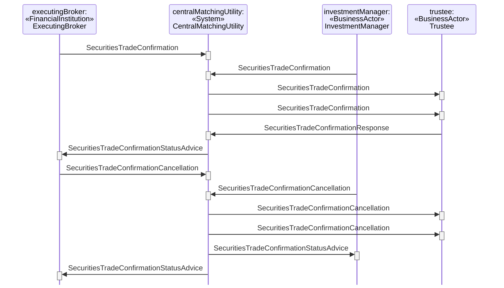

# Through Type Cancellation

## Source evidence

[src-000180](../../../../../../../../evidence/omitted/620693d01e301c06503cea9a.md); P200 and preceding scenario narrative P199. [Unchanged full source figure](../../../../../../../../evidence/omitted/b9d8746409461facc776aaff.md).

[Source sequence](../../../../../../../../evidence/omitted/b9d8746409461facc776aaff.md)

## Mermaid reconstruction

## Participants and ordered exchanges

Source instance names and stereotypes are retained in the diagram labels. Each occurrence links to a scoped participant record; a source business-actor label is not an assertion that a named institution always plays that role.

| Source instance / stereotype / label | Canonical scoped role |
| --- | --- |
| executingBroker / FinancialInstitution / ExecutingBroker | [ExecutingBroker](../../../../../../../../shared/reference/participants/participant-src-000180-broker-executing-broker.md) |
| centralMatchingUtility / System / CentralMatchingUtility | [CentralMatchingUtility](../../../../../../../../shared/reference/participants/participant-src-000180-central-matching-utility-cmu.md) |
| investmentManager / BusinessActor / InvestmentManager | [InvestmentManager](../../../../../../../../shared/reference/participants/participant-src-000180-investment-manager.md) |
| trustee / BusinessActor / Trustee | [Trustee](../../../../../../../../shared/reference/participants/participant-src-000180-trustee.md) |

| Source order | Sender | Receiver | Source message label | Exact supplied definition |
| --- | --- | --- | --- | --- |
| 1 | ExecutingBroker | CentralMatchingUtility | SecuritiesTradeConfirmation | [setr.027.001.05](../../../../../messages/setr.027.001.05/index.md) |
| 2 | InvestmentManager | CentralMatchingUtility | SecuritiesTradeConfirmation | [setr.027.001.05](../../../../../messages/setr.027.001.05/index.md) |
| 3 | CentralMatchingUtility | Trustee | SecuritiesTradeConfirmation | [setr.027.001.05](../../../../../messages/setr.027.001.05/index.md) |
| 4 | CentralMatchingUtility | Trustee | SecuritiesTradeConfirmation | [setr.027.001.05](../../../../../messages/setr.027.001.05/index.md) |
| 5 | Trustee | CentralMatchingUtility | SecuritiesTradeConfirmationResponse | [setr.030.001.03](../../../../../messages/setr.030.001.03/index.md) |
| 6 | CentralMatchingUtility | ExecutingBroker | SecuritiesTradeConfirmationStatusAdvice | [setr.044.001.04](../../../../../messages/setr.044.001.04/index.md) |
| 7 | ExecutingBroker | CentralMatchingUtility | SecuritiesTradeConfirmationCancellation | [setr.029.001.02](../../../../../messages/setr.029.001.02/index.md) |
| 8 | InvestmentManager | CentralMatchingUtility | SecuritiesTradeConfirmationCancellation | [setr.029.001.02](../../../../../messages/setr.029.001.02/index.md) |
| 9 | CentralMatchingUtility | Trustee | SecuritiesTradeConfirmationCancellation | [setr.029.001.02](../../../../../messages/setr.029.001.02/index.md) |
| 10 | CentralMatchingUtility | Trustee | SecuritiesTradeConfirmationCancellation | [setr.029.001.02](../../../../../messages/setr.029.001.02/index.md) |
| 11 | CentralMatchingUtility | InvestmentManager | SecuritiesTradeConfirmationStatusAdvice | [setr.044.001.04](../../../../../messages/setr.044.001.04/index.md) |
| 12 | CentralMatchingUtility | ExecutingBroker | SecuritiesTradeConfirmationStatusAdvice | [setr.044.001.04](../../../../../messages/setr.044.001.04/index.md) |

## Conditions, alternatives and notes

**P199** The executing broker and the investment manager send a confirmation to the CMU. The CMU will forward the two confirmations received to the trustee. The trustee will send an affirmation message to the CMU if it agrees with the detail of the trade. The message will bind the parties to the trade details of the confirmation being affirmed. The CMU will send an affirmation status message to the executing broker upon receipt of the affirmation message from the trustee. The executing broker and investment manager may, for whatever reason, decide to cancel the confirmation and a new confirmation may be sent. Cancellation of the confirmation may also imply the cancellation of the trade, in which case a new confirmation will not be sent.

[Reusable flow](../../flows/flow-src-000180-p198-through-type-cancellation.md); [Related activity process](../../flows/flow-src-000180-p146-through-type.md).

## Review evidence

Opened the full source PNG and rendered reconstruction; compared all 4 source actor instance/stereotype labels, 12 ordered message arrows, sender/receiver endpoints, receiver execution markers, and source notes. Inactive lifelines are retained. Alternate-actor, proprietary-report, securities-financing and pre-advice notes were checked where present. Dashed lifelines and readable complete message labels were checked after rendering; vertical marker spacing is not elapsed time. Parsed/rendered using Mermaid 12.3.0 with Chromium 156.0.8078.81. Visual comparison on 2026-11-09 Europe/Warsaw; render report UTC date 2026-11-08.

[Compared reconstruction](../../../../../../../../evidence/omitted/2e67abc1fdeac193c46a0cd0.md).
