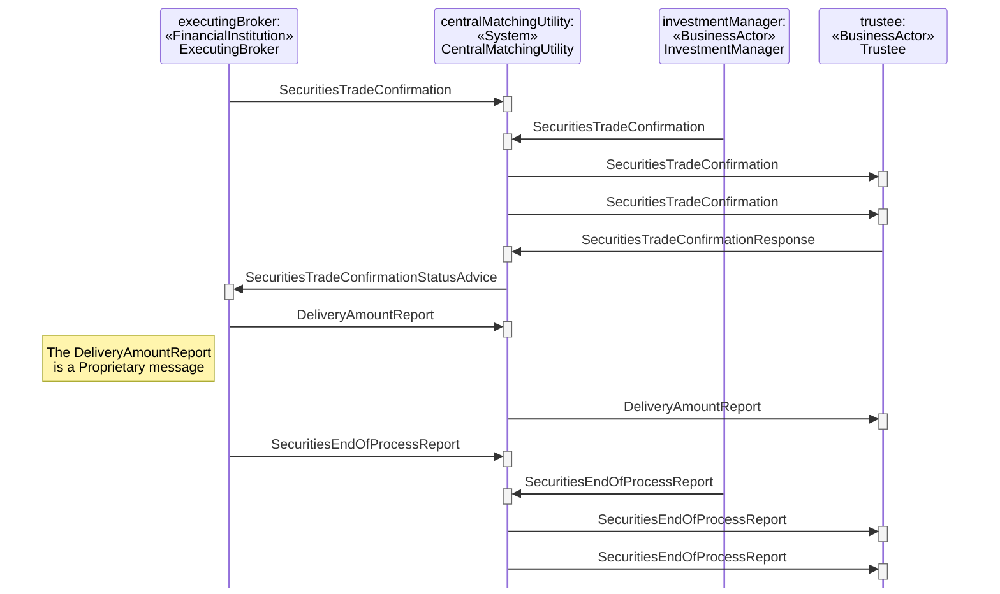

# End of Process Report for Listed Derivatives

## Source evidence

[src-000180](../../../../../../../../evidence/omitted/620693d01e301c06503cea9a.md); P229 and preceding scenario narrative P228. [Unchanged full source figure](../../../../../../../../evidence/omitted/3728acf7bdb57c4b1751b8ba.md).

[Source sequence](../../../../../../../../evidence/omitted/3728acf7bdb57c4b1751b8ba.md)

## Mermaid reconstruction

## Participants and ordered exchanges

Source instance names and stereotypes are retained in the diagram labels. Each occurrence links to a scoped participant record; a source business-actor label is not an assertion that a named institution always plays that role.

| Source instance / stereotype / label | Canonical scoped role |
| --- | --- |
| executingBroker / FinancialInstitution / ExecutingBroker | [ExecutingBroker](../../../../../../../../shared/reference/participants/participant-src-000180-broker-executing-broker.md) |
| centralMatchingUtility / System / CentralMatchingUtility | [CentralMatchingUtility](../../../../../../../../shared/reference/participants/participant-src-000180-central-matching-utility-cmu.md) |
| investmentManager / BusinessActor / InvestmentManager | [InvestmentManager](../../../../../../../../shared/reference/participants/participant-src-000180-investment-manager.md) |
| trustee / BusinessActor / Trustee | [Trustee](../../../../../../../../shared/reference/participants/participant-src-000180-trustee.md) |

| Source order | Sender | Receiver | Source message label | Exact supplied definition |
| --- | --- | --- | --- | --- |
| 1 | ExecutingBroker | CentralMatchingUtility | SecuritiesTradeConfirmation | [setr.027.001.05](../../../../../messages/setr.027.001.05/index.md) |
| 2 | InvestmentManager | CentralMatchingUtility | SecuritiesTradeConfirmation | [setr.027.001.05](../../../../../messages/setr.027.001.05/index.md) |
| 3 | CentralMatchingUtility | Trustee | SecuritiesTradeConfirmation | [setr.027.001.05](../../../../../messages/setr.027.001.05/index.md) |
| 4 | CentralMatchingUtility | Trustee | SecuritiesTradeConfirmation | [setr.027.001.05](../../../../../messages/setr.027.001.05/index.md) |
| 5 | Trustee | CentralMatchingUtility | SecuritiesTradeConfirmationResponse | [setr.030.001.03](../../../../../messages/setr.030.001.03/index.md) |
| 6 | CentralMatchingUtility | ExecutingBroker | SecuritiesTradeConfirmationStatusAdvice | [setr.044.001.04](../../../../../messages/setr.044.001.04/index.md) |
| 7 | ExecutingBroker | CentralMatchingUtility | DeliveryAmountReport | Source explicitly identifies proprietary message; no ISO definition assigned |
| 8 | CentralMatchingUtility | Trustee | DeliveryAmountReport | Source explicitly identifies proprietary message; no ISO definition assigned |
| 9 | ExecutingBroker | CentralMatchingUtility | SecuritiesEndOfProcessReport | [semt.023.001.02](../../../../../messages/semt.023.001.02/index.md) |
| 10 | InvestmentManager | CentralMatchingUtility | SecuritiesEndOfProcessReport | [semt.023.001.02](../../../../../messages/semt.023.001.02/index.md) |
| 11 | CentralMatchingUtility | Trustee | SecuritiesEndOfProcessReport | [semt.023.001.02](../../../../../messages/semt.023.001.02/index.md) |
| 12 | CentralMatchingUtility | Trustee | SecuritiesEndOfProcessReport | [semt.023.001.02](../../../../../messages/semt.023.001.02/index.md) |

## Conditions, alternatives and notes

**P228** The executing broker sends a confirmation of the trade to the CMU. The investment manager sends a confirmation of the trade to the CMU. The CMU will forward the two confirmations received to the trustee. After the executing broker sends all the trade confirmations on that day, the executing broker sends a delivery amount report to the CMU. The CMU forwards the delivery amount report to the trustee. The executing broker sends an end of process report of the confirmation to the CMU. After the investment manager sends all the trade confirmations on that day, the investment manager sends an end of process report of the confirmation to the CMU. The CMU forwards the end of day reports of the confirmation from both parties to the trustee.

The DeliveryAmountReport note explicitly classifies that exchange as proprietary. It is retained separately from SecuritiesEndOfProcessReport and is not assigned an invented ISO message identifier.

[Reusable flow](../../flows/flow-src-000180-p227-end-of-process-report-for-listed-derivatives.md); [Related activity process](../../flows/flow-src-000180-p165-end-of-process-report-for-listed-derivatives.md).

## Review evidence

Opened the full source PNG and rendered reconstruction; compared all 4 source actor instance/stereotype labels, 12 ordered message arrows, sender/receiver endpoints, receiver execution markers, and source notes. Inactive lifelines are retained. Alternate-actor, proprietary-report, securities-financing and pre-advice notes were checked where present. Dashed lifelines and readable complete message labels were checked after rendering; vertical marker spacing is not elapsed time. Parsed/rendered using Mermaid 12.3.0 with Chromium 156.0.8078.81. Visual comparison on 2026-11-09 Europe/Warsaw; render report UTC date 2026-11-08.

[Compared reconstruction](../../../../../../../../evidence/omitted/38c55f13412cb4f60d5a7d08.md).
