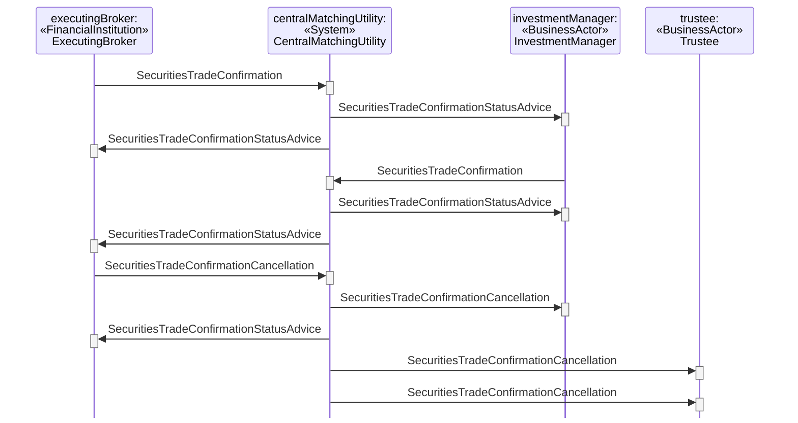

# Tripartite Central Matching Without Confirmation Distribution Service Cancellation by Executing Broker

## Source evidence

[src-000180](../../../../../../../../evidence/omitted/620693d01e301c06503cea9a.md); P243 and preceding scenario narrative P242. [Unchanged full source figure](../../../../../../../../evidence/omitted/d52552ce2d32af10c5f6f587.md).

[Source sequence](../../../../../../../../evidence/omitted/d52552ce2d32af10c5f6f587.md)

## Mermaid reconstruction

## Participants and ordered exchanges

Source instance names and stereotypes are retained in the diagram labels. Each occurrence links to a scoped participant record; a source business-actor label is not an assertion that a named institution always plays that role.

| Source instance / stereotype / label | Canonical scoped role |
| --- | --- |
| executingBroker / FinancialInstitution / ExecutingBroker | [ExecutingBroker](../../../../../../../../shared/reference/participants/participant-src-000180-broker-executing-broker.md) |
| centralMatchingUtility / System / CentralMatchingUtility | [CentralMatchingUtility](../../../../../../../../shared/reference/participants/participant-src-000180-central-matching-utility-cmu.md) |
| investmentManager / BusinessActor / InvestmentManager | [InvestmentManager](../../../../../../../../shared/reference/participants/participant-src-000180-investment-manager.md) |
| trustee / BusinessActor / Trustee | [Trustee](../../../../../../../../shared/reference/participants/participant-src-000180-trustee.md) |

| Source order | Sender | Receiver | Source message label | Exact supplied definition |
| --- | --- | --- | --- | --- |
| 1 | ExecutingBroker | CentralMatchingUtility | SecuritiesTradeConfirmation | [setr.027.001.05](../../../../../messages/setr.027.001.05/index.md) |
| 2 | CentralMatchingUtility | InvestmentManager | SecuritiesTradeConfirmationStatusAdvice | [setr.044.001.04](../../../../../messages/setr.044.001.04/index.md) |
| 3 | CentralMatchingUtility | ExecutingBroker | SecuritiesTradeConfirmationStatusAdvice | [setr.044.001.04](../../../../../messages/setr.044.001.04/index.md) |
| 4 | InvestmentManager | CentralMatchingUtility | SecuritiesTradeConfirmation | [setr.027.001.05](../../../../../messages/setr.027.001.05/index.md) |
| 5 | CentralMatchingUtility | InvestmentManager | SecuritiesTradeConfirmationStatusAdvice | [setr.044.001.04](../../../../../messages/setr.044.001.04/index.md) |
| 6 | CentralMatchingUtility | ExecutingBroker | SecuritiesTradeConfirmationStatusAdvice | [setr.044.001.04](../../../../../messages/setr.044.001.04/index.md) |
| 7 | ExecutingBroker | CentralMatchingUtility | SecuritiesTradeConfirmationCancellation | [setr.029.001.02](../../../../../messages/setr.029.001.02/index.md) |
| 8 | CentralMatchingUtility | InvestmentManager | SecuritiesTradeConfirmationCancellation | [setr.029.001.02](../../../../../messages/setr.029.001.02/index.md) |
| 9 | CentralMatchingUtility | ExecutingBroker | SecuritiesTradeConfirmationStatusAdvice | [setr.044.001.04](../../../../../messages/setr.044.001.04/index.md) |
| 10 | CentralMatchingUtility | Trustee | SecuritiesTradeConfirmationCancellation | [setr.029.001.02](../../../../../messages/setr.029.001.02/index.md) |
| 11 | CentralMatchingUtility | Trustee | SecuritiesTradeConfirmationCancellation | [setr.029.001.02](../../../../../messages/setr.029.001.02/index.md) |

## Conditions, alternatives and notes

**P242** The executing broker sends a trade confirmation to the CMU. The CMU advise both parties that the trade confirmation is not paired yet. The investment manager sends the corresponding trade confirmation to the CMU. The CMU performs a matching process between the two confirmations and sends matching status messages to both parties, reflecting the outcome of the matching process. The executing broker may, for whatever reason, send a new confirmation or may, upon mutual agreement, send a confirmation cancellation. The CMU will forward the cancellation to the investment manager. The CMU advise the executing broker that they send the cancellation to the investment manager. The CMU will forward the cancellation received from the executing broker and send the cancellation on the behalf of investment manager to the trustee.

[Reusable flow](../../flows/flow-src-000180-p241-tripartite-central-matching-without-confirmation-distribution-service-.md); [Related activity process](../../flows/flow-src-000180-p173-tripartite-central-matching-without-confirmation-distribution-service.md).

## Review evidence

Opened the full source PNG and rendered reconstruction; compared all 4 source actor instance/stereotype labels, 11 ordered message arrows, sender/receiver endpoints, receiver execution markers, and source notes. Inactive lifelines are retained. Alternate-actor, proprietary-report, securities-financing and pre-advice notes were checked where present. Dashed lifelines and readable complete message labels were checked after rendering; vertical marker spacing is not elapsed time. Parsed/rendered using Mermaid 12.3.0 with Chromium 156.0.8078.81. Visual comparison on 2026-11-09 Europe/Warsaw; render report UTC date 2026-11-08.

[Compared reconstruction](../../../../../../../../evidence/omitted/3205540a6890b250cdda750c.md).
