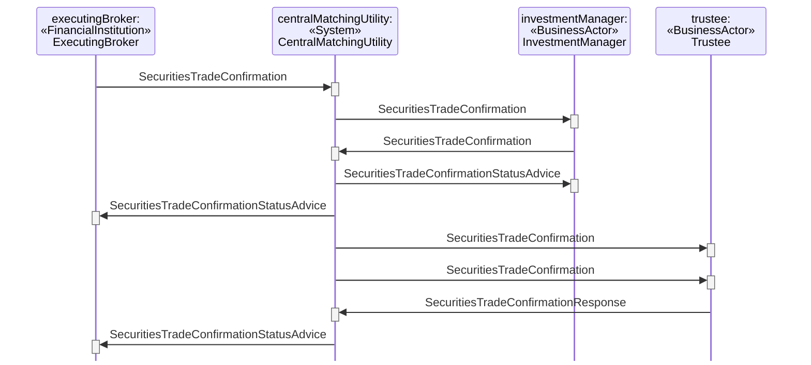

# Tripartite Central Matching With Confirmation Distribution Service

## Source evidence

[src-000180](../../../../../../../../evidence/omitted/620693d01e301c06503cea9a.md); P257 and preceding scenario narrative P256. [Unchanged full source figure](../../../../../../../../evidence/omitted/cd4d008e532b51db79548914.md).

[Source sequence](../../../../../../../../evidence/omitted/cd4d008e532b51db79548914.md)

## Mermaid reconstruction

## Participants and ordered exchanges

Source instance names and stereotypes are retained in the diagram labels. Each occurrence links to a scoped participant record; a source business-actor label is not an assertion that a named institution always plays that role.

| Source instance / stereotype / label | Canonical scoped role |
| --- | --- |
| executingBroker / FinancialInstitution / ExecutingBroker | [ExecutingBroker](../../../../../../../../shared/reference/participants/participant-src-000180-broker-executing-broker.md) |
| centralMatchingUtility / System / CentralMatchingUtility | [CentralMatchingUtility](../../../../../../../../shared/reference/participants/participant-src-000180-central-matching-utility-cmu.md) |
| investmentManager / BusinessActor / InvestmentManager | [InvestmentManager](../../../../../../../../shared/reference/participants/participant-src-000180-investment-manager.md) |
| trustee / BusinessActor / Trustee | [Trustee](../../../../../../../../shared/reference/participants/participant-src-000180-trustee.md) |

| Source order | Sender | Receiver | Source message label | Exact supplied definition |
| --- | --- | --- | --- | --- |
| 1 | ExecutingBroker | CentralMatchingUtility | SecuritiesTradeConfirmation | [setr.027.001.05](../../../../../messages/setr.027.001.05/index.md) |
| 2 | CentralMatchingUtility | InvestmentManager | SecuritiesTradeConfirmation | [setr.027.001.05](../../../../../messages/setr.027.001.05/index.md) |
| 3 | InvestmentManager | CentralMatchingUtility | SecuritiesTradeConfirmation | [setr.027.001.05](../../../../../messages/setr.027.001.05/index.md) |
| 4 | CentralMatchingUtility | InvestmentManager | SecuritiesTradeConfirmationStatusAdvice | [setr.044.001.04](../../../../../messages/setr.044.001.04/index.md) |
| 5 | CentralMatchingUtility | ExecutingBroker | SecuritiesTradeConfirmationStatusAdvice | [setr.044.001.04](../../../../../messages/setr.044.001.04/index.md) |
| 6 | CentralMatchingUtility | Trustee | SecuritiesTradeConfirmation | [setr.027.001.05](../../../../../messages/setr.027.001.05/index.md) |
| 7 | CentralMatchingUtility | Trustee | SecuritiesTradeConfirmation | [setr.027.001.05](../../../../../messages/setr.027.001.05/index.md) |
| 8 | Trustee | CentralMatchingUtility | SecuritiesTradeConfirmationResponse | [setr.030.001.03](../../../../../messages/setr.030.001.03/index.md) |
| 9 | CentralMatchingUtility | ExecutingBroker | SecuritiesTradeConfirmationStatusAdvice | [setr.044.001.04](../../../../../messages/setr.044.001.04/index.md) |

## Conditions, alternatives and notes

**P256** The executing broker sends a trade confirmation to the CMU. The CMU forwards the confirmation received from the broker to the investment manager. The investment manager compares the details of the trade to its own details and sends a trade confirmation to the CMU. The CMU performs a matching process and sends matching status messages to both parties reflecting the outcome of the matching process. If matched, the CMU sends both the confirmations received from the investment manager and from the executing broker to the trustee. If the trustee agrees with the details of the trade, it sends an affirmation message to the CMU. The message will bind the parties to the trade details of the confirmation being affirmed. Upon receipt of the affirmation message from the trustee, the CMU sends an affirmation status message to the executing broker and the trade can move into the settlement process.

[Reusable flow](../../flows/flow-src-000180-p255-tripartite-central-matching-with-confirmation-distribution-service.md); [Related activity process](../../flows/flow-src-000180-p180-tripartite-central-matching-with-confirmation-distribution-service.md).

## Review evidence

Opened the full source PNG and rendered reconstruction; compared all 4 source actor instance/stereotype labels, 9 ordered message arrows, sender/receiver endpoints, receiver execution markers, and source notes. Inactive lifelines are retained. Alternate-actor, proprietary-report, securities-financing and pre-advice notes were checked where present. Dashed lifelines and readable complete message labels were checked after rendering; vertical marker spacing is not elapsed time. Parsed/rendered using Mermaid 12.3.0 with Chromium 156.0.8078.81. Visual comparison on 2026-11-09 Europe/Warsaw; render report UTC date 2026-11-08.

[Compared reconstruction](../../../../../../../../evidence/omitted/d0564b192a5bbeefa52f9a36.md).
