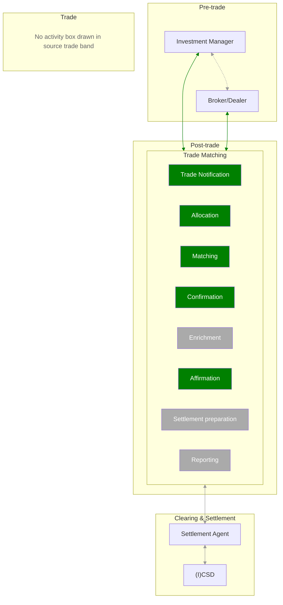

# Post-trade communication scope

## Source evidence

[src-000180](../../../../../../../../evidence/omitted/620693d01e301c06503cea9a.md); Scope and Functionality / Scope; direct-body paragraph P89; word/media/image1.emf. [Unchanged original figure or complete rendered document](../../../../../../../../evidence/omitted/7897f83cb548eded659600b5.md).

[Complete source figure](../../../../../../../../evidence/omitted/91ae049656d4b22af4aeaf87.md)

## Mermaid reconstruction

## Actors, activities and relationships

P87 explicitly states that green identifies scope. The five green Trade Matching activities are Trade Notification, Allocation, Matching, Confirmation and Affirmation. Enrichment, Settlement preparation and Reporting are gray. Investment Manager and Broker/Dealer are joined by a dotted bidirectional link; each connects bidirectionally to the Trade Matching boundary in green. Gray bidirectional links connect Trade Matching to Settlement Agent and Settlement Agent to (I)CSD. No internal ordering among the eight contained activity boxes is drawn. Four lifecycle bands are preserved; the explanatory empty-band label is explicitly a reconstruction cue, not a source activity.

| Source-scoped participant | Canonical record |
| --- | --- |
| investment manager | [investment manager](../../../../../../../../shared/reference/participants/participant-src-000180-investment-manager.md) |
| broker | [broker](../../../../../../../../shared/reference/participants/participant-src-000180-broker.md) |
| settlement agent | [settlement agent](../../../../../../../../shared/reference/participants/participant-src-000180-settlement-agent.md) |
| icsd scope actor | [icsd scope actor](../../../../../../../../shared/reference/participants/participant-src-000180-icsd-scope-actor.md) |

## Review evidence

Opened full original EMF rasterization and rendered reconstruction. Compared four lifecycle bands, eight Trade Matching activities and their five-green/three-gray scope distinction, five bidirectional relationships, and the dotted Investment Manager/Broker-Dealer relationship. No ordering inferred inside the activity boundary. Parsed and rendered with Mermaid 12.3.0 and Chromium156.0.8078.81; visual comparison 2026-11-09 Europe/Warsaw.

[Compared reconstruction](../../../../../../../../evidence/omitted/35567b5da784752cecd5b8d3.md).
