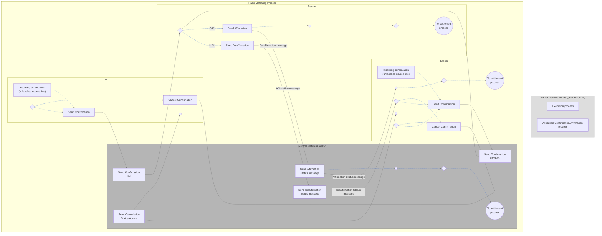

# Through-type local matching activity

## Source evidence

[src-000180](../../../../../../../../evidence/omitted/620693d01e301c06503cea9a.md); Description of BusinessActivities / BusinessProcess – Local Matching / Through Type; direct-body paragraph P149; word/media/image4.tmp. [Unchanged original figure or complete rendered document](../../../../../../../../evidence/omitted/b920552111ae085edc442c3a.md).

[Complete source figure](../../../../../../../../evidence/omitted/7c068df2d7fe435d55521e5d.md)

## Mermaid reconstruction

## Actors, activities and relationships

Broker and IM submit separate confirmations; CMU forwards each to Trustee. Trustee evaluates the details and follows N.G. to disaffirmation or O.K. to affirmation. CMU sends the corresponding status to Broker; disaffirmation loops to a new confirmation or cancellation, while affirmation continues toward settlement in the Broker, CMU and Trustee lanes. Cancellation inputs terminate at an unlabelled source endpoint within CMU; the separate cancellation-status action points to Broker and IM receipts. Two unconnected cancellation-choice diamonds remain as drawn. P147 says affirmation binds the trade details. T9 allows cancellation with a new confirmation, or cancellation of the trade without a new confirmation.

The activity artwork says Trustee while T9 says Trust Bank. Both scoped records are linked; this local correspondence does not establish general institutional equivalence. The invisible endpoint cue preserves the point at which a source arrow terminates without a labelled receiving action; this is a reconstruction cue, not an added lifecycle event. Unlabelled source symbols preserve source geometry without inventing a receiving activity.

| Source-scoped participant | Canonical record |
| --- | --- |
| broker | [broker](../../../../../../../../shared/reference/participants/participant-src-000180-broker.md) |
| investment manager | [investment manager](../../../../../../../../shared/reference/participants/participant-src-000180-investment-manager.md) |
| central matching utility cmu | [central matching utility cmu](../../../../../../../../shared/reference/participants/participant-src-000180-central-matching-utility-cmu.md) |
| central matching utility jasdec | [central matching utility jasdec](../../../../../../../../shared/reference/participants/participant-src-000180-central-matching-utility-jasdec.md) |
| trustee | [trustee](../../../../../../../../shared/reference/participants/participant-src-000180-trustee.md) |
| trust bank | [trust bank](../../../../../../../../shared/reference/participants/participant-src-000180-trust-bank.md) |

Reusable source flow: [Through Type](../../flows/flow-src-000180-p146-through-type.md). All narrative conditions and activity-table rows remain there.

Responsibilities and activities: [Source table T9](../../documents/src-000180/tables/tbl-0009.md).

## Review evidence

Opened the complete source figure and rendered reconstruction. Compared actor/lane labels, arrow direction and endpoints, all activity labels, N.G./O.K. and unmatched/matched branches, cancellation receipt paths, settlement/NAV outcomes, and source boundary/color distinctions where present. Source geometry is adapted; labelled reconstruction cues and the overlapping listed-derivatives boundary limitation are explicit. Final corrected render reopened after endpoint/style changes. Parsed and rendered with Mermaid 12.3.0 and Chromium156.0.8078.81; visual comparison 2026-11-09 Europe/Warsaw.

[Compared reconstruction](../../../../../../../../evidence/omitted/3a53cb3e6fd48d1e559ac0a5.md).
