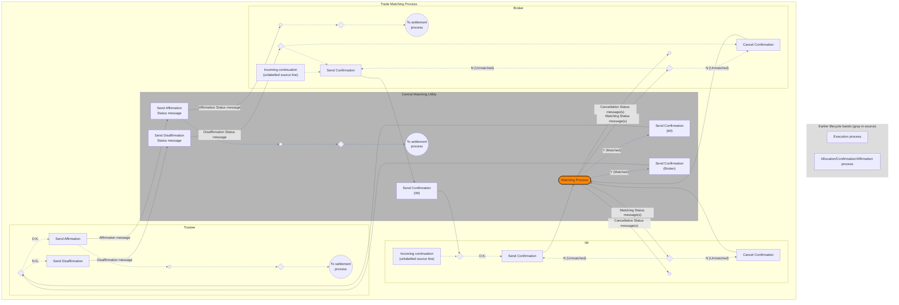

# Tripartite central matching with distribution

## Source evidence

[src-000180](../../../../../../../../evidence/omitted/620693d01e301c06503cea9a.md); Description of BusinessActivities / BusinessProcess – Central Matching / Tripartite Central Matching With Confirmation Distribution Service; direct-body paragraph P182; word/media/image9.tmp. [Unchanged original figure or complete rendered document](../../../../../../../../evidence/omitted/ceda2aba1e27c9c06398bca4.md).

[Complete source figure](../../../../../../../../evidence/omitted/d02ec29e88a3ff506042ba9f.md)

## Mermaid reconstruction

## Actors, activities and relationships

With distribution, Broker confirmation is first forwarded by CMU to IM; the initial IM O.K. comparison leads to its own confirmation. The top CMU forwarding box is labelled Send Confirmation (IM) in the source, although P181 describes forwarding Broker data; that exact box label is retained. The CMU matching process returns cancellation status to receipt circles and matching status to each party decision. N (Unmatched) returns toward a new confirmation or cancellation; Y (Matched) forwards both confirmations to Trustee. Trustee N.G. disaffirms and prompts Broker rework; O.K. affirms, produces status and permits settlement continuations. P174/P181 and T13/T14 preserve the timing, agreement and cancellation alternatives.

The source matching process is a narrow orange ellipse; native Mermaid uses a labelled rounded node while preserving all associated arrows. Color and exact shape remain in the original. Cancellation receipt markers do not imply a settlement reversal.

| Source-scoped participant | Canonical record |
| --- | --- |
| broker | [broker](../../../../../../../../shared/reference/participants/participant-src-000180-broker.md) |
| investment manager | [investment manager](../../../../../../../../shared/reference/participants/participant-src-000180-investment-manager.md) |
| central matching utility cmu | [central matching utility cmu](../../../../../../../../shared/reference/participants/participant-src-000180-central-matching-utility-cmu.md) |
| central matching utility jasdec | [central matching utility jasdec](../../../../../../../../shared/reference/participants/participant-src-000180-central-matching-utility-jasdec.md) |
| trustee | [trustee](../../../../../../../../shared/reference/participants/participant-src-000180-trustee.md) |
| trust bank | [trust bank](../../../../../../../../shared/reference/participants/participant-src-000180-trust-bank.md) |

Reusable source flow: [Tripartite Central Matching With Confirmation Distribution Service](../../flows/flow-src-000180-p180-tripartite-central-matching-with-confirmation-distribution-service.md). All narrative conditions and activity-table rows remain there.

Responsibilities and activities: [Source table T14](../../documents/src-000180/tables/tbl-0014.md).

## Review evidence

Opened the complete source figure and rendered reconstruction. Compared actor/lane labels, arrow direction and endpoints, all activity labels, N.G./O.K. and unmatched/matched branches, cancellation receipt paths, settlement/NAV outcomes, and source boundary/color distinctions where present. Source geometry is adapted; labelled reconstruction cues and the overlapping listed-derivatives boundary limitation are explicit. Final corrected render reopened after endpoint/style changes. Parsed and rendered with Mermaid 12.3.0 and Chromium156.0.8078.81; visual comparison 2026-11-09 Europe/Warsaw.

[Compared reconstruction](../../../../../../../../evidence/omitted/d9ae691b389bd5e5d9129660.md).
