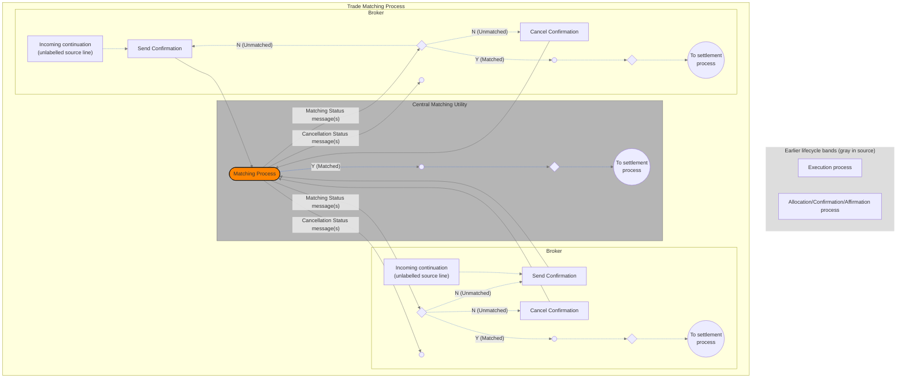

# Bilateral central matching activity

## Source evidence

[src-000180](../../../../../../../../evidence/omitted/620693d01e301c06503cea9a.md); Description of BusinessActivities / BusinessProcess – Central Matching / Bilateral Central Matching; direct-body paragraph P187; word/media/image10.tmp. [Unchanged original figure or complete rendered document](../../../../../../../../evidence/omitted/b18a5645a60d9027850684bb.md).

[Complete source figure](../../../../../../../../evidence/omitted/6bd7943a58187d1c879edaed.md)

## Mermaid reconstruction

## Actors, activities and relationships

The source activity labels both outer lanes Broker. Each submits a confirmation or cancellation to CMU. Cancellation status goes to the corresponding receipt marker; matching status goes to a local choice. N (Unmatched) loops to a new confirmation or cancellation; Y (Matched) continues toward settlement in both broker lanes and the CMU lane. P186 identifies the second narrative actor as Prime Broker. The reconstruction preserves the two identical artwork lane labels while linking the narrative-specific role separately.

Both Broker lane instances remain distinct; the canonical business role may appear in more than one instance. The source does not specify an institution name.

| Source-scoped participant | Canonical record |
| --- | --- |
| broker | [broker](../../../../../../../../shared/reference/participants/participant-src-000180-broker.md) |
| prime broker | [prime broker](../../../../../../../../shared/reference/participants/participant-src-000180-prime-broker.md) |
| central matching utility cmu | [central matching utility cmu](../../../../../../../../shared/reference/participants/participant-src-000180-central-matching-utility-cmu.md) |
| central matching utility jasdec | [central matching utility jasdec](../../../../../../../../shared/reference/participants/participant-src-000180-central-matching-utility-jasdec.md) |

Reusable source flow: [Bilateral Central Matching](../../flows/flow-src-000180-p185-bilateral-central-matching.md). All narrative conditions and activity-table rows remain there.

Responsibilities and activities: [Source table T15](../../documents/src-000180/tables/tbl-0015.md).

## Review evidence

Opened the complete source figure and rendered reconstruction. Compared actor/lane labels, arrow direction and endpoints, all activity labels, N.G./O.K. and unmatched/matched branches, cancellation receipt paths, settlement/NAV outcomes, and source boundary/color distinctions where present. Source geometry is adapted; labelled reconstruction cues and the overlapping listed-derivatives boundary limitation are explicit. Final corrected render reopened after endpoint/style changes. Parsed and rendered with Mermaid 12.3.0 and Chromium156.0.8078.81; visual comparison 2026-11-09 Europe/Warsaw.

[Compared reconstruction](../../../../../../../../evidence/omitted/6f6086363564270c5ccab101.md).
