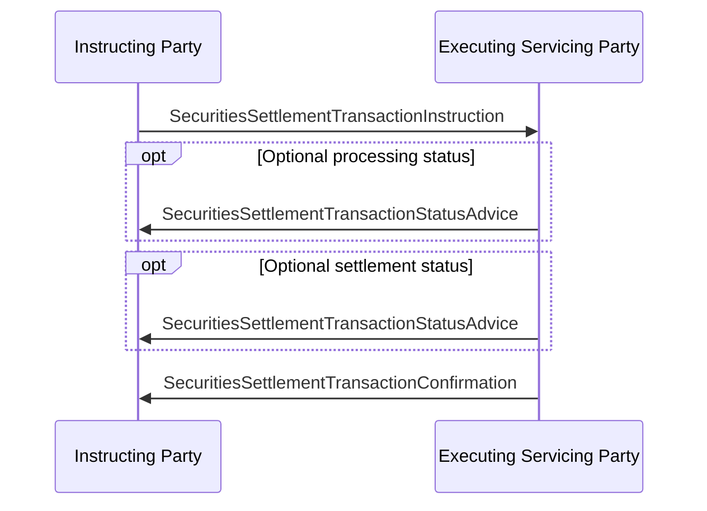

# Instruction and confirmation sequence

## Source and original artwork

[src-000196](../../../../../../../../evidence/omitted/590a0c85882f5e6c5c9ea627.md), §6.1 Instruction and Confirmation, paragraph328. Paragraph IDs count direct-body paragraphs. Archive member `word/media/image37.png`.

[Unchanged original figure](../../../../../../../../evidence/omitted/fcf08935f892a13538a03b64.md)

[Original figure](../../../../../../../../evidence/omitted/fcf08935f892a13538a03b64.md)

## Mermaid reconstruction

## Entities and relationships

Two optional status messages are separately shown. Both go from executing/servicing to instructing party; confirmation is last. Source building icons are decorative actor symbols, not institutional restrictions.

[Flow, participants, steps and alternatives](../../flows/instruction-confirmation.md)

## Review evidence

| Check | Result | Evidence |
| --- | --- | --- |
| Original figure inspection | performed | Source raster/EMF preview inspected on 2026-11-08 |
| Mermaid parse/render | pass | Mermaid 12.3.0; Chromium 156.0.8078.81; 2026-11-08 |
| Rendered reconstruction compared with original | pass | Compared both actors, instruction direction, two separate optional status boxes, confirmation and message labels. |

[Pilot diagram index](index.md)

[Validated SVG](../../../../../../../../evidence/omitted/4fbcd4a73425e7f2d4ab05d6.md) · [Readable rendered PNG](../../../../../../../../evidence/omitted/e9cad73e96662308e2cab555.md)

Visual review applies to this reconstructed view; it does not claim complete source-wide figure coverage or resolve source semantic defects.

<!-- RENDERED-SOURCE-START -->
## Rendered source page context

[Read-only Word-rendered source PDF](../../../../../../../../evidence/omitted/aae5b215a8f3b7a6b1062885.md); file page(s) 56. The page association is established by exact original-asset SHA-256 in the Word shape inventory, not by shape ordinal. Full-page/composite visual comparison is pending unless a separate dated review is recorded.
<!-- RENDERED-SOURCE-END -->
