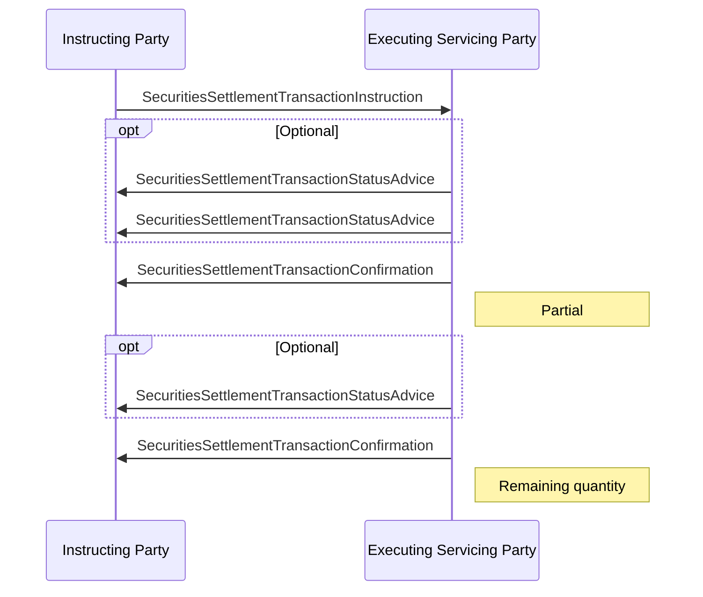

# Partial settlement confirmation sequence

## Source and original artwork

[src-000196](../../../../../../../../evidence/omitted/590a0c85882f5e6c5c9ea627.md), §6.3 Partial Settlement Confirmation, paragraph343. Paragraph IDs count direct-body paragraphs. Archive member `word/media/image39.png`.

[Unchanged original figure](../../../../../../../../evidence/omitted/ccec2bf740f7d04f027f3001.md)

[Original figure](../../../../../../../../evidence/omitted/ccec2bf740f7d04f027f3001.md)

## Mermaid reconstruction

## Entities and relationships

One optional box encloses two statuses before partial confirmation. Second optional box encloses one status after partial confirmation. Final confirmation is annotated Remaining quantity.

[Flow, participants, steps and alternatives](../../flows/partial-settlement.md)

## Review evidence

| Check | Result | Evidence |
| --- | --- | --- |
| Original figure inspection | performed | Source raster/EMF preview inspected on 2026-11-08 |
| Mermaid parse/render | pass | Mermaid 12.3.0; Chromium 156.0.8078.81; 2026-11-08 |
| Rendered reconstruction compared with original | pass | Compared both actors, six message arrows, first two statuses in one optional box, second optional status, Partial and Remaining quantity notes. |

[Pilot diagram index](index.md)

[Validated SVG](../../../../../../../../evidence/omitted/798d3d6e625727cb18a0b8ab.md) · [Readable rendered PNG](../../../../../../../../evidence/omitted/4b66a45af7e781764db85795.md)

Visual review applies to this reconstructed view; it does not claim complete source-wide figure coverage or resolve source semantic defects.

<!-- RENDERED-SOURCE-START -->
## Rendered source page context

[Read-only Word-rendered source PDF](../../../../../../../../evidence/omitted/aae5b215a8f3b7a6b1062885.md); file page(s) 58. The page association is established by exact original-asset SHA-256 in the Word shape inventory, not by shape ordinal. Full-page/composite visual comparison is pending unless a separate dated review is recorded.
<!-- RENDERED-SOURCE-END -->
