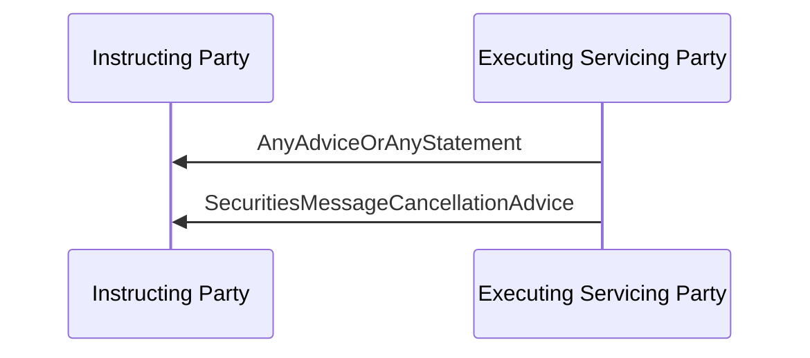

# Cancellation advice sequence

## Source and original artwork

[src-000196](../../../../../../../../evidence/omitted/590a0c85882f5e6c5c9ea627.md), §6.13 Cancellation Advice, paragraph621. Paragraph IDs count direct-body paragraphs. Archive member `word/media/image70.png`.

[Unchanged original figure](../../../../../../../../evidence/omitted/ff950c4ac9eedca246e5e6f0.md)

[Original figure](../../../../../../../../evidence/omitted/ff950c4ac9eedca246e5e6f0.md)

## Mermaid reconstruction

## Entities and relationships

Narrative describes an advice or statement followed by cancellation advice. The source arrow label AnyAdviceOrAnyStatement is retained exactly.

[Flow, participants, steps and alternatives](../../flows/cancellation-advice.md)

## Review evidence

| Check | Result | Evidence |
| --- | --- | --- |
| Original figure inspection | performed | Original inspected on 2026-11-08 |
| Mermaid parse/render | pass | Mermaid 12.3.0; Chromium 156.0.8078.81; 2026-11-08 |
| Rendered reconstruction compared with original | pass | Compared both arrows and corrected exact AnyAdviceOrAnyStatement label before final render. |

[Pilot diagram index](index.md)

[Validated SVG](../../../../../../../../evidence/omitted/1847902930858234f1852501.md) · [Readable rendered PNG](../../../../../../../../evidence/omitted/6018d85280eab32e752459f2.md)

Visual review applies to this reconstructed view; it does not claim complete source-wide figure coverage or resolve source semantic defects.
