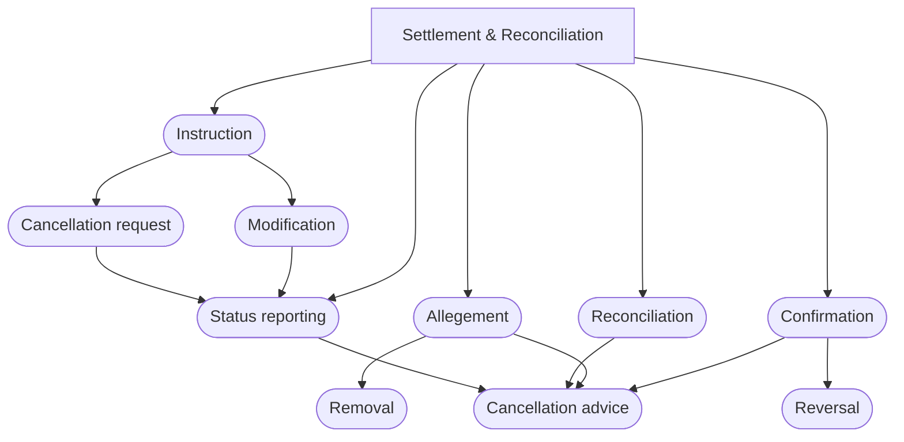

# Settlement and Reconciliation business processes

## Source and original artwork

[src-000196](../../../../../../../../evidence/omitted/590a0c85882f5e6c5c9ea627.md), §4 BusinessProcess Description, paragraph180. Paragraph IDs count direct-body paragraphs. Archive member `word/media/image5.emf`.

[Unchanged original figure](../../../../../../../../evidence/omitted/b09dadb5b00382bf95d8a781.md)

Original is an EMF vector figure. A separate working PNG was rasterized through Windows System.Drawing for source inspection; original vector file is unchanged.

## Mermaid reconstruction

## Entities and relationships

All 11 nodes and 15 arrow endpoints retained. Source is a process graph without actors or include/extend labels. Native flowchart represents it without inventing UML use-case semantics.

## Review evidence

| Check | Result | Evidence |
| --- | --- | --- |
| Original figure inspection | performed | Source raster/EMF preview inspected on 2026-11-08 |
| Mermaid parse/render | pass | Mermaid 12.3.0; Chromium 156.0.8078.81; 2026-11-08 |
| Rendered reconstruction compared with original | pass | Compared all 11 process nodes and 15 directed edges with Windows System.Drawing rasterization of unchanged EMF; no actors/include/extend semantics invented. |

[Pilot diagram index](index.md)

[Validated SVG](../../../../../../../../evidence/omitted/6dae2de63e964405a451dd55.md) · [Readable rendered PNG](../../../../../../../../evidence/omitted/d21613170918257d8c520296.md)

Visual review applies to this reconstructed view; it does not claim complete source-wide figure coverage or resolve source semantic defects.

<!-- RENDERED-SOURCE-START -->
## Rendered source page context

[Read-only Word-rendered source PDF](../../../../../../../../evidence/omitted/aae5b215a8f3b7a6b1062885.md); file page(s) 15. The page association is established by exact original-asset SHA-256 in the Word shape inventory, not by shape ordinal. Full-page/composite visual comparison is pending unless a separate dated review is recorded.
<!-- RENDERED-SOURCE-END -->

<!-- NATIVE-EVIDENCE-START -->
## Native embedded source object

[Microsoft_Visio_2003-2010_Drawing.vsd](../../../../../../../../evidence/omitted/4fde4def9b9523183801f2f3.md)

[Native-object identity and occurrence inventory](../../documents/src-000196/native-embeddings.md). These original embedded bytes are retained unchanged. The visual reconstruction was compared with the supplied visible picture/complete vector preview. Hidden native layers or additional native pages have not been activated or checked; visual fidelity does not assert their equivalence.
<!-- NATIVE-EVIDENCE-END -->
