# Split settlement activity

[src-000196](../../../../../../../../evidence/omitted/590a0c85882f5e6c5c9ea627.md); direct-body paragraph P270; Description of BusinessActivities / Split Settlement Process; `/w:document/w:body/w:p[270]`.

[Unchanged original asset](../../../../../../../../evidence/omitted/eaa5bb2c3a244955eae272d6.md) · [Readable original/complete vector preview](../../../../../../../../evidence/omitted/eaa5bb2c3a244955eae272d6.md)

## Mermaid source reconstruction

```mermaid
%%{init: {"themeVariables": {"edgeLabelBackground": "#ffffff"}, "themeCSS": ".edgeLabel rect { fill: #fff !important; opacity: 1 !important; }"}}%%
flowchart TB
  subgraph C["Client"]
    S@{shape: f-circ, label: " "} --> CP("Instruction processing")
    CM("Monitor Settlement Process") --> CD{"Settled?"}
    CD -->|No| CU("Update Status")
    CU --> CM
    CD -->|Yes| CX(["Settle trade"])
    CX --> CE@{shape: framed-circle, label: " "}
  end
  subgraph I["Instructing Party"]
    IP("Instruction processing") --> Needed{"Split Needed?"}
    Needed -->|Yes| Split("Instruct Split")
    Needed -->|No| IM("Monitor Settlement Process")
    IM --> ID{"Settled?"}
    ID -->|No| IU("Update Status")
    IU --> IM
    ID -->|Yes| IX(["Settle trade"])
    IX --> IE@{shape: framed-circle, label: " "}
  end
  subgraph E["Executing Party"]
    EP("Instruction processing") --> EM("Matching and Settlement Process")
    ESplit("Execute Split") --> EM
    EM --> ED{"Settled?"}
    ED -->|No| EU("Update Status")
    EU --> EM
    ED -->|Yes| EX(["Settle trade"])
    EX --> EE@{shape: framed-circle, label: " "}
    EU --> Join@{shape: fork, label: " "}
    EX --> Join
  end
  CP --> IP
  IP --> EP
  CP -.- Split
  Split --> ESplit
  Join --> IM
  IU --> CM
  IX --> CM
  classDef focus fill:#d1d8b8,stroke:#111,color:#111
  classDef context fill:#c0d1e5,stroke:#111,color:#111
  class Needed,Split,ESplit focus
  class CP,CM,CD,CU,CX,IP,IM,ID,IU,IX,EP,EM,ED,EU,EX context
  classDef fork fill:#111,stroke:#111
  class Join fork
  classDef framedcircle fill:#fff,stroke:#111,stroke-width:3px
  class CE,IE,EE framedcircle
  classDef fcirc fill:#4472c4,stroke:#4472c4
  class S fcirc
```

## Participants and flow context

- [split settlement client](../../../../../../../../shared/reference/participants/settlement-reconciliation-split-settlement-client.md)
- [instructing party](../../../../../../../../shared/reference/participants/settlement-reconciliation-instructing-party.md)
- [instructing splitting party](../../../../../../../../shared/reference/participants/settlement-reconciliation-instructing-splitting-party.md)
- [executing servicing party](../../../../../../../../shared/reference/participants/settlement-reconciliation-executing-servicing-party.md)

- [bilateral splitting](../../flows/bilateral-splitting.md)
- [unilateral splitting](../../flows/unilateral-splitting.md)

[Activity table T41 — all steps, definitions and Initiator values](../../documents/src-000196/tables/tbl-0041.md). These source responsibilities are distinct from message sender/receiver assertions.

## Semantics and limitations

- The original dashed connection from the client’s Instruction processing to Instruct Split has no clear arrowhead and remains a dashed plain connection. It is distinct from the solid instruction-processing chain.
- This activity picture has three lanes, whereas the detailed bilateral/unilateral sequences also show the opposite trade side and its client. The full flows retain those narrative/sequence participants.

Swimlane ownership is represented by native flowchart subgraphs. Decisions retain their source labels and branch labels; start/end symbols and explicit source bars use native Mermaid shapes. The layout is reflowed without changing endpoints. Green/blue fills preserve the source’s distinction between the foreground activities and surrounding status/context activities where visible.

## Rendering and visual review

Parse/render passed using Mermaid 12.3.0 with Mermaid browser API + Chromium 156.0.8078.81. [Rendered SVG](../../../../../../../../evidence/omitted/f1de90a356ea6a15b155ba3d.md) · [Rendered PNG](../../../../../../../../evidence/omitted/866e623607af4e3b09d8f704.md).

On 2026-11-09 (Europe/Warsaw), the original/full vector preview and the final reconstruction were directly compared for labels, role boundaries, decisions, branches, feedback paths, arrowheads/plain connections, start/end symbols and source synchronization bars. Result: **visual relationship fidelity pass**. Native layout reflows the lanes; original assets remain authoritative for pictorial layout. The machine render date is UTC 2026-11-08.

[Hash-bound review evidence](../../../../../../../../tracking/reviews/settlement-activities.json)
