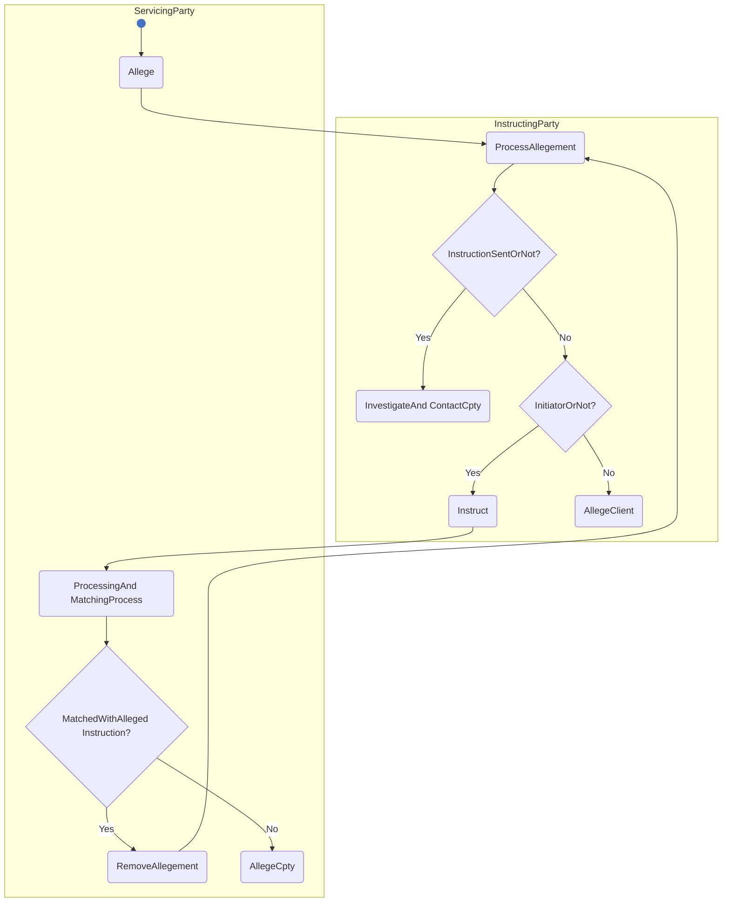

# Allegement activity

[src-000196](../../../../../../../../evidence/omitted/590a0c85882f5e6c5c9ea627.md); direct-body paragraph P272; Description of BusinessActivities / Allegement Process; `/w:document/w:body/w:p[272]`.

[Unchanged original asset](../../../../../../../../evidence/omitted/5c3f584901fc0a572d34f5ff.md) · [Readable original/complete vector preview](../../../../../../../../evidence/omitted/5c3f584901fc0a572d34f5ff.md)

## Mermaid source reconstruction

## Participants and flow context

- [instructing party](../../../../../../../../shared/reference/participants/settlement-reconciliation-instructing-party.md)
- [executing servicing party](../../../../../../../../shared/reference/participants/settlement-reconciliation-executing-servicing-party.md)

- [allegement](../../flows/allegement.md)

[Activity table T42 — all steps, definitions and Initiator values](../../documents/src-000196/tables/tbl-0042.md). These source responsibilities are distinct from message sender/receiver assertions.

## Semantics and limitations

- The source contains decision annotations (InstructionSentOrNot?, InitiatorOrNot?, MatchedWithAllegedInstruction?) attached to diamonds. They are placed inside native decision nodes here. Original compact activity names and Yes/No branches are retained.
- The activity picture does not separately draw the alleged client or counterparty as swimlanes. The full flow and sequence retain the two instructing-party instances and the parties named in the narrative.

Swimlane ownership is represented by native flowchart subgraphs. Decisions retain their source labels and branch labels; start/end symbols and explicit source bars use native Mermaid shapes. The layout is reflowed without changing endpoints. Green/blue fills preserve the source’s distinction between the foreground activities and surrounding status/context activities where visible.

## Rendering and visual review

Parse/render passed using Mermaid 12.3.0 with Mermaid browser API + Chromium 156.0.8078.81. [Rendered SVG](../../../../../../../../evidence/omitted/0bd96f32a2f5aea31020138d.md) · [Rendered PNG](../../../../../../../../evidence/omitted/cca49ef4e7aaf0bd1fa1df80.md).

On 2026-11-09 (Europe/Warsaw), the original/full vector preview and the final reconstruction were directly compared for labels, role boundaries, decisions, branches, feedback paths, arrowheads/plain connections, start/end symbols and source synchronization bars. Result: **visual relationship fidelity pass**. Native layout reflows the lanes; original assets remain authoritative for pictorial layout. The machine render date is UTC 2026-11-08.

[Hash-bound review evidence](../../../../../../../../tracking/reviews/settlement-activities.json)

<!-- RENDERED-SOURCE-START -->
## Rendered source page context

[Read-only Word-rendered source PDF](../../../../../../../../evidence/omitted/aae5b215a8f3b7a6b1062885.md); file page(s) 46. The page association is established by exact original-asset SHA-256 in the Word shape inventory, not by shape ordinal. Full-page/composite visual comparison is pending unless a separate dated review is recorded.
<!-- RENDERED-SOURCE-END -->
