# Reporting push activity

[src-000196](../../../../../../../../evidence/omitted/590a0c85882f5e6c5c9ea627.md); direct-body paragraph P284; Description of BusinessActivities / Reconciliation and Reporting Process / Push Mode; `/w:document/w:body/w:p[284]`.

[Unchanged original asset](../../../../../../../../evidence/omitted/d2878c1f20a1e864d488f83e.md) · [Readable original/complete vector preview](../../../../../../../../evidence/omitted/f8d5658e5bdbfa6f9aeba00e.md)

## Mermaid source reconstruction

```mermaid
%%{init: {"themeVariables": {"edgeLabelBackground": "#ffffff"}, "themeCSS": ".edgeLabel rect { fill: #fff !important; opacity: 1 !important; }"}}%%
flowchart TB
  subgraph I["Instructing Party"]
    subgraph IC["Settlement context"]
      S@{shape: f-circ, label: " "} --> Instruct("Instruct settlement")
      IM("Monitor Matching and Settlement Process") --> ID{"Settled?"}
      ID -->|No| IU("Update Status")
      IU --> IM
      ID -->|Yes| IX(["Settle instruction"])
    end
    subgraph IR["Reconciliation"]
      ReconcileP("Reconcile Pending Transaction Statuses") --> Investigate("Investigate and solve breaks")
      ReconcileH("Reconcile Holdings") --> Investigate
    end
  end
  subgraph E["Executing/Servicing Party"]
    subgraph EC["Settlement context"]
      Process("Process instruction") --> PD{"Processed?"}
      PD -->|No| PU("Update Status")
      PD -->|Yes| EM("Matching and Settlement Process")
      EM --> ED{"Settled?"}
      ED -->|No| EU("Update Status")
      EU --> EM
      ED -->|Yes| EX(["Settle instruction"])
      EX --- End@{shape: framed-circle, label: " "}
      EX --> Join@{shape: fork, label: " "}
      EU --> Join
      EX --> Fan@{shape: fork, label: " "}
    end
    subgraph ER["Reporting"]
      RT("Report Transactions") --> Holds@{shape: fork, label: " "}
      RI("Report Intra-position movements") --> Holds
      RC("Report holding (custody)") --> Holds
      RA("Report holdings (accounting)") --> Holds
      RP("Report Pending Transaction") --> Pending@{shape: fork, label: " "}
      RL("Report Allegements") --> Pending
    end
  end
  Instruct --> Process
  PU --> Instruct
  Join --> IM
  IU -.-> ReconcileP
  IX -.-> ReconcileH
  Fan -.-> RT
  Fan -.-> RI
  Fan -.-> RC
  Fan -.-> RA
  EU -.-> RP
  EU -.-> RL
  Holds --> ReconcileH
  Pending --> ReconcileP
  classDef focus fill:#d1d8b8,stroke:#111,color:#111
  classDef context fill:#c0d1e5,stroke:#111,color:#111
  class ReconcileP,ReconcileH,Investigate,RT,RI,RC,RA,RP,RL focus
  class Instruct,IM,ID,IU,IX,Process,PD,PU,EM,ED,EU,EX context
  classDef fork fill:#111,stroke:#111
  class Join,Fan,Holds,Pending fork
  classDef framedcircle fill:#fff,stroke:#111,stroke-width:3px
  class End framedcircle
  classDef fcirc fill:#4472c4,stroke:#4472c4
  class S fcirc
```

## Participants and flow context

- [instructing party](../../../../../../../../shared/reference/participants/settlement-reconciliation-instructing-party.md)
- [executing servicing party](../../../../../../../../shared/reference/participants/settlement-reconciliation-executing-servicing-party.md)
- [reporting third party](../../../../../../../../shared/reference/participants/settlement-reconciliation-reporting-third-party.md)

- [reporting push](../../flows/reporting-push.md)

[Activity table T43 — all steps, definitions and Initiator values](../../documents/src-000196/tables/tbl-0043.md). These source responsibilities are distinct from message sender/receiver assertions.

## Semantics and limitations

- The source separates blue settlement context from green reporting/reconciliation by a horizontal dashed divider. Named nested groups here make that separation explicit; the group captions are explanatory, not additional source participants.
- Dashed dependencies from settlement activities to reports/reconciliation remain dashed. The original bars and both reconciliation routes are retained. Reports are selected by account setup and narrative conditions; the bars do not mean every report must be sent on every occasion.
- The source picture shows only instructing and executing/servicing lanes. The narrative also includes a Third Party for audit-trail reporting; its linked canonical participant and flow remain available.

Swimlane ownership is represented by native flowchart subgraphs. Decisions retain their source labels and branch labels; start/end symbols and explicit source bars use native Mermaid shapes. The layout is reflowed without changing endpoints. Green/blue fills preserve the source’s distinction between the foreground activities and surrounding status/context activities where visible.

## Rendering and visual review

Parse/render passed using Mermaid 12.3.0 with Mermaid browser API + Chromium 156.0.8078.81. [Rendered SVG](../../../../../../../../evidence/omitted/1c060945867dd16215e528df.md) · [Rendered PNG](../../../../../../../../evidence/omitted/d7ba5061d8e3df351ea58d05.md).

On 2026-11-09 (Europe/Warsaw), the original/full vector preview and the final reconstruction were directly compared for labels, role boundaries, decisions, branches, feedback paths, arrowheads/plain connections, start/end symbols and source synchronization bars. Result: **visual relationship fidelity pass**. Native layout reflows the lanes; original assets remain authoritative for pictorial layout. The machine render date is UTC 2026-11-08.

[Hash-bound review evidence](../../../../../../../../tracking/reviews/settlement-activities.json)

<!-- RENDERED-SOURCE-START -->
## Rendered source page context

[Read-only Word-rendered source PDF](../../../../../../../../evidence/omitted/aae5b215a8f3b7a6b1062885.md); file page(s) 48. The page association is established by exact original-asset SHA-256 in the Word shape inventory, not by shape ordinal. Full-page/composite visual comparison is pending unless a separate dated review is recorded.
<!-- RENDERED-SOURCE-END -->
