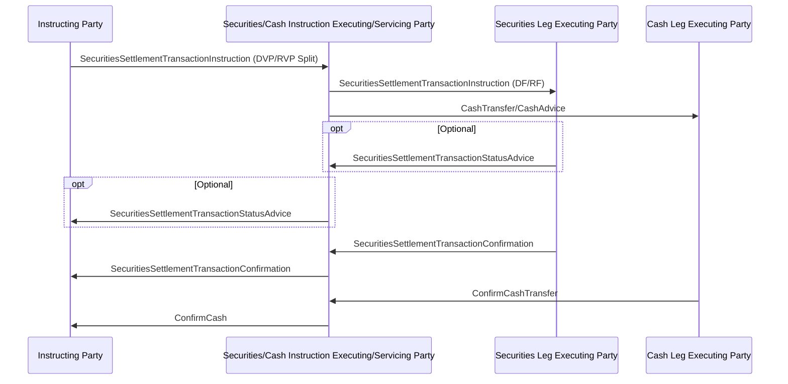

# Cash/securities split instruction and confirmation

[src-000196](../../../../../../../../evidence/omitted/590a0c85882f5e6c5c9ea627.md); direct-body paragraph P453; BusinessTransactions / Cash/Securities Split Instruction and Confirmation; `/w:document/w:body/w:p[453]`.

[Original image](../../../../../../../../evidence/omitted/5fac8088c8d1296c8ff1b46d.md) · [Business flow and narrative responsibilities](../../flows/cash-securities-split.md)

## Source reconstruction

## Actors and relationships

- **A — Instructing Party**: [canonical functional participant](../../../../../../../../shared/reference/participants/settlement-reconciliation-instructing-party.md).
- **B — Securities/Cash Instruction Executing/Servicing Party**: [canonical functional participant](../../../../../../../../shared/reference/participants/settlement-reconciliation-cash-securities-split-servicing-party.md).
- **C — Securities Leg Executing Party**: [canonical functional participant](../../../../../../../../shared/reference/participants/settlement-reconciliation-securities-leg-executing-party.md).
- **D — Cash Leg Executing Party**: [canonical functional participant](../../../../../../../../shared/reference/participants/settlement-reconciliation-cash-leg-executing-party.md).

The source picture is a sequence of directed communications. Each optional rectangle is preserved as its own native optional block, including multiple messages inside the same rectangle. Repeated arrows are separate occurrences, not deduplicated. Building pictograms are replaced with labelled participant lifelines without assigning a particular institution.

| Order | Direction | Source label | Source optionality |
| --- | --- | --- | --- |
| 1 | A → B | SecuritiesSettlementTransactionInstruction (DVP/RVP Split) | No optional boundary drawn |
| 2 | B → C | SecuritiesSettlementTransactionInstruction (DF/RF) | No optional boundary drawn |
| 3 | B → D | CashTransfer/CashAdvice | No optional boundary drawn |
| 4 | C → B | SecuritiesSettlementTransactionStatusAdvice | Optional |
| 5 | B → A | SecuritiesSettlementTransactionStatusAdvice | Optional |
| 6 | C → B | SecuritiesSettlementTransactionConfirmation | No optional boundary drawn |
| 7 | B → A | SecuritiesSettlementTransactionConfirmation | No optional boundary drawn |
| 8 | D → B | ConfirmCashTransfer | No optional boundary drawn |
| 9 | B → A | ConfirmCash | No optional boundary drawn |

## Message definitions in the supplied edition

- [sese.023.001.13 — SecuritiesSettlementTransactionInstruction](../../../../../messages/sese.023.001.13/index.md)
- [sese.024.001.14 — SecuritiesSettlementTransactionStatusAdvice](../../../../../messages/sese.024.001.14/index.md)
- [sese.025.001.13 — SecuritiesSettlementTransactionConfirmation](../../../../../messages/sese.025.001.13/index.md)

Names are linked to the exact definitions in supplied Part2. Labels retained from the picture are shown in the ordered table above; generic labels are not assigned an invented message ID.

## Source qualifications and discrepancies

- CashTransfer/CashAdvice, ConfirmCashTransfer and ConfirmCash are retained as source labels. No particular payment schema is inferred from them.

## Rendering and visual review

Parse/render passed with Mermaid 12.3.0 and Mermaid browser API + Chromium 156.0.8078.81. [Rendered SVG](../../../../../../../../evidence/omitted/48b64ae6e8194044974d8c3e.md) · [Rendered PNG](../../../../../../../../evidence/omitted/1e6e5c78c34fa56bb56c8316.md).

On 2026-11-09 (Europe/Warsaw), the original and rendered reconstruction were directly compared for all participant labels, message labels, endpoints, direction, order, repeated messages and optional groups. Result: **visual fidelity pass**. Render date in the machine report is UTC 2026-11-08. Source disagreements are preserved; this is not approval of the entire business flow.

[Hash-bound review evidence](../../../../../../../../tracking/reviews/settlement-sequences.json)

<!-- RENDERED-SOURCE-START -->
## Rendered source page context

[Read-only Word-rendered source PDF](../../../../../../../../evidence/omitted/aae5b215a8f3b7a6b1062885.md); file page(s) 71. The page association is established by exact original-asset SHA-256 in the Word shape inventory, not by shape ordinal. Full-page/composite visual comparison is pending unless a separate dated review is recorded.
<!-- RENDERED-SOURCE-END -->
