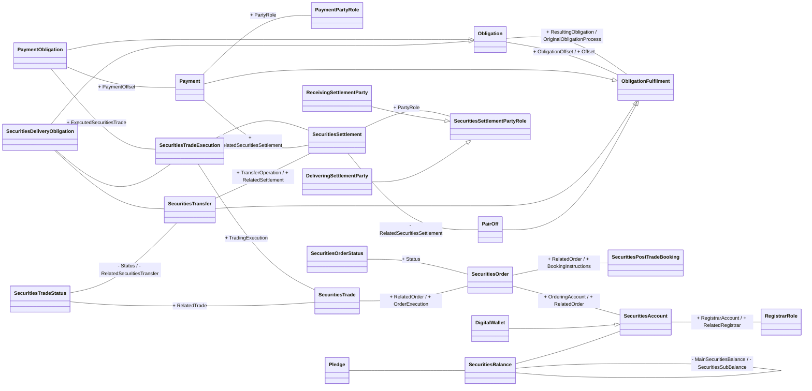

# SettlementAndReconciliation conceptual business model

Source: [src-000198](../../../../../../../../../evidence/omitted/c6a84c22fb63cab3b848bd88.md), worksheet `SettlementAndReconciliation`, drawing anchor `A1:Z59` (including recorded offsets in extraction coverage), `xl/drawings/drawing2.xml`.

[Unchanged source model](../../../../../../../../../evidence/omitted/3a27e843f5b2fd39c6fca50a.md)

## Mermaid reconstruction

## Complete relationship inventory

The source labels are transcribed below. A blank label means this artwork leaves the association unlabelled. `--|>` denotes the visible hollow-triangle generalization. `--` is an association, not a message direction. Visible plus/minus prefixes are preserved. Numeric end labels appear only when visible; blank cardinality is not asserted as one.

| Node A | Relationship | Node B | Source labels | A cardinality | B cardinality |
| --- | --- | --- | --- | --- | --- |
| Obligation | -- | ObligationFulfilment | + ResultingObligation / OriginalObligationProcess |  |  |
| Obligation | -- | ObligationFulfilment | + ObligationOffset / + Offset |  |  |
| PaymentObligation | --\|&gt; | Obligation |  |  |  |
| SecuritiesDeliveryObligation | --\|&gt; | Obligation |  |  |  |
| Payment | --\|&gt; | ObligationFulfilment |  |  |  |
| SecuritiesTransfer | --\|&gt; | ObligationFulfilment |  |  |  |
| PairOff | --\|&gt; | ObligationFulfilment |  |  |  |
| Payment | -- | PaymentPartyRole | + PartyRole |  |  |
| PaymentObligation | -- | Payment | + PaymentOffset |  |  |
| SecuritiesDeliveryObligation | -- | SecuritiesTransfer |  |  |  |
| PaymentObligation | -- | SecuritiesTradeExecution | + ExecutedSecuritiesTrade |  |  |
| SecuritiesDeliveryObligation | -- | SecuritiesTradeExecution |  |  |  |
| SecuritiesTradeExecution | -- | SecuritiesSettlement |  |  |  |
| Payment | -- | SecuritiesSettlement | + RelatedSecuritiesSettlement |  |  |
| SecuritiesTransfer | -- | SecuritiesSettlement | + TransferOperation / + RelatedSettlement |  |  |
| SecuritiesSettlement | -- | PairOff | - RelatedSecuritiesSettlement |  |  |
| SecuritiesTradeExecution | -- | SecuritiesTrade | + TradingExecution |  |  |
| SecuritiesTradeStatus | -- | SecuritiesTrade | + RelatedTrade |  |  |
| SecuritiesTradeStatus | -- | SecuritiesTransfer | - Status / - RelatedSecuritiesTransfer |  |  |
| SecuritiesOrderStatus | -- | SecuritiesOrder | + Status |  |  |
| SecuritiesSettlement | -- | SecuritiesSettlementPartyRole | + PartyRole |  |  |
| ReceivingSettlementParty | --\|&gt; | SecuritiesSettlementPartyRole |  |  |  |
| DeliveringSettlementParty | --\|&gt; | SecuritiesSettlementPartyRole |  |  |  |
| SecuritiesTrade | -- | SecuritiesOrder | + RelatedOrder / + OrderExecution |  |  |
| SecuritiesOrder | -- | SecuritiesPostTradeBooking | + RelatedOrder / + BookingInstructions |  |  |
| SecuritiesOrder | -- | SecuritiesAccount | + OrderingAccount / + RelatedOrder |  |  |
| SecuritiesAccount | -- | RegistrarRole | + RegistrarAccount / + RelatedRegistrar |  |  |
| DigitalWallet | --\|&gt; | SecuritiesAccount |  |  |  |
| SecuritiesBalance | -- | SecuritiesAccount |  |  |  |
| Pledge | -- | SecuritiesBalance |  |  |  |
| SecuritiesBalance | -- | SecuritiesBalance | - MainSecuritiesBalance / - SecuritiesSubBalance |  |  |

## Entities and textual model context

- **Obligation**: Specifies the assets (quantity of securities, goods, services, and cash amounts) that have to be delivered. (src-000198 `FullBusinessModel!A2903:F2903`.)
- **ObligationFulfilment**: Processes by which an obligation is extinguished fully or partially. (src-000198 `FullBusinessModel!A2915:F2915`.)
- **PaymentObligation**: Obligation for the debtor to pay the creditor an amount of cash. (src-000198 `FullBusinessModel!A3166:F3166`.)
- **PaymentPartyRole**: Role played by a party in the context of a payment. (src-000198 `FullBusinessModel!A3197:F3197`.)
- **Payment**: Payment information and processes required to transfer cash end to end from the debtor to the creditor. (src-000198 `FullBusinessModel!A3055:F3055`.)
- **SecuritiesDeliveryObligation**: Obligation for one party to deliver securities to another party. (src-000198 `FullBusinessModel!A3984:F3984`.)
- **SecuritiesTransfer**: Completion of a securities settlement instruction, wherein securities are delivered/debited from a securities account and received/credited to the designated securities account. (src-000198 `FullBusinessModel!A4642:F4642`.)
- **SecuritiesTradeExecution**: Transaction between two counterparties in which they agree to buy and sell a financial instrument. A trade transaction occurs with the matching of the two counterparties orders. There could be several trade transactions necessary to execute the trade. (src-000198 `FullBusinessModel!A4578:F4578`.)
- **SecuritiesSettlement**: Settlement of the securities in a securities transaction, that is, the instruction to deliver or receive securities, involving the payment of an amount of money or not. (src-000198 `FullBusinessModel!A4474:F4474`.)
- **PairOff**: Transaction is paired off and netted against one or more previous transactions. (src-000198 `FullBusinessModel!A3018:F3018`.)
- **SecuritiesTradeStatus**: Status of a securities trade. (src-000198 `FullBusinessModel!A4610:F4610`.)
- **SecuritiesOrderStatus**: Status of a securities order or of the processing of a securities order. (src-000198 `FullBusinessModel!A4227:F4227`.)
- **SecuritiesSettlementPartyRole**: Role played by a party in the context of the settlement of securities. (src-000198 `FullBusinessModel!A4517:F4517`.)
- **ReceivingSettlementParty**: Party that receives securities as part of a chain of settlement parties or as ultimate party. (src-000198 `FullBusinessModel!A3686:F3686`.)
- **DeliveringSettlementParty**: Party that is responsible for delivering securities as part of a chain of settlement parties or as party that sells them. (src-000198 `FullBusinessModel!A1533:F1533`.)
- **SecuritiesTrade**: Specifies trades linked to securities operations such as the exchange of securities, the lending of securities and the transactions related to investment funds. (src-000198 `FullBusinessModel!A4557:F4557`.)
- **SecuritiesOrder**: Intention to transfer an ownership of a financial instrument. (src-000198 `FullBusinessModel!A4114:F4114`.)
- **SecuritiesPostTradeBooking**: Information used to book the executions of a trade. (src-000198 `FullBusinessModel!A4254:F4254`.)
- **Pledge**: shown by this source drawing; corresponding component definition not located in FullBusinessModel. No definition is invented.
- **SecuritiesBalance**: Net position of a segregated holding, in a single security, within the overall position held in a securities account. A securities balance is calculated from the sum of securities' receipts minus the sum of securities' deliveries. (src-000198 `FullBusinessModel!A3921:F3921`.)
- **SecuritiesAccount**: Account to or from which a securities entry is made. (src-000198 `FullBusinessModel!A3889:F3889`.)
- **DigitalWallet**: Digital account where digital assets or digital tokens can be stored and where an entry is made. (src-000198 `FullBusinessModel!A1575:F1575`.)
- **RegistrarRole**: Party responsible for keeping track of the owners of securities. (src-000198 `FullBusinessModel!A3748:F3748`.)

## Scope and limitations

The artwork contains Pledge, for which no component definition was located in the supplied FullBusinessModel table. The figure is retained as its own source claim; this is not evidence that the figure and table are synchronized. The source does not display association cardinalities in this view.

This is a reconstruction of a supplied conceptual model, not an XSD-derived view. It does not establish cardinality/defaults for any message schema. Repeated ISODateTime/FrequencyCode drawing occurrences keep separate rendering identifiers while retaining their source labels.

## Review evidence

Original and rendered reconstruction visually compared on 2026-11-08. Compared 23 nodes and 31 associations/generalizations to original. Verified Payment-to-SecuritiesSettlement association and corrected its label placement. Pledge image/table discrepancy remains issue-000015. Mermaid 12.3.0 and Chromium 156.0.8078.81 parsed and rendered this view successfully. The relationship inventory preserves all transcribed links; this does not resolve the stated source inconsistencies.

[Workbook index](../index.md)

[Validated SVG](../../../../../../../../../evidence/omitted/74c0e36c6349126a7c5b75ae.md) · [Rendered comparison image](../../../../../../../../../evidence/omitted/ec642c8f4b12b3d743614e35.md)

[Source ambiguities: issue-000015](../../../../../../../../../tracking/issues.md) · [Contextual participants](../../../participants.md)
