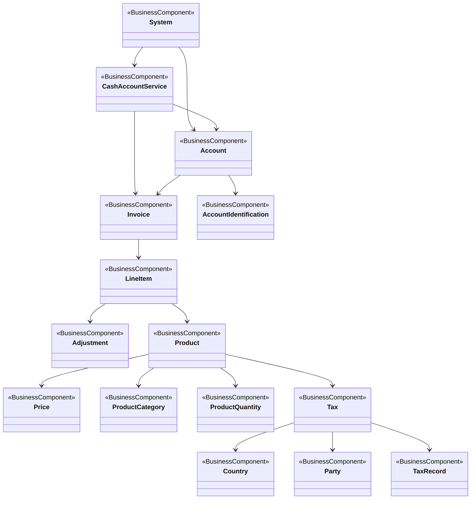

# T2S billing conceptual model

[src-000348](../../../../../../../../../evidence/omitted/e6546c5f64c53f963440988a.md) archive member `ISO20022_MDR_Target2Securities_August_2026_v1/Target2-Securities_Billing_MessageSet/ISO20022_MDRPart3_Target2Securities_Billing_v1.xlsx`, Billing!A1:U53; xl/drawings/drawing2.xml; anchor 1. Original image SHA-256: ddfaeaea6f11adcc6cd2fbd433386cd3fa599e387d505d9ecce24acdc90238db.

[Original complete figure](../../../../../../../../../evidence/omitted/fafceb3a9a657982fd5637a2.md) · [Rendered Mermaid SVG](../../../../../../../../../evidence/omitted/ce3d194206d1afe54530ca4c.md) · [Rendered Mermaid PNG](../../../../../../../../../evidence/omitted/724da1d0b873cee0536d026e.md)

## Source reconstruction

## Entities and relationships

System has directed associations to cash-account service and account. Service and account each point to invoice; account points to account identification. Invoice points to line item, then adjustment/product. Product points to price, category, quantity and tax; tax points to country, party and tax record. These arrows belong to the source conceptual model and do not establish chronological billing activities or XML containment.

All 15 visible node occurrences and 16 relationship lines are retained. No numeric multiplicity is shown in this source view, so none is inferred. Printed package labels and absent labels are preserved in the entity register; the reconstruction adds no package boundaries absent from the source. Association labels retain literal +/− prefixes and combined end names. Their re-layout position is not additional navigability evidence. The native class inheritance marker is reserved for the source’s hollow-triangle generalizations. Source editor/navigation icons are omitted as interface decoration; no business entity or relationship is excluded.

## Complete relationship register

| From node | To node | Source relationship kind | Visible source label(s) | From-end multiplicity | To-end multiplicity |
| --- | --- | --- | --- | --- | --- |
| System | CashAccountService | directed association | (unlabelled in source) | not printed | not printed |
| System | Account | directed association | (unlabelled in source) | not printed | not printed |
| CashAccountService | Account | directed association | (unlabelled in source) | not printed | not printed |
| CashAccountService | Invoice | directed association | (unlabelled in source) | not printed | not printed |
| Account | Invoice | directed association | (unlabelled in source) | not printed | not printed |
| Account | AccountIdentification | directed association | (unlabelled in source) | not printed | not printed |
| Invoice | LineItem | directed association | (unlabelled in source) | not printed | not printed |
| LineItem | Adjustment | directed association | (unlabelled in source) | not printed | not printed |
| LineItem | Product | directed association | (unlabelled in source) | not printed | not printed |
| Product | Price | directed association | (unlabelled in source) | not printed | not printed |
| Product | ProductCategory | directed association | (unlabelled in source) | not printed | not printed |
| Product | ProductQuantity | directed association | (unlabelled in source) | not printed | not printed |
| Product | Tax | directed association | (unlabelled in source) | not printed | not printed |
| Tax | Country | directed association | (unlabelled in source) | not printed | not printed |
| Tax | Party | directed association | (unlabelled in source) | not printed | not printed |
| Tax | TaxRecord | directed association | (unlabelled in source) | not printed | not printed |

## Entity definitions and precise workbook locators

| Visible label | Source package / stereotype | Definition evidence |
| --- | --- | --- |
| System | not printed in figure / BusinessComponent | [FullBusinessModel!A4871:D4871](../sheets/02-fullbusinessmodel/tbl-0026.md) — Set of integrated applications that provides centralised services such as clearing, netting, reconciliation, trading and/or settlement. |
| CashAccountService | not printed in figure / BusinessComponent | [FullBusinessModel!A598:D598](../sheets/02-fullbusinessmodel/tbl-0004.md) — Services linked to an account which are available to the account owner or to the holder of a mandate. The exercise of these services may be submitted to a limit. |
| Account | not printed in figure / BusinessComponent | [FullBusinessModel!A24:D24](../sheets/02-fullbusinessmodel/tbl-0002.md) — Record of transactions in specific types of assets, maintained by a servicing party on behalf of one or more owning parties. Business relationship between an account servicer and one or more account owners. |
| Invoice | not printed in figure / BusinessComponent | [FullBusinessModel!A2419:D2419](../sheets/02-fullbusinessmodel/tbl-0014.md) — General information about an invoice, such as number, issue date date and monetary amounts. |
| AccountIdentification | not printed in figure / BusinessComponent | [FullBusinessModel!A71:D71](../sheets/02-fullbusinessmodel/tbl-0002.md) — Unique identifier of an account, as assigned by the account servicer. |
| LineItem | not printed in figure / BusinessComponent | [FullBusinessModel!A2555:D2555](../sheets/02-fullbusinessmodel/tbl-0014.md) — Unit of information  showing the related  provision of products and/or services and monetary summations reported as a discrete line item. |
| Adjustment | not printed in figure / BusinessComponent | [FullBusinessModel!A156:D156](../sheets/02-fullbusinessmodel/tbl-0002.md) — Modification on the value of goods and / or services. For example: rebate, discount. |
| Product | not printed in figure / BusinessComponent | [FullBusinessModel!A3502:D3502](../sheets/02-fullbusinessmodel/tbl-0019.md) — Item that is offered for sale. Products can be services or goods. |
| Price | not printed in figure / BusinessComponent | [FullBusinessModel!A3466:D3466](../sheets/02-fullbusinessmodel/tbl-0019.md) — Amount of money for which goods, services or assets are offered, sold, or bought. |
| ProductCategory | not printed in figure / BusinessComponent | [FullBusinessModel!A3519:D3519](../sheets/02-fullbusinessmodel/tbl-0019.md) — Specifies the category of the product. |
| ProductQuantity | not printed in figure / BusinessComponent | [FullBusinessModel!A3544:D3544](../sheets/02-fullbusinessmodel/tbl-0019.md) — Specifies the ordered quantity of a product. |
| Tax | not printed in figure / BusinessComponent | [FullBusinessModel!A4937:D4937](../sheets/02-fullbusinessmodel/tbl-0026.md) — Amount of money due to the government or tax authority, according to various pre-defined parameters such as thresholds or income. |
| Country | not printed in figure / BusinessComponent | [FullBusinessModel!A1243:D1243](../sheets/02-fullbusinessmodel/tbl-0008.md) — Nation with its own government. |
| Party | not printed in figure / BusinessComponent | [FullBusinessModel!A2998:D2998](../sheets/02-fullbusinessmodel/tbl-0016.md) — Entity involved in an activity. |
| TaxRecord | not printed in figure / BusinessComponent | [FullBusinessModel!A4999:D4999](../sheets/02-fullbusinessmodel/tbl-0026.md) — Record of tax details. |

## Participant and flow navigation

This is a conceptual entity model, not a message exchange diagram. A business component or relationship label is not automatically a functional participant or institution. [Message-set participant references](../../../participants.md) and [Message-set business flows](../../../flows/index.md) provide the independently sourced actor/process context. These references are navigational; source figure associations do not establish message direction.

## Rendering and visual review

2026-11-09: Mermaid 12.3.0 parsed and rendered successfully with Mermaid browser API + Chromium 156.0.8078.81. Compared complete source artwork against the final rendered Mermaid PNG; all visible entities, relationship lines, literal labels, printed stereotypes and any package labels reconciled. Inheritance triangles, association arrows and composition diamonds preserve source endpoint direction. No absent numerical multiplicity is inferred. [Renderer evidence](../../../../../../../../../work/t2s-workbook-models/render-report.json).

