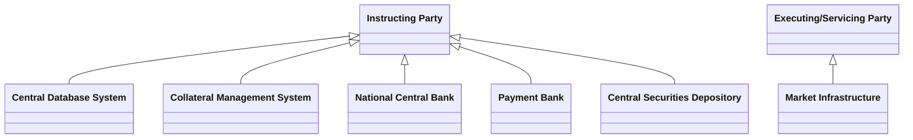

# Cash account business-role context

## Source evidence

[src-000350](../../../../../../../../evidence/omitted/e6546c5f64c53f963440988a.md) archive member `ISO20022_MDR_Target2Securities_August_2026_v1/Target2-Securities_CashAccountQueryAndReport_MessageSet/ISO20022_MDRPart1_Target2Securities_CashAccountQueryAndReport_v2.docx`; BusinessRoles and Participants; direct-body paragraph P113; word/media/image1.emf. [Unchanged original figure](../../../../../../../../evidence/omitted/2888269d929adf64b9c55541.md).

[Complete source figure](../../../../../../../../evidence/omitted/c06d7b41c7586798f7cad28e.md)

## Mermaid reconstruction

## Roles, activities and alternatives

Five hollow-triangle connections point toward Instructing Party from Central Database System, Collateral Management System, National Central Bank, Payment Bank and Central Securities Depository. Market Infrastructure points with the same hollow-triangle notation toward Executing/Servicing Party. Native class notation preserves the source arrowheads; it does not turn these contextual functional roles into institution identities or a validated ontology. T5 defines functional participants; T7 instead maps Account Servicer/Owner columns and omits Central Database System. Both source vocabularies and the unresolved correspondence are retained under issue-000038.

| Source-scoped role | Canonical reference |
| --- | --- |
| instructing party | [instructing party](../../../../../../../../shared/reference/participants/participant-src-000350-instructing-party.md) |
| executing servicing party | [executing servicing party](../../../../../../../../shared/reference/participants/participant-src-000350-executing-servicing-party.md) |
| central database system | [central database system](../../../../../../../../shared/reference/participants/participant-src-000350-central-database-system.md) |
| collateral management system | [collateral management system](../../../../../../../../shared/reference/participants/participant-src-000350-collateral-management-system.md) |
| national central bank | [national central bank](../../../../../../../../shared/reference/participants/participant-src-000350-national-central-bank.md) |
| payment bank | [payment bank](../../../../../../../../shared/reference/participants/participant-src-000350-payment-bank.md) |
| central securities depository csd | [central securities depository csd](../../../../../../../../shared/reference/participants/participant-src-000350-central-securities-depository-csd.md) |
| market infrastructure | [market infrastructure](../../../../../../../../shared/reference/participants/participant-src-000350-market-infrastructure.md) |
| account servicer | [account servicer](../../../../../../../../shared/reference/participants/participant-src-000350-account-servicer.md) |
| account owner | [account owner](../../../../../../../../shared/reference/participants/participant-src-000350-account-owner.md) |

Source responsibilities/conditions: [T5](../../documents/src-000350/tables/tbl-0005.md), [T6](../../documents/src-000350/tables/tbl-0006.md), [T7](../../documents/src-000350/tables/tbl-0007.md).

## Review evidence

Opened full original EMF preview and rendered reconstruction. Compared actor/lane labels, hollow triangle endpoints in role overview, process/action labels, complete arrow order and direction, solid/dashed error response distinction, lifecycle paths and source labels. The source activity request scope exclusion and alternative responses are documented without adding messages. Visual correspondence passes, but role-matrix vocabulary conflict remains issue-000038 and prevents reviewed page status. Mermaid12.3.0 / Chromium156.0.8078.81; visual comparison2026-11-09 Europe/Warsaw.

[Compared reconstruction](../../../../../../../../evidence/omitted/78846ebb73f1512c9f994f51.md). [Unchanged native assets and provenance](../../documents/src-000350/native-embeddings.md). Hidden native layers remain outside this visible-artwork review.
