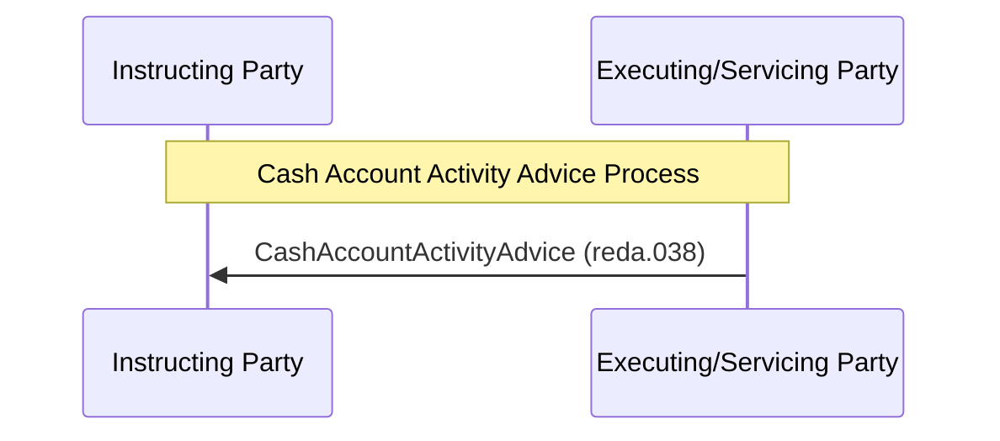

# Cash account activity advice push sequence

## Source evidence

[src-000350](../../../../../../../../evidence/omitted/e6546c5f64c53f963440988a.md) archive member `ISO20022_MDR_Target2Securities_August_2026_v1/Target2-Securities_CashAccountQueryAndReport_MessageSet/ISO20022_MDRPart1_Target2Securities_CashAccountQueryAndReport_v2.docx`; BusinessTransactions / Query/Response Process / Cash Account Activity Advice Process; direct-body paragraph P162; word/media/image10.emf. [Unchanged original figure](../../../../../../../../evidence/omitted/d05329eed29fb3b1439d24ea.md).

[Complete source figure](../../../../../../../../evidence/omitted/29dbc5f5cc6f71b3c5e7e125.md)

## Mermaid reconstruction

## Roles, activities and alternatives

Executing/Servicing Party unilaterally sends CashAccountActivityAdvice to Instructing Party. P164 specifies changes to cash-account reference data during the business day. P91-P95 includes creation, modification and deletion, with advice elements varying by requestor scope and delivery to subscribers. Recipient Party in T10 is also linked as a contextual narrative role; no extra sender or request exchange is added.

| Source-scoped role | Canonical reference |
| --- | --- |
| instructing party | [instructing party](../../../../../../../../shared/reference/participants/participant-src-000350-instructing-party.md) |
| executing servicing party | [executing servicing party](../../../../../../../../shared/reference/participants/participant-src-000350-executing-servicing-party.md) |
| recipient party | [recipient party](../../../../../../../../shared/reference/participants/participant-src-000350-recipient-party.md) |

Source responsibilities/conditions: [T10](../../documents/src-000350/tables/tbl-0010.md), [T13](../../documents/src-000350/tables/tbl-0013.md).

## Exact message evidence

| Source family | Exact supplied definition | Companion MDR Part2 locator |
| --- | --- | --- |
| reda.038 | [reda.038.001.01](../../../../../messages/reda.038.001.01/index.md) | src-000351; 4 reda.038.001.01 CashAccountActivityAdviceV01; file pages108-112 |

Reusable flows: [Cash Account Activity Advice Process](../../flows/flow-src-000350-p161-cash-account-activity-advice-process.md).

## Review evidence

Opened full original EMF preview and rendered reconstruction. Compared actor/lane labels, hollow triangle endpoints in role overview, process/action labels, complete arrow order and direction, solid/dashed error response distinction, lifecycle paths and source labels. The source activity request scope exclusion and alternative responses are documented without adding messages. Mermaid12.3.0 / Chromium156.0.8078.81; visual comparison2026-11-09 Europe/Warsaw.

[Compared reconstruction](../../../../../../../../evidence/omitted/d33529bd86b64cc6b82a39fb.md). [Unchanged native assets and provenance](../../documents/src-000350/native-embeddings.md). Hidden native layers remain outside this visible-artwork review.
