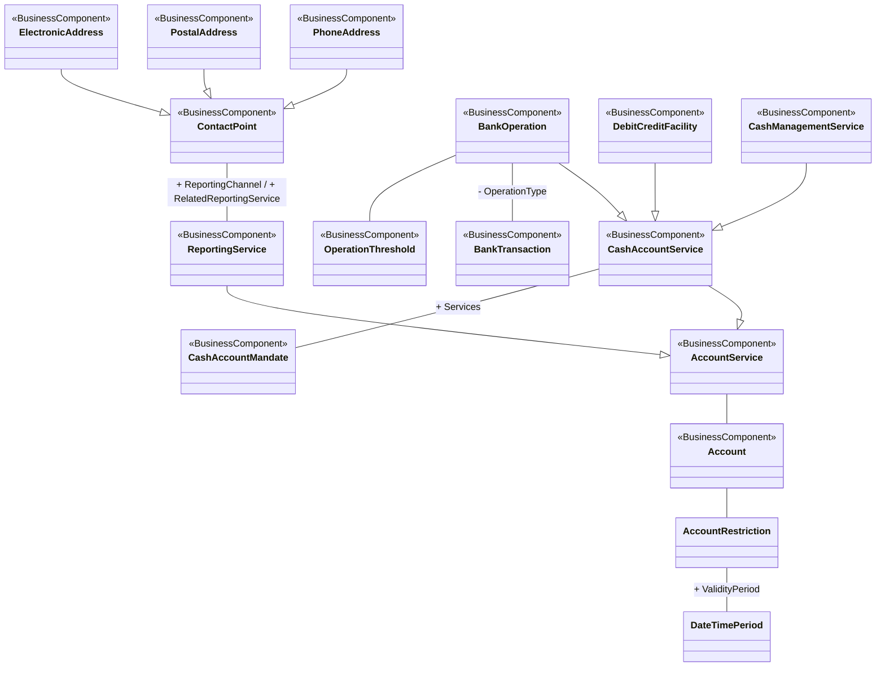

# T2S cash-account management conceptual model

[src-000352](../../../../../../../../../evidence/omitted/e6546c5f64c53f963440988a.md) archive member `ISO20022_MDR_Target2Securities_August_2026_v1/Target2-Securities_CashAccountQueryAndReport_MessageSet/ISO20022_MDRPart3_Target2Securities_CashAccountQueryAndReport_v1.xlsx`, T2S - Cash Account Management!A1:AI29; xl/drawings/drawing2.xml; anchor 1. Original image SHA-256: 5cbb3b107b27eb9d4a49345b7b00e0db09020422bb2c98ec727b3dfad6bcc699.

[Original complete figure](../../../../../../../../../evidence/omitted/0692926533635ab1e74a5182.md) · [Rendered Mermaid SVG](../../../../../../../../../evidence/omitted/b7d8ed238bceefe201e85f16.md) · [Rendered Mermaid PNG](../../../../../../../../../evidence/omitted/553d5c548adce51e46340c9a.md)

## Source reconstruction

## Entities and relationships

Cash-account and reporting services specialize account service. Cash-account service further generalizes bank operation, debit/credit facility and cash-management service; it connects mandate, while bank operation connects bank transaction and threshold. Contact-point channels specialize into phone, postal and electronic addresses. Account restriction connects a validity period. The displaced ReportingChannel/RelatedReportingService labels are attached to the ContactPoint–ReportingService association, independently confirmed by FullBusinessModel!A1000:F1000 and A3799:F3799. No message direction is implied.

All 16 visible node occurrences and 15 relationship lines are retained. No numeric multiplicity is shown in this source view, so none is inferred. Printed package labels and absent labels are preserved in the entity register; the reconstruction adds no package boundaries absent from the source. Association labels retain literal +/− prefixes and combined end names. Their re-layout position is not additional navigability evidence. The native class inheritance marker is reserved for the source’s hollow-triangle generalizations. Source editor/navigation icons are omitted as interface decoration; no business entity or relationship is excluded.

## Complete relationship register

| From node | To node | Source relationship kind | Visible source label(s) | From-end multiplicity | To-end multiplicity |
| --- | --- | --- | --- | --- | --- |
| AccountService | Account | association | (unlabelled in source) | not printed | not printed |
| Account | AccountRestriction | association | (unlabelled in source) | not printed | not printed |
| AccountRestriction | DateTimePeriod | association | + ValidityPeriod | not printed | not printed |
| ReportingService | AccountService | generalization: subtype to supertype | (unlabelled in source) | not printed | not printed |
| CashAccountService | AccountService | generalization: subtype to supertype | (unlabelled in source) | not printed | not printed |
| ContactPoint | ReportingService | association | + ReportingChannel / + RelatedReportingService | not printed | not printed |
| PhoneAddress | ContactPoint | generalization: subtype to supertype | (unlabelled in source) | not printed | not printed |
| PostalAddress | ContactPoint | generalization: subtype to supertype | (unlabelled in source) | not printed | not printed |
| ElectronicAddress | ContactPoint | generalization: subtype to supertype | (unlabelled in source) | not printed | not printed |
| BankOperation | CashAccountService | generalization: subtype to supertype | (unlabelled in source) | not printed | not printed |
| DebitCreditFacility | CashAccountService | generalization: subtype to supertype | (unlabelled in source) | not printed | not printed |
| CashManagementService | CashAccountService | generalization: subtype to supertype | (unlabelled in source) | not printed | not printed |
| CashAccountService | CashAccountMandate | association | + Services | not printed | not printed |
| BankOperation | BankTransaction | association | - OperationType | not printed | not printed |
| BankOperation | OperationThreshold | association | (unlabelled in source) | not printed | not printed |

## Entity definitions and precise workbook locators

| Visible label | Source package / stereotype | Definition evidence |
| --- | --- | --- |
| AccountService | DICO_BusinessComponents / BusinessComponent | [FullBusinessModel!A103:D103](../sheets/02-fullbusinessmodel/tbl-0002.md) — Services linked to an account which are available to the account owner or to the holder of a mandate. |
| Account | not printed in figure / BusinessComponent | [FullBusinessModel!A24:D24](../sheets/02-fullbusinessmodel/tbl-0002.md) — Record of transactions in specific types of assets, maintained by a servicing party on behalf of one or more owning parties. Business relationship between an account servicer and one or more account owners. |
| AccountRestriction | DICO_BusinessComponents / (stereotype not printed) | [FullBusinessModel!A99:D99](../sheets/02-fullbusinessmodel/tbl-0002.md) — Restriction on capability or operations allowed. |
| DateTimePeriod | DICO_BusinessComponentsDataTypes / (stereotype not printed) | [FullBusinessModel!A1363:D1363](../sheets/02-fullbusinessmodel/tbl-0008.md) — Time span defined by a start date and time, and an end date and time. |
| ReportingService | DICO_BusinessComponents / BusinessComponent | [FullBusinessModel!A3795:D3795](../sheets/02-fullbusinessmodel/tbl-0020.md) — Specifies the reporting parameters that are included in the account contract which specifies the services linked to the account.. |
| CashAccountService | DICO_BusinessComponents / BusinessComponent | [FullBusinessModel!A601:D601](../sheets/02-fullbusinessmodel/tbl-0004.md) — Services linked to an account which are available to the account owner or to the holder of a mandate. The exercise of these services may be submitted to a limit. |
| CashAccountMandate | not printed in figure / BusinessComponent | [FullBusinessModel!A598:D598](../sheets/02-fullbusinessmodel/tbl-0004.md) — Authorisation given to a mandate holder to perform some operation on an account. |
| ContactPoint | DICO_BusinessComponents / BusinessComponent | [FullBusinessModel!A994:D994](../sheets/02-fullbusinessmodel/tbl-0006.md) — Number, physical or virtual address, used for communication. |
| PhoneAddress | DICO_BusinessComponents / BusinessComponent | [FullBusinessModel!A3329:D3329](../sheets/02-fullbusinessmodel/tbl-0018.md) — Collection of information that identifies a phone address. |
| PostalAddress | DICO_BusinessComponents / BusinessComponent | [FullBusinessModel!A3441:D3441](../sheets/02-fullbusinessmodel/tbl-0019.md) — Information that locates and identifies a specific address. |
| ElectronicAddress | DICO_BusinessComponents / BusinessComponent | [FullBusinessModel!A1746:D1746](../sheets/02-fullbusinessmodel/tbl-0010.md) — Address which is accessed by electronic means. |
| BankOperation | DICO_BusinessComponents / BusinessComponent | [FullBusinessModel!A368:D368](../sheets/02-fullbusinessmodel/tbl-0003.md) — Operation on a bank account. It may be limited in time, amount or type of operation. |
| DebitCreditFacility | DICO_BusinessComponents / BusinessComponent | [FullBusinessModel!A1447:D1447](../sheets/02-fullbusinessmodel/tbl-0009.md) — Specifies the conditions for overdraft on the account or for positive amounts. |
| CashManagementService | DICO_BusinessComponents / BusinessComponent | [FullBusinessModel!A696:D696](../sheets/02-fullbusinessmodel/tbl-0005.md) — Set of applications that provides services which facilitate the management of cash positions on an account. |
| BankTransaction | DICO_BusinessComponents / BusinessComponent | [FullBusinessModel!A372:D372](../sheets/02-fullbusinessmodel/tbl-0003.md) — Code of the underlying bank transaction. |
| OperationThreshold | not printed in figure / BusinessComponent | [FullBusinessModel!A2920:D2920](../sheets/02-fullbusinessmodel/tbl-0016.md) — Threshold related to a bank account operation. |

## Participant and flow navigation

This is a conceptual entity model, not a message exchange diagram. A business component or relationship label is not automatically a functional participant or institution. [Message-set participant references](../../../participants.md) and [Message-set business flows](../../../flows/index.md) provide the independently sourced actor/process context. These references are navigational; source figure associations do not establish message direction.

## Rendering and visual review

2026-11-09: Mermaid 12.3.0 parsed and rendered successfully with Mermaid browser API + Chromium 156.0.8078.81. Compared complete source artwork against the final rendered Mermaid PNG; all visible entities, relationship lines, literal labels, printed stereotypes and any package labels reconciled. Inheritance triangles, association arrows and composition diamonds preserve source endpoint direction. No absent numerical multiplicity is inferred. Reporting-channel endpoint labels independently checked against FullBusinessModel A1000:F1000 and A3799:F3799. [Renderer evidence](../../../../../../../../../work/t2s-workbook-models/render-report.json).

