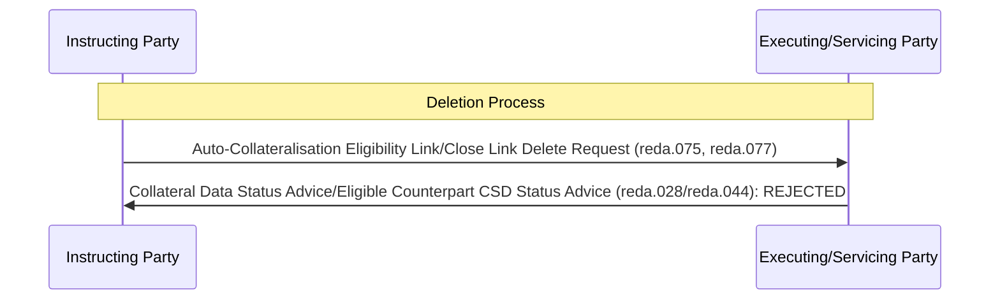

# Collateral-reference deletion rejected

## Source evidence

[src-000353](../../../../../../../../evidence/omitted/e6546c5f64c53f963440988a.md) archive member `ISO20022_MDR_Target2Securities_August_2026_v1/Target2-Securities_CollateralManagementReferenceData_MessageSet/ISO20022_MDRPart1_Target2Securities_CollateralManagementReferenceData_v2.docx`; BusinessTransactions / Collateral Reference Data deletion / Rejection Scenario; direct-body paragraph P163; Word file/printed page 19. [Unchanged original figure](../../../../../../../../evidence/omitted/417ec96cdd9728e2df1f57fb.md).

[Complete source figure](../../../../../../../../evidence/omitted/7191cd6fa2dae4f368a9dbe1.md)

## Mermaid reconstruction

## Roles, activities and alternatives

The Instructing Party sends a deletion instruction for an existing auto-collateralisation eligibility link or close link. The Executing/Servicing Party returns REJECTED and identifies the reference data rejected. Request items are alternatives within the combined source label, not a requirement to send all request messages. The source response label includes reda.044, but P80 associates deletion075/077 with reda.028 while P82 associates reda.044 with creation026. The original label is retained under issue-000043; reda.044 is recorded as a disputed source assertion rather than a confirmed deletion-response mapping.

| Source-scoped role | Canonical reference |
| --- | --- |
| instructing party | [instructing party](../../../../../../../../shared/reference/participants/participant-src-000353-instructing-party.md) |
| executing servicing party | [executing servicing party](../../../../../../../../shared/reference/participants/participant-src-000353-executing-servicing-party.md) |

## Exact message evidence

| Source family | Exact supplied definition | Companion MDR Part2 locator |
| --- | --- | --- |
| reda.028 | [reda.028.001.01](../../../../../messages/reda.028.001.01/index.md) | src-000354; 6 reda.028.001.01 CollateralDataStatusAdviceV01; file pages36-45 |
| reda.075 | [reda.075.001.01](../../../../../messages/reda.075.001.01/index.md) | src-000354; 8 reda.075.001.01 EligibleSecuritiesDeletionRequestV01; file pages51-56 |
| reda.077 | [reda.077.001.01](../../../../../messages/reda.077.001.01/index.md) | src-000354; 9 reda.077.001.01 CloseLinkDeletionRequestV01; file pages57-62 |

Reusable flows: [Rejection Scenario](../../flows/flow-src-000353-p160-rejection-scenario.md).

## Review evidence

Opened complete source artwork and rendered reconstruction; compared every role/lane label, arrow direction and endpoint, six overview activities, accepted/rejected choices, dashed retry loop, status labels and exact family strings where present. The four composite sequences were compared with complete Word file/printed pages16-19, including all multi-object labels. Visible correspondence passes; source inconsistency issue-000043 remains unresolved, so reviewed page status is withheld. Mermaid12.3.0 / Chromium156.0.8078.81; visual comparison2026-11-09 Europe/Warsaw.

[Compared reconstruction](../../../../../../../../evidence/omitted/b7bc8f083609b1bf06704582.md).
