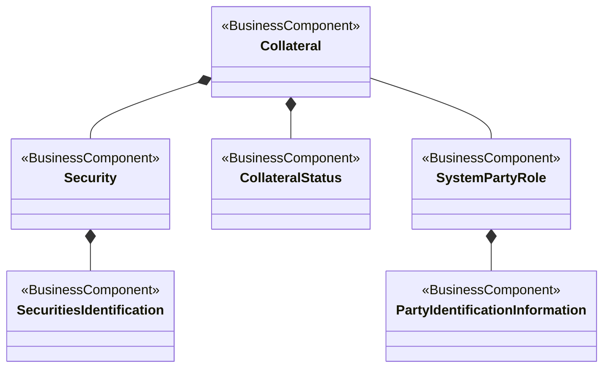

# T2S collateral-management reference-data conceptual model

[src-000355](../../../../../../../../../evidence/omitted/e6546c5f64c53f963440988a.md) archive member `ISO20022_MDR_Target2Securities_August_2026_v1/Target2-Securities_CollateralManagementReferenceData_MessageSet/ISO20022_MDRPart3_Target2Securities_CollateralManagementReferenceData_v1.xlsx`, T2S - Collateral Management Ref!A1:K20; xl/drawings/drawing2.xml; anchor 1. Original image SHA-256: 8b8b3288acc44d96aa377257c3c13f6b52b0eeb9167cd92ba3f6af676c13965b.

[Original complete figure](../../../../../../../../../evidence/omitted/b135116d50da8214c99b3ca5.md) · [Rendered Mermaid SVG](../../../../../../../../../evidence/omitted/a24e2a5770fee43ec49d30f4.md) · [Rendered Mermaid PNG](../../../../../../../../../evidence/omitted/565f1365340e1a2e1d54145f.md)

## Source reconstruction

## Entities and relationships

Filled diamonds are retained at the source owner ends: Collateral composes Security and CollateralStatus; Security composes SecuritiesIdentification; SystemPartyRole composes PartyIdentificationInformation. Collateral and SystemPartyRole have a plain association. This records the supplied conceptual notation, without turning composition into database keys, XML containment or institutional ownership.

All 6 visible node occurrences and 5 relationship lines are retained. No numeric multiplicity is shown in this source view, so none is inferred. Printed package labels and absent labels are preserved in the entity register; the reconstruction adds no package boundaries absent from the source. Association labels retain literal +/− prefixes and combined end names. Their re-layout position is not additional navigability evidence. The native class inheritance marker is reserved for the source’s hollow-triangle generalizations. Source editor/navigation icons are omitted as interface decoration; no business entity or relationship is excluded.

## Complete relationship register

| From node | To node | Source relationship kind | Visible source label(s) | From-end multiplicity | To-end multiplicity |
| --- | --- | --- | --- | --- | --- |
| Collateral | Security | composition at from node | (unlabelled in source) | not printed | not printed |
| Collateral | CollateralStatus | composition at from node | (unlabelled in source) | not printed | not printed |
| Collateral | SystemPartyRole | association | (unlabelled in source) | not printed | not printed |
| SystemPartyRole | PartyIdentificationInformation | composition at from node | (unlabelled in source) | not printed | not printed |
| Security | SecuritiesIdentification | composition at from node | (unlabelled in source) | not printed | not printed |

## Entity definitions and precise workbook locators

| Visible label | Source package / stereotype | Definition evidence |
| --- | --- | --- |
| Collateral | not printed in figure / BusinessComponent | [FullBusinessModel!A816:D816](../sheets/02-fullbusinessmodel/tbl-0006.md) — Assets pledged by a debtor to secure a loan or an exposure and subject to seizure in the event of default. |
| Security | not printed in figure / BusinessComponent | [FullBusinessModel!A4563:D4563](../sheets/02-fullbusinessmodel/tbl-0024.md) — Financial instruments representing a sum of rights of the investor vis-a-vis the issuer. |
| CollateralStatus | not printed in figure / BusinessComponent | [FullBusinessModel!A892:D892](../sheets/02-fullbusinessmodel/tbl-0006.md) — Specifies the status of the collateral or of an event related to collateral. |
| SystemPartyRole | not printed in figure / BusinessComponent | [FullBusinessModel!A4862:D4862](../sheets/02-fullbusinessmodel/tbl-0026.md) — Role played by a party in a system. |
| SecuritiesIdentification | not printed in figure / BusinessComponent | [FullBusinessModel!A3975:D3975](../sheets/02-fullbusinessmodel/tbl-0021.md) — Unique and unambiguous identifier of a security, assigned under a formal or proprietary identification scheme. |
| PartyIdentificationInformation | not printed in figure / BusinessComponent | [FullBusinessModel!A2983:D2983](../sheets/02-fullbusinessmodel/tbl-0016.md) — Unique and unambiguous way to identify a party |

## Participant and flow navigation

This is a conceptual entity model, not a message exchange diagram. A business component or relationship label is not automatically a functional participant or institution. [Message-set participant references](../../../participants.md) and [Message-set business flows](../../../flows/index.md) provide the independently sourced actor/process context. These references are navigational; source figure associations do not establish message direction.

## Rendering and visual review

2026-11-09: Mermaid 12.3.0 parsed and rendered successfully with Mermaid browser API + Chromium 156.0.8078.81. Compared complete source artwork against the final rendered Mermaid PNG; all visible entities, relationship lines, literal labels, printed stereotypes and any package labels reconciled. Inheritance triangles, association arrows and composition diamonds preserve source endpoint direction. No absent numerical multiplicity is inferred. [Renderer evidence](../../../../../../../../../work/t2s-workbook-models/render-report.json).

