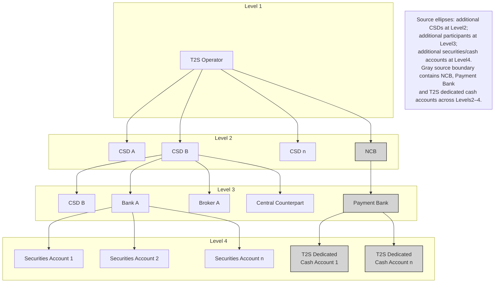

# T2S hierarchy of roles and access rights

## Source evidence

[src-000356](../../../../../../../../evidence/omitted/e6546c5f64c53f963440988a.md) archive member `ISO20022_MDR_Target2Securities_August_2026_v1/Target2-Securities_CollateralReporting_MessageSet/ISO20022_MDRPart1_Target2Securities_CollateralReporting_2023_2024_v2.docx`; BusinessRoles and Participants; direct-body paragraph P108; word/media/image1.wmf. [Unchanged original figure](../../../../../../../../evidence/omitted/7b347e9622ee3dbc1ae34492.md).

[Complete source figure](../../../../../../../../evidence/omitted/faccc3a850e9d0f64f1e01d6.md)

## Mermaid reconstruction

## Roles, activities and alternatives

This is a four-level role/access-rights hierarchy, not legal ownership or schema containment. T2S Operator has links to CSD A, CSD B, CSD n and NCB. The level2 CSD B links to a separate level3 CSD B instance, Bank A, Broker A and Central Counterpart. Bank A links to Securities Accounts1,2,n. NCB links to Payment Bank, which links to Dedicated Cash Accounts1,n. Source ellipses retain open-ended series, not numerical multiplicities. P110 says the gray area is dedicated-cash-account static data; an NCB acting as home-country CSD and providing dedicated accounts exists in both CSD and NCB roles. The reconstruction shades the four relevant node classes and explicitly documents the cross-level gray boundary; the original retains its exact enclosure.

| Source-scoped role | Canonical reference |
| --- | --- |
| t2s operator | [t2s operator](../../../../../../../../shared/reference/participants/participant-src-000356-t2s-operator.md) |
| central securities depositories csd | [central securities depositories csd](../../../../../../../../shared/reference/participants/participant-src-000356-central-securities-depositories-csd.md) |
| national central bank ncb | [national central bank ncb](../../../../../../../../shared/reference/participants/participant-src-000356-national-central-bank-ncb.md) |
| payment bank | [payment bank](../../../../../../../../shared/reference/participants/participant-src-000356-payment-bank.md) |
| bank example | [bank example](../../../../../../../../shared/reference/participants/participant-src-000356-bank-example.md) |
| broker example | [broker example](../../../../../../../../shared/reference/participants/participant-src-000356-broker-example.md) |
| central counterpart | [central counterpart](../../../../../../../../shared/reference/participants/participant-src-000356-central-counterpart.md) |

Source responsibilities/conditions: [T6](../../documents/src-000356/tables/tbl-0006.md), [T7](../../documents/src-000356/tables/tbl-0007.md).

## Review evidence

Compared the complete source artwork, its complete Word-rendered page and the Mermaid reconstruction. Checked all hierarchy levels and14 links, the six query categories and25 leaf labels, SD/DD common-store connections, all three success/failure checks, actor lanes, query/response directions and mutually exclusive rejection/execution paths where applicable. The long taxonomy was additionally compared in three readable focused views. Source geometry and rendering conventions remain documented as presentation limitations. Mermaid12.3.0 / Chromium156.0.8078.81; visual comparison2026-11-09 Europe/Warsaw.

[Compared reconstruction](../../../../../../../../evidence/omitted/237d1541a860d530c5ac79d7.md); [Complete Word page9](../../../../../../../../evidence/omitted/786c32d282c15db4b1d7dccc.md).
