# Central-system query taxonomy and communication modes

## Source evidence

[src-000356](../../../../../../../../evidence/omitted/e6546c5f64c53f963440988a.md) archive member `ISO20022_MDR_Target2Securities_August_2026_v1/Target2-Securities_CollateralReporting_MessageSet/ISO20022_MDRPart1_Target2Securities_CollateralReporting_2023_2024_v2.docx`; BusinessProcess Description / BusinessProcess Diagram; direct-body paragraph P130; word/media/image2.png. [Unchanged original figure](../../../../../../../../evidence/omitted/dba44d7482ed3e96fd408d58.md).

[Complete source figure](../../../../../../../../evidence/omitted/dba44d7482ed3e96fd408d58.md)

## Mermaid reconstruction

```mermaid
flowchart TB
 Q["Queries"] --> U["U2A"]
 Q --> A["A2A"]
 U --- Modes((" "))
 A --- Modes
 Modes --> C["CSDs"]
 Modes --> S["Settlement Banks"]
 Modes --> P["Payment Banks"]
 Modes --> N["NCBs"]
 C --- Actors((" "))
 S --- Actors
 P --- Actors
 N --- Actors
 Actors --> Ins["Instructions"]
 Actors --> Sec["Security account"]
 Actors --> Cash["Cash account"]
 Actors --> Day["Settlement day"]
 Actors --> Dyn["Dynamic data queries"]
 Actors --> Static["Static data"]
 Ins --> Ins0["Settlement Instruction"]
 Ins --> Ins1["Settlement Instruction Current Status"]
 Ins --> Ins2["Settlement Instruction Status Audit Trail"]
 Ins --> Ins3["Settlement Instruction Audit Trail"]
 Ins --> Ins4["Settlement Transaction"]
 Sec --> Sec0["Security Account Position"]
 Sec --> Sec1["Security Account Position History"]
 Cash --> Cash0["T2S Dedicated Cash Account Balance"]
 Cash --> Cash1["T2S Dedicated Cash Account Posting Query"]
 Cash --> Cash2["Outstanding Auto-Collateralisation Credit"]
 Cash --> Cash3["Overall Liquidity"]
 Cash --> Cash4["Cash Forecast"]
 Cash --> Cash5["Limit"]
 Cash --> Cash6["Immediate Liquidity Transfer Order List Query"]
 Cash --> Cash7["Limit Utilisation Journal"]
 Cash --> Cash8["Limit Utilisation"]
 Cash --> Cash9["Total Collateral Value"]
 Cash --> Cash10["Collateral Value per Cash Account"]
 Cash --> Cash11["Collateral Value of a Security"]
 Cash --> Cash12["Cash Account List"]
 Cash --> Cash13["Immediate Liquidity Transfer Order Detail Query"]
 Day --> Day0["T2S Calendar"]
 Day --> Day1["T2S Diary"]
 Dyn --> Dyn0["Report"]
 Static --> Static0["Several queries available (e.g. Liquidity Transfer Orders and Liquidity Transfer Order Link Set)"]
 style Modes fill:none,stroke:none
 style Actors fill:none,stroke:none
```

## Roles, activities and alternatives

The source is a query taxonomy rather than a use-case diagram: rectangular categories and directed branches, no actor/use-case ellipses or include/extend relationships. Queries branch to U2A and A2A; a shared connector reaches CSDs, Settlement Banks, Payment Banks and NCBs; another shared connector reaches six categories. The categories have5 instruction queries,2 securities-account queries,14 cash-account queries,2 settlement-day queries,1 dynamic report query and1 static-data example box. In the source, the fourteen cash queries connect outward from a common vertical trunk; adjacent left/right boxes are not bidirectional messages to each other. Invisible connector cues retain those shared trunks without adding actions. P121-P129 restrict every query and returned data to actor roles, privileges and access rights; this taxonomy is not blanket authorisation. U2A/A2A definitions are retained in T2.

| Source-scoped role | Canonical reference |
| --- | --- |
| central system | [central system](../../../../../../../../shared/reference/participants/participant-src-000356-central-system.md) |
| system user | [system user](../../../../../../../../shared/reference/participants/participant-src-000356-system-user.md) |
| central securities depositories csd | [central securities depositories csd](../../../../../../../../shared/reference/participants/participant-src-000356-central-securities-depositories-csd.md) |
| settlement bank | [settlement bank](../../../../../../../../shared/reference/participants/participant-src-000356-settlement-bank.md) |
| payment bank | [payment bank](../../../../../../../../shared/reference/participants/participant-src-000356-payment-bank.md) |
| national central bank ncb | [national central bank ncb](../../../../../../../../shared/reference/participants/participant-src-000356-national-central-bank-ncb.md) |

Source responsibilities/conditions: [T2](../../documents/src-000356/tables/tbl-0002.md).

## Review evidence

Compared the complete source artwork, its complete Word-rendered page and the Mermaid reconstruction. Checked all hierarchy levels and14 links, the six query categories and25 leaf labels, SD/DD common-store connections, all three success/failure checks, actor lanes, query/response directions and mutually exclusive rejection/execution paths where applicable. The long taxonomy was additionally compared in three readable focused views. Source geometry and rendering conventions remain documented as presentation limitations. Mermaid12.3.0 / Chromium156.0.8078.81; visual comparison2026-11-09 Europe/Warsaw.

[Compared reconstruction](../../../../../../../../evidence/omitted/1b6e6c782d044c3595a38fc0.md); [Complete Word page13](../../../../../../../../evidence/omitted/23b657e0511222f15dd5a66f.md).

## Focused taxonomy views

- [Modes, actors and six query categories](fig-0002-overview.md)
- [Fourteen cash-account queries](fig-0002-cash.md)
- [Other query-category detail](fig-0002-other.md)

All25 leaf boxes are preserved across the cash-account and other-category details; the complete source and full reconstruction remain above.
