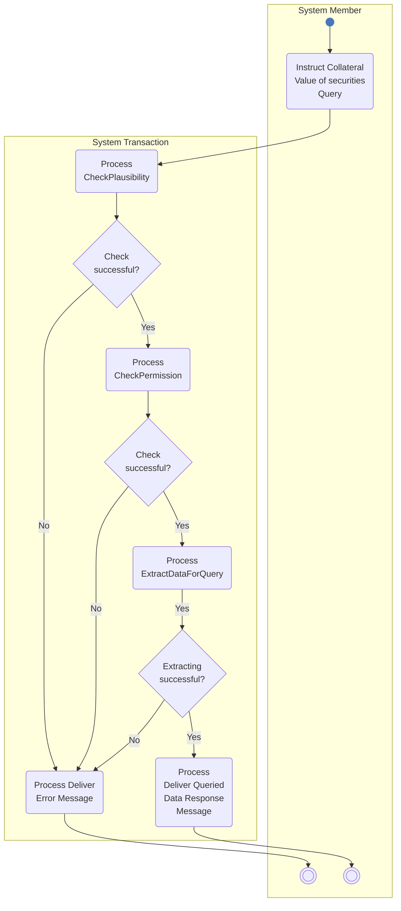

# Collateral-query member and administrator activity

## Source evidence

[src-000356](../../../../../../../../evidence/omitted/e6546c5f64c53f963440988a.md) archive member `ISO20022_MDR_Target2Securities_August_2026_v1/Target2-Securities_CollateralReporting_MessageSet/ISO20022_MDRPart1_Target2Securities_CollateralReporting_2023_2024_v2.docx`; Description of BusinessActivities / Query Management Process; direct-body paragraph P142; word/media/image8.png. [Unchanged original figure](../../../../../../../../evidence/omitted/aacda3ff5f7dab019347f86c.md).

[Complete source figure](../../../../../../../../evidence/omitted/aacda3ff5f7dab019347f86c.md)

## Mermaid reconstruction

## Roles, activities and alternatives

System Member sends the query to System Transaction Administrator. Failure of plausibility, permission or extraction leads to Deliver Error Message and a member end point. All successful checks lead to Deliver Queried Data Response Message and a distinct member end point. The Yes label on the ExtractDataForQuery-to-decision arrow is retained exactly as drawn, in addition to the decision Yes/No labels. T9 lists the same three rejection reasons. P140 maps the instructing party context to direct participant/payment bank/CSD and the executing/receiving role to settlement infrastructure.

| Source-scoped role | Canonical reference |
| --- | --- |
| system member | [system member](../../../../../../../../shared/reference/participants/participant-src-000356-system-member.md) |
| system transaction administrator | [system transaction administrator](../../../../../../../../shared/reference/participants/participant-src-000356-system-transaction-administrator.md) |
| instructing party | [instructing party](../../../../../../../../shared/reference/participants/participant-src-000356-instructing-party.md) |
| executing servicing party | [executing servicing party](../../../../../../../../shared/reference/participants/participant-src-000356-executing-servicing-party.md) |
| settlement infrastructure | [settlement infrastructure](../../../../../../../../shared/reference/participants/participant-src-000356-settlement-infrastructure.md) |
| settlement infrastructure direct participant | [settlement infrastructure direct participant](../../../../../../../../shared/reference/participants/participant-src-000356-settlement-infrastructure-direct-participant.md) |
| payment bank | [payment bank](../../../../../../../../shared/reference/participants/participant-src-000356-payment-bank.md) |
| central securities depositories csd | [central securities depositories csd](../../../../../../../../shared/reference/participants/participant-src-000356-central-securities-depositories-csd.md) |

Source responsibilities/conditions: [T9](../../documents/src-000356/tables/tbl-0009.md).

## Exact message evidence

| Source family | Exact supplied definition | Companion MDR Part2 locator |
| --- | --- | --- |
| colr.001 | [colr.001.001.02](../../../../../messages/colr.001.001.02/index.md) | src-000357; 2 colr.001.001.02 CollateralValueQueryV02; file pages4-15 |
| colr.002 | [colr.002.001.02](../../../../../messages/colr.002.001.02/index.md) | src-000357; 3 colr.002.001.02 CollateralValueReportV02; file pages16-39 |

Reusable flows: [Query Management Process](../../flows/flow-src-000356-p138-query-management-process.md).

## Review evidence

Compared the complete source artwork, its complete Word-rendered page and the Mermaid reconstruction. Checked all hierarchy levels and14 links, the six query categories and25 leaf labels, SD/DD common-store connections, all three success/failure checks, actor lanes, query/response directions and mutually exclusive rejection/execution paths where applicable. The long taxonomy was additionally compared in three readable focused views. Source geometry and rendering conventions remain documented as presentation limitations. Mermaid12.3.0 / Chromium156.0.8078.81; visual comparison2026-11-09 Europe/Warsaw.

[Compared reconstruction](../../../../../../../../evidence/omitted/5c0e4c1a8c0244e9c8099102.md); [Complete Word page16](../../../../../../../../evidence/omitted/c8625c4173cca96aa60b1993.md).
