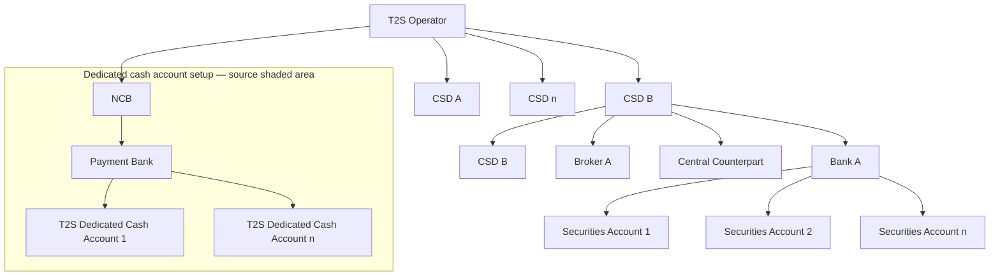

# Hierarchical roles and access-rights context

[src-000359](../../../../../../../../evidence/omitted/e6546c5f64c53f963440988a.md) archive member `ISO20022_MDR_Target2Securities_August_2026_v1/Target2-Securities_IntraBalanceMovement_MessageSet/ISO20022_MDRPart1_Target2Securities_IntraBalanceMovement_2023_2024_v2.docx`; direct-body paragraph P141; BusinessRoles and Participants; Word-derived file page 10.

[Complete source figure / rendered composite](../../../../../../../../evidence/omitted/dc3d44ec3d169a5eb17bb863.md) · [Complete Word-page context](../../../../../../../../evidence/omitted/cbc468294bcfeec8aca76cc5.md)

[Canonical reused artwork and its open contextual review](../../../../../../../../shared/reference/message-sets/t2s-administration/march-2024/diagrams/administration/fig-0001.md)

## Mermaid reconstruction

## Actors, entities and relationships

The reconstruction above retains the source-labelled entities, directed or undirected connectors, decision labels and lane boundaries. Each Mermaid line is the maintained relationship transcription; source activity-table definitions and responsibilities are linked below.

- [Central Counterparty](../../../../../../../../shared/reference/participants/participant-src-000359-central-counterparty.md)
- [Central Securities Depositories (CSD)](../../../../../../../../shared/reference/participants/participant-src-000359-central-securities-depositories-csd.md)
- [National Central Bank (NCB)](../../../../../../../../shared/reference/participants/participant-src-000359-national-central-bank-ncb.md)
- [Payment Bank](../../../../../../../../shared/reference/participants/participant-src-000359-payment-bank.md)
- [T2S operator](../../../../../../../../shared/reference/participants/participant-src-000359-t2s-operator.md)

## Source tables and limitations

- [T5: BusinessRoles and Participants / Participants and BusinessRoles Definitions](../../documents/src-000359/tables/tbl-0005.md)
- [T6: BusinessRoles and Participants / Participants and BusinessRoles Definitions](../../documents/src-000359/tables/tbl-0006.md)
- [T7: BusinessRoles and Participants / BusinessRoles and Participants Table](../../documents/src-000359/tables/tbl-0007.md)

- Source P140 says Collateral Reporting despite this IntraBalanceMovement publication (issue-000047).
- The artwork is byte-identical to source343 figure1; its existing source reconstruction is reused. The source343 canonical context remains needs-review under issue-000039. Disposition is canonical-artwork-reused; contextual-review-open, not deduplicated-to-reviewed.
- P143 defines the grey area as dedicated cash-account static-data setup and explains that an NCB acting as a CSD exists in both roles. Institutions are not collapsed into their contextual role.
- Mermaid flowchart boxes preserve hierarchy and account labels; original grey shading, levels 1–4 and repeated CSD B occurrences remain explicit in the source artwork.

[Source ambiguities: issue-000047](../../../../../../../../tracking/issues.md)

## Review evidence

Transcribed after direct original and complete native-composite inspection. Completed parsing, rendered comparison and whole-page review are recorded below.

<!-- INTRABALANCE-REVIEW-START -->
## Completed rendering and visual comparison

Mermaid browser API + Chromium 156.0.8078.81; Mermaid 12.3.0; 2026-11-09: parsing and rendering **pass**. [Rendered SVG](../../../../../../../../evidence/omitted/7b0caf7b0b8f14550b74df93.md) · [Rendered PNG](../../../../../../../../evidence/omitted/6f30cabdf949eb67aa99ffe0.md).

Original versus Mermaid: literal labels, connector endpoints/direction, decisions, solid/dashed lines, role boundaries and complete Word-page surroundings. Source-text labels clipped by the local Word rendering are explicitly disclosed, not presented as visibly read. Review **pass for extraction fidelity with the stated limitations**. Complete Word file page 10 was inspected; standalone picture reconstructions were also compared against their detailed original previews. Native sequence figures17–24 use the full Word composite, including original drawing text when labels are clipped.

[Hash-bound review and source-object inventory](../../../../../../../../tracking/reviews/intrabalance-diagrams.json). Contextual source ambiguities keep the page needs-review. This does not certify missing business context or hidden native layers.

<!-- INTRABALANCE-REVIEW-END -->
