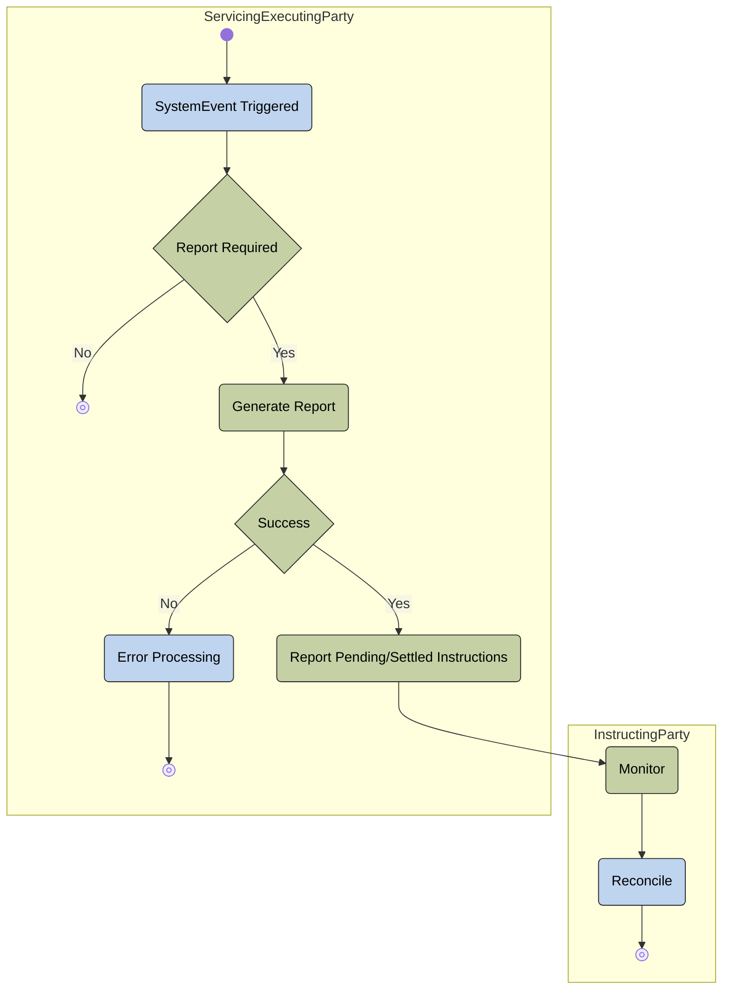

# Pending and posting reporting activity

[src-000359](../../../../../../../../evidence/omitted/e6546c5f64c53f963440988a.md) archive member `ISO20022_MDR_Target2Securities_August_2026_v1/Target2-Securities_IntraBalanceMovement_MessageSet/ISO20022_MDRPart1_Target2Securities_IntraBalanceMovement_2023_2024_v2.docx`; direct-body paragraph P209; Description of BusinessActivities / Intra-Balance Movement Pending/Posting Report Process; Word-derived file page 28.

[Complete source figure / rendered composite](../../../../../../../../evidence/omitted/a6b65a844249973251cc58dc.md) · [Complete Word-page context](../../../../../../../../evidence/omitted/d917c496a75dea7e807e2d33.md)

## Mermaid reconstruction

## Actors, entities and relationships

The reconstruction above retains the source-labelled entities, directed or undirected connectors, decision labels and lane boundaries. Each Mermaid line is the maintained relationship transcription; source activity-table definitions and responsibilities are linked below.

- [Account owner](../../../../../../../../shared/reference/participants/participant-src-000359-account-owner.md)
- [Instructing Party](../../../../../../../../shared/reference/participants/participant-src-000359-instructing-party.md)
- [Servicing/Executing Party](../../../../../../../../shared/reference/participants/participant-src-000359-servicing-executing-party.md)

[Reusable flow: trigger, conditions, responsibilities and narrative](../../flows/flow-src-000359-p208-intra-balance-movement-pending-posting-report-process.md)

## Source tables and limitations

- [T17: BusinessProcess Description / Intra-Balance Management](../../documents/src-000359/tables/tbl-0017.md)
- [T18: BusinessProcess Description / Intra-Balance Management](../../documents/src-000359/tables/tbl-0018.md)
- [T25: Description of BusinessActivities / Intra-Balance Movement Pending/Posting Report Process](../../documents/src-000359/tables/tbl-0025.md)

- T25 Successful Process and Monitor rows refer to Cancellation/Modification Report, despite the pending/posting heading and picture. Those copied labels remain visible as issue-000047.
- T25 jointly names Servicing/Executing Party Instructing Party as event initiator and says Error Processing routes a response; the picture shows the event only in the servicing lane and an error end point.
- Native Mermaid flowchart subgraphs retain source swimlane responsibility. Source start/end glyphs, labelled decisions and bars remain explicit. T19 defines bars as parallel actions; the original uses some bars at converging alternative paths, so no extra execution semantics are inferred.

[Source ambiguities: issue-000047](../../../../../../../../tracking/issues.md)

## Review evidence

Transcribed after direct original and complete native-composite inspection. Completed parsing, rendered comparison and whole-page review are recorded below.

<!-- INTRABALANCE-REVIEW-START -->
## Completed rendering and visual comparison

Mermaid browser API + Chromium 156.0.8078.81; Mermaid 12.3.0; 2026-11-09: parsing and rendering **pass**. [Rendered SVG](../../../../../../../../evidence/omitted/e3972ade5853c4a0aefbd43d.md) · [Rendered PNG](../../../../../../../../evidence/omitted/f6e3f00b9f5472f60e9f6b14.md).

Original versus Mermaid: literal labels, connector endpoints/direction, decisions, solid/dashed lines, role boundaries and complete Word-page surroundings. Source-text labels clipped by the local Word rendering are explicitly disclosed, not presented as visibly read. Review **pass for extraction fidelity with the stated limitations**. Complete Word file page 28 was inspected; standalone picture reconstructions were also compared against their detailed original previews. Native sequence figures17–24 use the full Word composite, including original drawing text when labels are clipped.

[Hash-bound review and source-object inventory](../../../../../../../../tracking/reviews/intrabalance-diagrams.json). Contextual source ambiguities keep the page needs-review. This does not certify missing business context or hidden native layers.

<!-- INTRABALANCE-REVIEW-END -->
