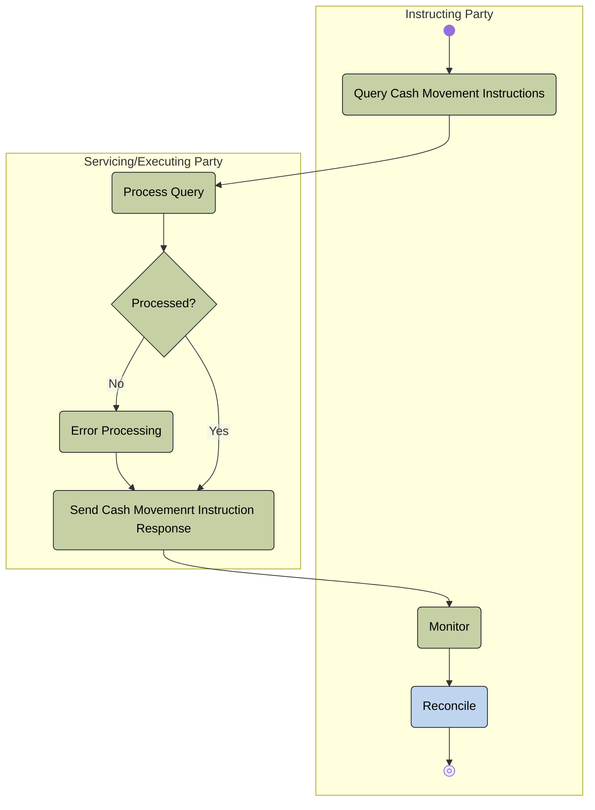

# Movement query and response activity

[src-000359](../../../../../../../../evidence/omitted/e6546c5f64c53f963440988a.md) archive member `ISO20022_MDR_Target2Securities_August_2026_v1/Target2-Securities_IntraBalanceMovement_MessageSet/ISO20022_MDRPart1_Target2Securities_IntraBalanceMovement_2023_2024_v2.docx`; direct-body paragraph P213; Description of BusinessActivities / Intra-Balance Movement Query/Response Process; Word-derived file page 30.

[Complete source figure / rendered composite](../../../../../../../../evidence/omitted/b4202dab33def90c870664c7.md) · [Complete Word-page context](../../../../../../../../evidence/omitted/2e2c731b5938c1f5e95442f7.md)

## Mermaid reconstruction

## Actors, entities and relationships

The reconstruction above retains the source-labelled entities, directed or undirected connectors, decision labels and lane boundaries. Each Mermaid line is the maintained relationship transcription; source activity-table definitions and responsibilities are linked below.

- [Instructing Party](../../../../../../../../shared/reference/participants/participant-src-000359-instructing-party.md)
- [Servicing/Executing Party](../../../../../../../../shared/reference/participants/participant-src-000359-servicing-executing-party.md)

[Reusable flow: trigger, conditions, responsibilities and narrative](../../flows/flow-src-000359-p211-intra-balance-movement-query-response-process.md)

## Source tables and limitations

- [T14: BusinessProcess Description / Intra-Balance Management](../../documents/src-000359/tables/tbl-0014.md)
- [T15: BusinessProcess Description / Intra-Balance Management](../../documents/src-000359/tables/tbl-0015.md)
- [T26: Description of BusinessActivities / Intra-Balance Movement Query/Response Process](../../documents/src-000359/tables/tbl-0026.md)

- The picture prints Movemenrt in the response activity; it is preserved literally. T26 uses Send Intra Balance Movement Report and the transaction sequence uses IntraBalanceMovementQueryResponse. These source labels remain distinct.
- T15 names a system-event trigger while requiring receipt of an incoming query; this wording is retained, without imposing a timing rule beyond the source.
- Native Mermaid flowchart subgraphs retain source swimlane responsibility. Source start/end glyphs, labelled decisions and bars remain explicit. T19 defines bars as parallel actions; the original uses some bars at converging alternative paths, so no extra execution semantics are inferred.

[Source ambiguities: issue-000047](../../../../../../../../tracking/issues.md)

## Review evidence

Transcribed after direct original and complete native-composite inspection. Completed parsing, rendered comparison and whole-page review are recorded below.

<!-- INTRABALANCE-REVIEW-START -->
## Completed rendering and visual comparison

Mermaid browser API + Chromium 156.0.8078.81; Mermaid 12.3.0; 2026-11-09: parsing and rendering **pass**. [Rendered SVG](../../../../../../../../evidence/omitted/7adfd6c54722c76c113168ab.md) · [Rendered PNG](../../../../../../../../evidence/omitted/7207ba753a37de469ea6341d.md).

Original versus Mermaid: literal labels, connector endpoints/direction, decisions, solid/dashed lines, role boundaries and complete Word-page surroundings. Source-text labels clipped by the local Word rendering are explicitly disclosed, not presented as visibly read. Review **pass for extraction fidelity with the stated limitations**. Complete Word file page 30 was inspected; standalone picture reconstructions were also compared against their detailed original previews. Native sequence figures17–24 use the full Word composite, including original drawing text when labels are clipped.

[Hash-bound review and source-object inventory](../../../../../../../../tracking/reviews/intrabalance-diagrams.json). Contextual source ambiguities keep the page needs-review. This does not certify missing business context or hidden native layers.

<!-- INTRABALANCE-REVIEW-END -->
