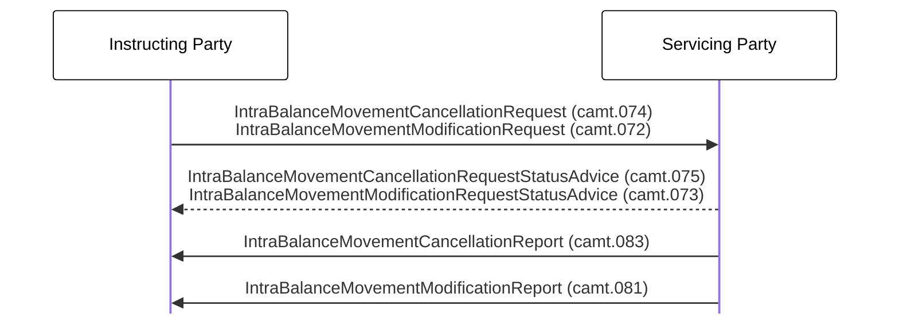

# Event-triggered cancellation and modification reporting

[src-000359](../../../../../../../../evidence/omitted/e6546c5f64c53f963440988a.md) archive member `ISO20022_MDR_Target2Securities_August_2026_v1/Target2-Securities_IntraBalanceMovement_MessageSet/ISO20022_MDRPart1_Target2Securities_IntraBalanceMovement_2023_2024_v2.docx`; direct-body paragraph P284; BusinessTransactions / Intra-Balance Movement Modification/Cancellation Query and Report Process / Producing an Intra Balance Modification/Cancellation Report at a business event.; Word-derived file page 37.

[Complete source figure / rendered composite](../../../../../../../../evidence/omitted/f902773bdfb3939da3049e6f.md) · [Complete Word-page context](../../../../../../../../evidence/omitted/f902773bdfb3939da3049e6f.md)

## Mermaid reconstruction

## Actors, entities and relationships

| Step | Sender | Receiver | Complete source label | Line | Source colour |
| --- | --- | --- | --- | --- | --- |
| 1 | Instructing Party | Servicing Party | IntraBalanceMovementCancellationRequest (camt.074) IntraBalanceMovementModificationRequest (camt.072) | solid | black |
| 2 | Servicing Party | Instructing Party | IntraBalanceMovementCancellationRequestStatusAdvice (camt.075) IntraBalanceMovementModificationRequestStatusAdvice (camt.073) | dashed | black |
| 3 | Servicing Party | Instructing Party | IntraBalanceMovementCancellationReport (camt.083) | solid | green |
| 4 | Servicing Party | Instructing Party | IntraBalanceMovementModificationReport (camt.081) | solid | green |

- [Account owner](../../../../../../../../shared/reference/participants/participant-src-000359-account-owner.md)
- [Instructing Party](../../../../../../../../shared/reference/participants/participant-src-000359-instructing-party.md)
- [Servicing Party](../../../../../../../../shared/reference/participants/participant-src-000359-servicing-party.md)

[Reusable flow: trigger, conditions, responsibilities and narrative](../../flows/flow-src-000359-p282-producing-an-intra-balance-modification-cancellation-report-at-a-busin.md)

## Source tables and limitations

- [T16: BusinessProcess Description / Intra-Balance Management](../../documents/src-000359/tables/tbl-0016.md)
- [T23: Description of BusinessActivities / Intra-Balance Movement Modification/Cancellation Query/Report Process / Push Mode](../../documents/src-000359/tables/tbl-0023.md)

- The complete rendered picture shows one request arrow and one dashed status arrow; the labels cover cancellation/modification variants. Both native source labels are preserved on those shared arrows, without adding unseen connectors. The modification-status label and code suffixes are clipped/overlapped in the local Word view but present at P284 and P291–P292.
- The two report arrows are separate in the source. No query arrow is supplied in this event-triggered scenario.
- Source-native text boxes and connector objects form a complete figure. The retained Word page is the complete composite; the small WMF bank pictograms are not treated as standalone diagrams.
- Solid/dashed connectors and their directions are preserved. Source colours are recorded per message step below; colours distinguish pictured context without asserting extra protocol semantics.
- Native Mermaid boxes replace institutional pictograms; labels define the functional participants and do not bind a role to one institution.

[Source ambiguities: issue-000047](../../../../../../../../tracking/issues.md)

## Review evidence

Transcribed after direct original and complete native-composite inspection. Completed parsing, rendered comparison and whole-page review are recorded below.

<!-- INTRABALANCE-REVIEW-START -->
## Completed rendering and visual comparison

Mermaid browser API + Chromium 156.0.8078.81; Mermaid 12.3.0; 2026-11-09: parsing and rendering **pass**. [Rendered SVG](../../../../../../../../evidence/omitted/4779a435a92abf8440c23415.md) · [Rendered PNG](../../../../../../../../evidence/omitted/94a0270b7e18b2e3f7509d5a.md).

Original versus Mermaid: literal labels, connector endpoints/direction, decisions, solid/dashed lines, role boundaries and complete Word-page surroundings. Source-text labels clipped by the local Word rendering are explicitly disclosed, not presented as visibly read. Review **pass for extraction fidelity with the stated limitations**. Complete Word file page 37 was inspected; standalone picture reconstructions were also compared against their detailed original previews. Native sequence figures17–24 use the full Word composite, including original drawing text when labels are clipped.

[Hash-bound review and source-object inventory](../../../../../../../../tracking/reviews/intrabalance-diagrams.json). Contextual source ambiguities keep the page needs-review. This does not certify missing business context or hidden native layers.

<!-- INTRABALANCE-REVIEW-END -->
