# T2S intra-balance movement conceptual model

[src-000361](../../../../../../../../../evidence/omitted/e6546c5f64c53f963440988a.md) archive member `ISO20022_MDR_Target2Securities_August_2026_v1/Target2-Securities_IntraBalanceMovement_MessageSet/ISO20022_MDRPart3_Target2Securities_IntraBalanceMovement_2023_2024_v1.xlsx`, IntraBalanceMovement!A1:AU49; xl/drawings/drawing2.xml; anchor 1. Original image SHA-256: 83cd2195d2f975d00968c937debb646a4b62ccea9c76e7631d3a147a54cfad0e.

[Original complete figure](../../../../../../../../../evidence/omitted/2504efd21218964832f75766.md) · [Rendered Mermaid SVG](../../../../../../../../../evidence/omitted/32e53a747fc365e87afb5945.md) · [Rendered Mermaid PNG](../../../../../../../../../evidence/omitted/16a44fe96f6632d57576058b.md)

## Source reconstruction

```mermaid
classDiagram
direction TB
class Country["Country"] {
<<BusinessComponent>>
}
class PostalAddress["PostalAddress"] {
<<BusinessComponent>>
}
class DateTimePeriod["DateTimePeriod"] {
<<BusinessComponent>>
}
class Scheme["Scheme"] {
<<BusinessComponent>>
}
class GenericIdentification["GenericIdentification"] {
<<BusinessComponent>>
}
class LotBreakdown["LotBreakdown"] {
<<BusinessComponent>>
}
class SystemPartyRole["SystemPartyRole"] {
<<BusinessComponent>>
}
class System["System"] {
<<BusinessComponent>>
}
class SystemMemberRole["SystemMemberRole"] {
<<BusinessComponent>>
}
class ClearingMemberRole["ClearingMemberRole"] {
<<BusinessComponent>>
}
class CashClearingSystemMember["CashClearingSystemMember"] {
<<BusinessComponent>>
}
class OrganisationIdentification["OrganisationIdentification"] {
<<BusinessComponent>>
}
class Entry["Entry"] {
<<BusinessComponent>>
}
class Account["Account"] {
<<BusinessComponent>>
}
class Balance["Balance"] {
<<BusinessComponent>>
}
class AssetHolding["AssetHolding"] {
<<BusinessComponent>>
}
class BookEntry["BookEntry"] {
<<BusinessComponent>>
}
class CashEntry["CashEntry"] {
<<BusinessComponent>>
}
class CashSettlement["CashSettlement"] {
<<BusinessComponent>>
}
class CashAccount["CashAccount"] {
<<BusinessComponent>>
}
class CashBalance["CashBalance"] {
<<BusinessComponent>>
}
class Payment["Payment"] {
<<BusinessComponent>>
}
class SecuritiesBalance["SecuritiesBalance"] {
<<BusinessComponent>>
}
class SecuritiesQuantity["SecuritiesQuantity"] {
<<BusinessComponent>>
}
class SecuritiesTransfer["SecuritiesTransfer"] {
<<BusinessComponent>>
}
class IntraPositionTransfer["IntraPositionTransfer"] {
<<BusinessComponent>>
}
class ObligationFulfilment["ObligationFulfilment"] {
<<BusinessComponent>>
}
class Obligation["Obligation"] {
<<BusinessComponent>>
}
class Trade["Trade"] {
<<BusinessComponent>>
}
class StatusReason["StatusReason"] {
<<BusinessComponent>>
}
class SecuritiesTradeStatus["SecuritiesTradeStatus"] {
<<BusinessComponent>>
}
class SecuritiesTradeStatusReason["SecuritiesTradeStatusReason"] {
<<BusinessComponent>>
}
class SecuritiesSettlement["SecuritiesSettlement"] {
<<BusinessComponent>>
}
class SecuritiesTrade["SecuritiesTrade"] {
<<BusinessComponent>>
}
class SecuritiesTradeExecution["SecuritiesTradeExecution"] {
<<BusinessComponent>>
}
Country -- PostalAddress : + PostalAddressSpecification
PostalAddress -- DateTimePeriod : - RelatedPostalAddress / + ValidityPeriod
DateTimePeriod -- Scheme : - AssessmentValidityPeriod / + AssessmentValidityScheme
Scheme -- GenericIdentification : + Identification
GenericIdentification -- LotBreakdown : + LotNumber / + IdentificationForLot
DateTimePeriod -- Account : + ReportedPeriod
Account -- System
SystemPartyRole -- System : + PartyRole / + RelatedSystem
SystemMemberRole --|> SystemPartyRole
ClearingMemberRole --|> SystemPartyRole
Account -- SystemMemberRole : - SystemMember
ClearingMemberRole -- CashClearingSystemMember : + ClearingMember / - ClearingSystemMemberIdentification
CashClearingSystemMember -- OrganisationIdentification : + ClearingSystemMemberIdentificationType
Entry -- Account
Entry -- Balance : + BalanceEntry
Account -- Balance
Balance -- AssetHolding
CashEntry --|> Entry
BookEntry -- CashEntry : + RelatedBookEntry / + CashEntry
BookEntry -- CashEntry : + DebitRelatedBookEntry / + DebitEntry
BookEntry -- CashEntry : + CreditRelatedBookEntry / + CreditEntry
BookEntry -- CashSettlement : + RelatedSettlementInstruction
CashSettlement -- CashAccount : + RelatedSettlementInstruction / + SettlementAccount
CashEntry -- CashAccount
CashEntry -- CashBalance : + CashBalanceEntry
CashAccount -- CashBalance
CashAccount -- Payment : - Account
CashBalance --|> Balance
SecuritiesBalance --|> Balance
CashBalance -- SystemMemberRole : + Counterparty
SecuritiesBalance -- SecuritiesQuantity : + AvailableQuantityBalance / + AvailableQuantity
SecuritiesBalance -- SecuritiesQuantity : + AggregateQuantityBalance / - AggregateQuantity
SecuritiesBalance -- SecuritiesQuantity : + RelatedSubBalance / - SubBalanceQuantity
SecuritiesBalance -- IntraPositionTransfer : - RelatedIntraPositionTransfer
IntraPositionTransfer --|> SecuritiesTransfer
SecuritiesTransfer --|> ObligationFulfilment
SecuritiesTransfer -- SecuritiesQuantity : + TransferredQuantity
SecuritiesQuantity -- LotBreakdown
SecuritiesQuantity -- SecuritiesSettlement : - TurnedQuantity / - RelatedTurnaroundSettlement
SecuritiesQuantity -- SecuritiesSettlement : - SettlementQuantity
SecuritiesQuantity -- SecuritiesTradeExecution : - ExecutedTradeQuantity
SecuritiesQuantity -- SecuritiesTrade : + TradeQuantity / + Trade
ObligationFulfilment -- Obligation : + Offset / + ObligationOffset
ObligationFulfilment -- Obligation : - OriginalObligationProcess / + ResultingObligation
Obligation -- Trade
System -- Trade
SecuritiesTrade --|> Trade
SecuritiesTrade -- SecuritiesTradeExecution : + RelatedTrade / + TradingExecution
SecuritiesTradeExecution -- SecuritiesSettlement
SecuritiesTransfer -- SecuritiesSettlement : + TransferOperation / + RelatedSettlement
SecuritiesTransfer -- SecuritiesTradeStatus : - RelatedSecuritiesTransfer / - Status
SecuritiesTradeStatus -- SecuritiesTradeStatusReason : + Reason
SecuritiesTradeStatusReason --|> StatusReason
```

## Entities and relationships

The source connects account balances and entries, cash settlement and payments, securities quantities and transfers, clearing/system membership, trade execution and settlement, obligation fulfilment, status reasons and reference identifiers. Shared visual routes carry multiple separate relationships: three BookEntry–CashEntry associations, three SecuritiesBalance–SecuritiesQuantity associations and two ObligationFulfilment–Obligation associations. Their independence is confirmed by FullBusinessModel rows 2063–2065, 2566/2573/2577 and 1203–1204. CashBalance–SystemMemberRole is the Counterparty association (row 1795); it is not another quantity association. IntraPositionTransfer specializes SecuritiesTransfer and links SecuritiesBalance (rows 2583 and 2992–2995). Turned and settled quantity are distinct links to SecuritiesSettlement. The conceptual source does not order activities or assign message senders.

All 35 visible node occurrences and 53 relationship lines are retained. No numeric multiplicity is shown in this source view, so none is inferred. The source prints no package names or enclosing package boundaries, and none are added. Repeated entity occurrences retain separate diagram IDs but the same visible source label. Association labels retain literal +/− prefixes and combined end names. Their re-layout position is not additional navigability evidence. The native class inheritance marker is reserved for the source’s hollow-triangle generalizations. Source editor/navigation icons are omitted as interface decoration; no business entity or relationship is excluded.

## Complete relationship register

| From node | To node | Source relationship kind | Visible source label(s) | From-end multiplicity | To-end multiplicity |
| --- | --- | --- | --- | --- | --- |
| Country | PostalAddress | association | + PostalAddressSpecification | not printed | not printed |
| PostalAddress | DateTimePeriod | association | - RelatedPostalAddress / + ValidityPeriod | not printed | not printed |
| DateTimePeriod | Scheme | association | - AssessmentValidityPeriod / + AssessmentValidityScheme | not printed | not printed |
| Scheme | GenericIdentification | association | + Identification | not printed | not printed |
| GenericIdentification | LotBreakdown | association | + LotNumber / + IdentificationForLot | not printed | not printed |
| DateTimePeriod | Account | association | + ReportedPeriod | not printed | not printed |
| Account | System | association | (unlabelled in source) | not printed | not printed |
| SystemPartyRole | System | association | + PartyRole / + RelatedSystem | not printed | not printed |
| SystemMemberRole | SystemPartyRole | generalization: subtype to supertype | (unlabelled in source) | not printed | not printed |
| ClearingMemberRole | SystemPartyRole | generalization: subtype to supertype | (unlabelled in source) | not printed | not printed |
| Account | SystemMemberRole | association | - SystemMember | not printed | not printed |
| ClearingMemberRole | CashClearingSystemMember | association | + ClearingMember / - ClearingSystemMemberIdentification | not printed | not printed |
| CashClearingSystemMember | OrganisationIdentification | association | + ClearingSystemMemberIdentificationType | not printed | not printed |
| Entry | Account | association | (unlabelled in source) | not printed | not printed |
| Entry | Balance | association | + BalanceEntry | not printed | not printed |
| Account | Balance | association | (unlabelled in source) | not printed | not printed |
| Balance | AssetHolding | association | (unlabelled in source) | not printed | not printed |
| CashEntry | Entry | generalization: subtype to supertype | (unlabelled in source) | not printed | not printed |
| BookEntry | CashEntry | association | + RelatedBookEntry / + CashEntry | not printed | not printed |
| BookEntry | CashEntry | association | + DebitRelatedBookEntry / + DebitEntry | not printed | not printed |
| BookEntry | CashEntry | association | + CreditRelatedBookEntry / + CreditEntry | not printed | not printed |
| BookEntry | CashSettlement | association | + RelatedSettlementInstruction | not printed | not printed |
| CashSettlement | CashAccount | association | + RelatedSettlementInstruction / + SettlementAccount | not printed | not printed |
| CashEntry | CashAccount | association | (unlabelled in source) | not printed | not printed |
| CashEntry | CashBalance | association | + CashBalanceEntry | not printed | not printed |
| CashAccount | CashBalance | association | (unlabelled in source) | not printed | not printed |
| CashAccount | Payment | association | - Account | not printed | not printed |
| CashBalance | Balance | generalization: subtype to supertype | (unlabelled in source) | not printed | not printed |
| SecuritiesBalance | Balance | generalization: subtype to supertype | (unlabelled in source) | not printed | not printed |
| CashBalance | SystemMemberRole | association | + Counterparty | not printed | not printed |
| SecuritiesBalance | SecuritiesQuantity | association | + AvailableQuantityBalance / + AvailableQuantity | not printed | not printed |
| SecuritiesBalance | SecuritiesQuantity | association | + AggregateQuantityBalance / - AggregateQuantity | not printed | not printed |
| SecuritiesBalance | SecuritiesQuantity | association | + RelatedSubBalance / - SubBalanceQuantity | not printed | not printed |
| SecuritiesBalance | IntraPositionTransfer | association | - RelatedIntraPositionTransfer | not printed | not printed |
| IntraPositionTransfer | SecuritiesTransfer | generalization: subtype to supertype | (unlabelled in source) | not printed | not printed |
| SecuritiesTransfer | ObligationFulfilment | generalization: subtype to supertype | (unlabelled in source) | not printed | not printed |
| SecuritiesTransfer | SecuritiesQuantity | association | + TransferredQuantity | not printed | not printed |
| SecuritiesQuantity | LotBreakdown | association | (unlabelled in source) | not printed | not printed |
| SecuritiesQuantity | SecuritiesSettlement | association | - TurnedQuantity / - RelatedTurnaroundSettlement | not printed | not printed |
| SecuritiesQuantity | SecuritiesSettlement | association | - SettlementQuantity | not printed | not printed |
| SecuritiesQuantity | SecuritiesTradeExecution | association | - ExecutedTradeQuantity | not printed | not printed |
| SecuritiesQuantity | SecuritiesTrade | association | + TradeQuantity / + Trade | not printed | not printed |
| ObligationFulfilment | Obligation | association | + Offset / + ObligationOffset | not printed | not printed |
| ObligationFulfilment | Obligation | association | - OriginalObligationProcess / + ResultingObligation | not printed | not printed |
| Obligation | Trade | association | (unlabelled in source) | not printed | not printed |
| System | Trade | association | (unlabelled in source) | not printed | not printed |
| SecuritiesTrade | Trade | generalization: subtype to supertype | (unlabelled in source) | not printed | not printed |
| SecuritiesTrade | SecuritiesTradeExecution | association | + RelatedTrade / + TradingExecution | not printed | not printed |
| SecuritiesTradeExecution | SecuritiesSettlement | association | (unlabelled in source) | not printed | not printed |
| SecuritiesTransfer | SecuritiesSettlement | association | + TransferOperation / + RelatedSettlement | not printed | not printed |
| SecuritiesTransfer | SecuritiesTradeStatus | association | - RelatedSecuritiesTransfer / - Status | not printed | not printed |
| SecuritiesTradeStatus | SecuritiesTradeStatusReason | association | + Reason | not printed | not printed |
| SecuritiesTradeStatusReason | StatusReason | generalization: subtype to supertype | (unlabelled in source) | not printed | not printed |

## Entity definitions and precise workbook locators

| Visible label | Source package / stereotype | Definition evidence |
| --- | --- | --- |
| Country | not printed in figure / BusinessComponent | [FullBusinessModel!A203:D203](../sheets/02-fullbusinessmodel/tbl-0003.md) — Nation with its own government. |
| PostalAddress | not printed in figure / BusinessComponent | [FullBusinessModel!A441:D441](../sheets/02-fullbusinessmodel/tbl-0004.md) — Information that locates and identifies a specific address. |
| DateTimePeriod | not printed in figure / BusinessComponent | [FullBusinessModel!A693:D693](../sheets/02-fullbusinessmodel/tbl-0005.md) — Time span defined by a start date and time, and an end date and time. |
| Scheme | not printed in figure / BusinessComponent | [FullBusinessModel!A678:D678](../sheets/02-fullbusinessmodel/tbl-0005.md) — Information regarding an enumerated code list and its owner. |
| GenericIdentification | not printed in figure / BusinessComponent | [FullBusinessModel!A152:D152](../sheets/02-fullbusinessmodel/tbl-0002.md) — Information related to a non-standardised identification, such as a proprietary party identification or account identification. |
| LotBreakdown | not printed in figure / BusinessComponent | [FullBusinessModel!A1933:D1933](../sheets/02-fullbusinessmodel/tbl-0011.md) — Number of securities purchased or sold in one transaction. In terms of options, a lot represents the number of contracts contained in one derivative security. |
| SystemPartyRole | not printed in figure / BusinessComponent | [FullBusinessModel!A1700:D1700](../sheets/02-fullbusinessmodel/tbl-0010.md) — Role played by a party in a system. |
| System | not printed in figure / BusinessComponent | [FullBusinessModel!A1664:D1664](../sheets/02-fullbusinessmodel/tbl-0010.md) — Set of integrated applications that provides centralised services such as clearing, netting, reconciliation, trading and/or settlement. |
| SystemMemberRole | not printed in figure / BusinessComponent | [FullBusinessModel!A1702:D1702](../sheets/02-fullbusinessmodel/tbl-0010.md) — Information about the members of a system. |
| ClearingMemberRole | not printed in figure / BusinessComponent | [FullBusinessModel!A1708:D1708](../sheets/02-fullbusinessmodel/tbl-0010.md) — Member of an exchange's clearing corporation, responsible for executing client trades and involved in the clearing of trades. |
| CashClearingSystemMember | not printed in figure / BusinessComponent | [FullBusinessModel!A1288:D1288](../sheets/02-fullbusinessmodel/tbl-0008.md) — Unique and unambiguous identifier for a clearing system member, as assigned by the clearing system. In some clearing systems, the accounts of the clearing system members are also assigned an identifier. The identifier can be used when transmitting, reconciling and confirming payment orders or security transfer instructions prior to settlement, and may include the netting of instructions and the establishment of final positions for settlement. |
| OrganisationIdentification | not printed in figure / BusinessComponent | [FullBusinessModel!A490:D490](../sheets/02-fullbusinessmodel/tbl-0004.md) — Unique and unambiguous way to identify an organisation. |
| Entry | not printed in figure / BusinessComponent | [FullBusinessModel!A1317:D1317](../sheets/02-fullbusinessmodel/tbl-0008.md) — Posting to an account that results in an increase or decrease to a balance. |
| Account | not printed in figure / BusinessComponent | [FullBusinessModel!A521:D521](../sheets/02-fullbusinessmodel/tbl-0004.md) — Record of transactions in specific types of assets, maintained by a servicing party on behalf of one or more owning parties. Business relationship between an account servicer and one or more account owners. |
| Balance | not printed in figure / BusinessComponent | [FullBusinessModel!A1780:D1780](../sheets/02-fullbusinessmodel/tbl-0010.md) — Numerical representation of the net increases and decreases in an account at a specific point in time. |
| AssetHolding | not printed in figure / BusinessComponent | [FullBusinessModel!A1622:D1622](../sheets/02-fullbusinessmodel/tbl-0010.md) — Specifies in terms of value and quantity the assets. |
| BookEntry | not printed in figure / BusinessComponent | [FullBusinessModel!A2062:D2062](../sheets/02-fullbusinessmodel/tbl-0012.md) — Movement of cash between two accounts. One account is debited and the other account is credited. |
| CashEntry | not printed in figure / BusinessComponent | [FullBusinessModel!A1331:D1331](../sheets/02-fullbusinessmodel/tbl-0008.md) — Posting of an item to a cash account, in the context of a cash transaction, that results in an increase or decrease to the balance of the account. |
| CashSettlement | not printed in figure / BusinessComponent | [FullBusinessModel!A1731:D1731](../sheets/02-fullbusinessmodel/tbl-0010.md) — Instruction between two financial institutions stipulating the cash transfer characteristics between the two parties. |
| CashAccount | not printed in figure / BusinessComponent | [FullBusinessModel!A556:D556](../sheets/02-fullbusinessmodel/tbl-0004.md) — Account to or from which a cash entry is made. |
| CashBalance | not printed in figure / BusinessComponent | [FullBusinessModel!A1792:D1792](../sheets/02-fullbusinessmodel/tbl-0010.md) — Numerical representation of the net increases and decreases in an account at a specific point in time. A cash balance is calculated from a sum of cash credits minus a sum of cash debits. |
| Payment | not printed in figure / BusinessComponent | [FullBusinessModel!A1205:D1205](../sheets/02-fullbusinessmodel/tbl-0008.md) — Payment information and processes required to transfer cash end to end from the debtor to the creditor. |
| SecuritiesBalance | not printed in figure / BusinessComponent | [FullBusinessModel!A2561:D2561](../sheets/02-fullbusinessmodel/tbl-0014.md) — Net position of a segregated holding, in a single security, within the overall position held in a securities account. A securities balance is calculated from the sum of securities' receipts minus the sum of securities' deliveries. |
| SecuritiesQuantity | not printed in figure / BusinessComponent | [FullBusinessModel!A1402:D1402](../sheets/02-fullbusinessmodel/tbl-0009.md) — Quantity of a security. |
| SecuritiesTransfer | not printed in figure / BusinessComponent | [FullBusinessModel!A1555:D1555](../sheets/02-fullbusinessmodel/tbl-0009.md) — Completion of a securities settlement instruction, wherein securities are delivered/debited from a securities account and received/credited to the designated securities account. |
| IntraPositionTransfer | not printed in figure / BusinessComponent | [FullBusinessModel!A2992:D2992](../sheets/02-fullbusinessmodel/tbl-0016.md) — Transfer of securities from one sub-balance to another or from one balance status to another. |
| ObligationFulfilment | not printed in figure / BusinessComponent | [FullBusinessModel!A1201:D1201](../sheets/02-fullbusinessmodel/tbl-0007.md) — Processes by which an obligation is extinguished fully or partially. |
| Obligation | not printed in figure / BusinessComponent | [FullBusinessModel!A1151:D1151](../sheets/02-fullbusinessmodel/tbl-0007.md) — Specifies the assets (quantity of securities, goods, services, and cash amounts) that have to be delivered. |
| Trade | not printed in figure / BusinessComponent | [FullBusinessModel!A654:D654](../sheets/02-fullbusinessmodel/tbl-0005.md) — Result of an order between at least two parties. A trade relates to the delivery of goods and services, cash or securities. |
| StatusReason | not printed in figure / BusinessComponent | [FullBusinessModel!A1521:D1521](../sheets/02-fullbusinessmodel/tbl-0009.md) — Specifies the underlying reason for the status of an object. |
| SecuritiesTradeStatus | not printed in figure / BusinessComponent | [FullBusinessModel!A2137:D2137](../sheets/02-fullbusinessmodel/tbl-0012.md) — Status of a securities trade. |
| SecuritiesTradeStatusReason | not printed in figure / BusinessComponent | [FullBusinessModel!A2154:D2154](../sheets/02-fullbusinessmodel/tbl-0012.md) — Specifies the underlying reason for a status of a securities trade. |
| SecuritiesSettlement | not printed in figure / BusinessComponent | [FullBusinessModel!A1891:D1891](../sheets/02-fullbusinessmodel/tbl-0011.md) — Settlement of the securities in a securities transaction, that is, the instruction to deliver or receive securities, involving the payment of an amount of money or not. |
| SecuritiesTrade | not printed in figure / BusinessComponent | [FullBusinessModel!A1490:D1490](../sheets/02-fullbusinessmodel/tbl-0009.md) — Specifies trades linked to securities operations such as the exchange of securities, the lending of securities and the transactions related to investment funds. |
| SecuritiesTradeExecution | not printed in figure / BusinessComponent | [FullBusinessModel!A2115:D2115](../sheets/02-fullbusinessmodel/tbl-0012.md) — Transaction between two counterparties in which they agree to buy and sell a financial instrument. A trade transaction occurs with the matching of the two counterparties orders. There could be several trade transactions necessary to execute the trade. |

## Participant and flow navigation

This is a conceptual entity model, not a message exchange diagram. A business component or relationship label is not automatically a functional participant or institution. [Message-set participant references](../../../participants.md) and [Message-set business flows](../../../flows/index.md) provide the independently sourced actor/process context. These references are navigational; source figure associations do not establish message direction.

## Rendering and visual review

2026-11-09: Mermaid 12.3.0 parsed and rendered successfully with Mermaid browser API + Chromium 156.0.8078.81. Compared final Mermaid PNG and original complete artwork plus three readable crops. Reconciled all node occurrences, literal labels, generalization directions and visible associations. Independently checked shared-route relationships against the cited FullBusinessModel rows. Original image retained; no numerical multiplicity invented. [Renderer evidence](../../../../../../../../../work/t2s-large-workbook-models/render-report.json).

