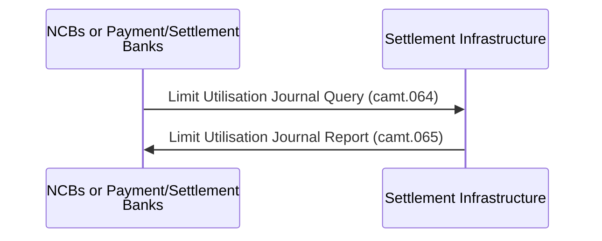

# Limit-utilisation journal scope exchange

## Source evidence

[src-000362](../../../../../../../../evidence/omitted/e6546c5f64c53f963440988a.md) archive member `ISO20022_MDR_Target2Securities_August_2026_v1/Target2-Securities_LimitUtilisationJournal_MessageSet/ISO20022_MDRPart1_Target2Securities_LimitUtilisationJournal_v2.docx`; Scope and Functionality / Scope; direct-body paragraph P53; word/media/image2.png. [Unchanged original figure](../../../../../../../../evidence/omitted/e6e490cbc582cfce7b49a84c.md).

[Complete source figure](../../../../../../../../evidence/omitted/e6e490cbc582cfce7b49a84c.md)

## Mermaid reconstruction

## Roles, activities and alternatives

The scope picture shows an NCB/payment/settlement-bank query to Settlement Infrastructure and the returning report. P51 additionally names CSDs; P62/P77 also name directly connected system participants. Those narrative actors are included in the flow and participant library even though this particular picture omits them. Complete Word6 confirms the floating source text is part of the settlement-infrastructure label, with no additional actor or message. The query/report uses Business Application Header head.001 (P55), not Business File Header.

| Source-scoped role | Canonical reference |
| --- | --- |
| instructing party | [instructing party](../../../../../../../../shared/reference/participants/participant-src-000362-instructing-party.md) |
| executing servicing party | [executing servicing party](../../../../../../../../shared/reference/participants/participant-src-000362-executing-servicing-party.md) |
| national central bank ncb | [national central bank ncb](../../../../../../../../shared/reference/participants/participant-src-000362-national-central-bank-ncb.md) |
| payment bank | [payment bank](../../../../../../../../shared/reference/participants/participant-src-000362-payment-bank.md) |
| settlement bank | [settlement bank](../../../../../../../../shared/reference/participants/participant-src-000362-settlement-bank.md) |
| settlement infrastructure | [settlement infrastructure](../../../../../../../../shared/reference/participants/participant-src-000362-settlement-infrastructure.md) |
| central securities depositories csd | [central securities depositories csd](../../../../../../../../shared/reference/participants/participant-src-000362-central-securities-depositories-csd.md) |
| direct connected participant dcp | [direct connected participant dcp](../../../../../../../../shared/reference/participants/participant-src-000362-direct-connected-participant-dcp.md) |

Source responsibilities/conditions: [T4](../../documents/src-000362/tables/tbl-0004.md), [T7](../../documents/src-000362/tables/tbl-0007.md), [T8](../../documents/src-000362/tables/tbl-0008.md).

## Exact message evidence

| Source family | Exact supplied definition | Companion MDR Part2 locator |
| --- | --- | --- |
| camt.064 | [camt.064.001.01](../../../../../messages/camt.064.001.01/index.md) | src-000363; 2 camt.064.001.01 LimitUtilisationJournalQueryV01; file pages4-8 |
| camt.065 | [camt.065.001.01](../../../../../messages/camt.065.001.01/index.md) | src-000363; 3 camt.065.001.01 LimitUtilisationJournalReportV01; file pages9-28 |

Reusable flows: [Pull mode](../../flows/flow-src-000362-p137-pull-mode.md).

## Review evidence

Compared complete source artwork and complete Word pages with the rendered reconstruction. Checked six actor symbols and source stereotypes, association direction, source green reporting scope, all14 taxonomy query/response pairs with28 leaf labels and28 exchange labels, business-role mappings, ordered activities, exclusive validation branches, source join bar, scheduled push origin and message direction. The two identical context occurrences remain linked to one reconstruction. Mermaid12.3.0 / Chromium156.0.8078.81; comparison2026-11-09 Europe/Warsaw. [Compared reconstruction](../../../../../../../../evidence/omitted/fe20032d03954956e73e8e62.md).

Complete source pages: [Word6](../../../../../../../../evidence/omitted/4c579287450e2ec07a01bf77.md).
