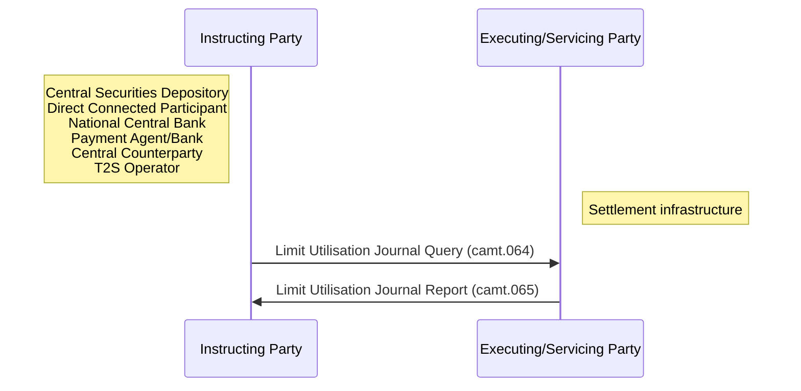

# Limit reporting communication roles

## Source evidence

[src-000362](../../../../../../../../evidence/omitted/e6546c5f64c53f963440988a.md) archive member `ISO20022_MDR_Target2Securities_August_2026_v1/Target2-Securities_LimitUtilisationJournal_MessageSet/ISO20022_MDRPart1_Target2Securities_LimitUtilisationJournal_v2.docx`; BusinessRoles and Participants; direct-body paragraph P99; word/media/image4.png. [Unchanged original figure](../../../../../../../../evidence/omitted/564f4b32a74c9973b1a8835d.md).

[Complete source figure](../../../../../../../../evidence/omitted/564f4b32a74c9973b1a8835d.md)

## Mermaid reconstruction

## Roles, activities and alternatives

The source lists six contextual business-role alternatives beside Instructing Party and Settlement infrastructure beside Executing/Servicing Party. Dotted annotation leaders point from the two role/lifeline areas toward their labels; these are mapping annotations, not additional message exchanges. T7 independently confirms the mappings. The reconstruction uses native notes for the labels while retaining the exact leader appearance in the original.

| Source-scoped role | Canonical reference |
| --- | --- |
| instructing party | [instructing party](../../../../../../../../shared/reference/participants/participant-src-000362-instructing-party.md) |
| executing servicing party | [executing servicing party](../../../../../../../../shared/reference/participants/participant-src-000362-executing-servicing-party.md) |
| central securities depositories csd | [central securities depositories csd](../../../../../../../../shared/reference/participants/participant-src-000362-central-securities-depositories-csd.md) |
| direct connected participant dcp | [direct connected participant dcp](../../../../../../../../shared/reference/participants/participant-src-000362-direct-connected-participant-dcp.md) |
| national central bank ncb | [national central bank ncb](../../../../../../../../shared/reference/participants/participant-src-000362-national-central-bank-ncb.md) |
| payment bank | [payment bank](../../../../../../../../shared/reference/participants/participant-src-000362-payment-bank.md) |
| payment agent | [payment agent](../../../../../../../../shared/reference/participants/participant-src-000362-payment-agent.md) |
| central counterparty | [central counterparty](../../../../../../../../shared/reference/participants/participant-src-000362-central-counterparty.md) |
| t2s operator | [t2s operator](../../../../../../../../shared/reference/participants/participant-src-000362-t2s-operator.md) |
| settlement infrastructure | [settlement infrastructure](../../../../../../../../shared/reference/participants/participant-src-000362-settlement-infrastructure.md) |

Source responsibilities/conditions: [T7](../../documents/src-000362/tables/tbl-0007.md).

## Exact message evidence

| Source family | Exact supplied definition | Companion MDR Part2 locator |
| --- | --- | --- |
| camt.064 | [camt.064.001.01](../../../../../messages/camt.064.001.01/index.md) | src-000363; 2 camt.064.001.01 LimitUtilisationJournalQueryV01; file pages4-8 |
| camt.065 | [camt.065.001.01](../../../../../messages/camt.065.001.01/index.md) | src-000363; 3 camt.065.001.01 LimitUtilisationJournalReportV01; file pages9-28 |

Reusable flows: [Pull mode](../../flows/flow-src-000362-p137-pull-mode.md).

## Review evidence

Compared complete source artwork and complete Word pages with the rendered reconstruction. Checked six actor symbols and source stereotypes, association direction, source green reporting scope, all14 taxonomy query/response pairs with28 leaf labels and28 exchange labels, business-role mappings, ordered activities, exclusive validation branches, source join bar, scheduled push origin and message direction. The two identical context occurrences remain linked to one reconstruction. Mermaid12.3.0 / Chromium156.0.8078.81; comparison2026-11-09 Europe/Warsaw. [Compared reconstruction](../../../../../../../../evidence/omitted/53e327460928e253190c92a7.md).

Complete source pages: [Word9](../../../../../../../../evidence/omitted/531714aad33396c2d3a75a8d.md).
