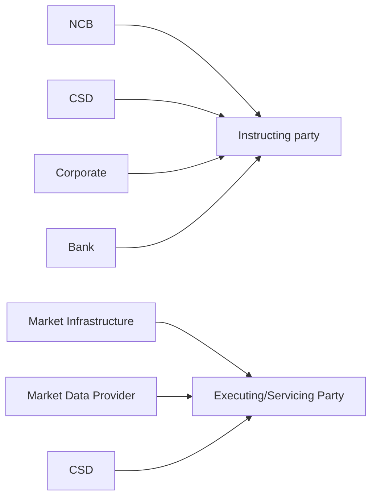

# Link reference-data role mappings

## Source evidence

[src-000365](../../../../../../../../evidence/omitted/e6546c5f64c53f963440988a.md) archive member `ISO20022_MDR_Target2Securities_August_2026_v1/Target2-Securities_LinkReferenceData_MessageSet/ISO20022_MDRPart1_Target2Securities_LinkReferenceData_v2.docx`; BusinessRoles and Participants; direct-body paragraph P103; word/media/image1.png. [Unchanged original figure](../../../../../../../../evidence/omitted/b5183991d004dabecbcca8e6.md).

[Complete source figure](../../../../../../../../evidence/omitted/b5183991d004dabecbcca8e6.md)

## Mermaid reconstruction

## Roles, activities and alternatives

Seven source arrows map business-role labels to two functional participant roles. The CSD appears in both relationships and remains one scoped record; an institution can act in either role. Source T7 additionally permits Market Data Provider as Instructing Party, which is absent from this typical-roles picture and remains included in the library/flows. The arrows are associations, not inheritance. Source P102 erroneously calls this Party Reference Data; cover/body and actual link messages establish Link Reference Data, retained under issue-000049.

| Source-scoped role | Canonical reference |
| --- | --- |
| instructing party | [instructing party](../../../../../../../../shared/reference/participants/participant-src-000365-instructing-party.md) |
| executing servicing party | [executing servicing party](../../../../../../../../shared/reference/participants/participant-src-000365-executing-servicing-party.md) |
| national central bank ncb | [national central bank ncb](../../../../../../../../shared/reference/participants/participant-src-000365-national-central-bank-ncb.md) |
| central securities depositories csd | [central securities depositories csd](../../../../../../../../shared/reference/participants/participant-src-000365-central-securities-depositories-csd.md) |
| corporate | [corporate](../../../../../../../../shared/reference/participants/participant-src-000365-corporate.md) |
| bank | [bank](../../../../../../../../shared/reference/participants/participant-src-000365-bank.md) |
| market infrastructure | [market infrastructure](../../../../../../../../shared/reference/participants/participant-src-000365-market-infrastructure.md) |
| market data provider | [market data provider](../../../../../../../../shared/reference/participants/participant-src-000365-market-data-provider.md) |

Source responsibilities/conditions: [T5](../../documents/src-000365/tables/tbl-0005.md), [T6](../../documents/src-000365/tables/tbl-0006.md), [T7](../../documents/src-000365/tables/tbl-0007.md).

## Review evidence

See recorded visual review below.

## Recorded visual review

Compared all visible actor labels, business-role arrows, two overview activities, accepted/rejected decisions and retry path, three status messages, line styles and message directions with complete Word source pages. Identical complete activity previews have one canonical reconstruction while creation and modification rules remain distinct. Literal duplicate Instructing Party labels on modification sequences are preserved and qualified under issue-000049. Mermaid12.3.0 / Chromium156.0.8078.81 parse/render and visual comparison passed2026-11-09 Europe/Warsaw. [Compared reconstruction](../../../../../../../../evidence/omitted/032e535c3961143c90106fad.md). Source pages: [Word10](../../../../../../../../evidence/omitted/0a842520e640c88224ffa436.md).
