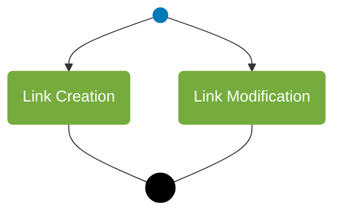

# Link creation and modification overview

## Source evidence

[src-000365](../../../../../../../../evidence/omitted/e6546c5f64c53f963440988a.md) archive member `ISO20022_MDR_Target2Securities_August_2026_v1/Target2-Securities_LinkReferenceData_MessageSet/ISO20022_MDRPart1_Target2Securities_LinkReferenceData_v2.docx`; BusinessProcess Description; direct-body paragraph P111; word/media/image2.jpg. [Unchanged original figure](../../../../../../../../evidence/omitted/b1bad15cbb486d4265af05fb.md).

[Complete source figure](../../../../../../../../evidence/omitted/b1bad15cbb486d4265af05fb.md)

## Mermaid reconstruction

## Roles, activities and alternatives

A single start branches to Link Creation and Link Modification, which converge at an end point. The source does not draw an exclusive-choice diamond or a parallel bar, so neither execution constraint is inferred. P110 says the overview is not exhaustive. T8/T9 supply distinct known-party/privilege preconditions and acknowledgment postconditions for creation versus modification.

| Source-scoped role | Canonical reference |
| --- | --- |
| instructing party | [instructing party](../../../../../../../../shared/reference/participants/participant-src-000365-instructing-party.md) |
| executing servicing party | [executing servicing party](../../../../../../../../shared/reference/participants/participant-src-000365-executing-servicing-party.md) |
| authorised user | [authorised user](../../../../../../../../shared/reference/participants/participant-src-000365-authorised-user.md) |
| authorised party | [authorised party](../../../../../../../../shared/reference/participants/participant-src-000365-authorised-party.md) |

Source responsibilities/conditions: [T8](../../documents/src-000365/tables/tbl-0008.md), [T9](../../documents/src-000365/tables/tbl-0009.md).

## Exact message evidence

| Source family | Exact supplied definition | Companion MDR Part2 locator |
| --- | --- | --- |
| reda.045 | [reda.045.001.01](../../../../../messages/reda.045.001.01/index.md) | src-000366; 2 reda.045.001.01 SecurityCSDLinkCreationRequestV01; file pages6-16 |
| reda.046 | [reda.046.001.01](../../../../../messages/reda.046.001.01/index.md) | src-000366; 3 reda.046.001.01 SecurityCSDLinkMaintenanceRequestV01; file pages17-24 |
| reda.047 | [reda.047.001.01](../../../../../messages/reda.047.001.01/index.md) | src-000366; 4 reda.047.001.01 SecurityCSDLinkStatusAdviceV01; file pages25-34 |
| reda.049 | [reda.049.001.01](../../../../../messages/reda.049.001.01/index.md) | src-000366; 5 reda.049.001.01 AccountLinkCreationRequestV01; file pages35-40 |
| reda.050 | [reda.050.001.01](../../../../../messages/reda.050.001.01/index.md) | src-000366; 6 reda.050.001.01 AccountLinkMaintenanceRequestV01; file pages41-46 |
| reda.051 | [reda.051.001.01](../../../../../messages/reda.051.001.01/index.md) | src-000366; 7 reda.051.001.01 AccountLinkStatusAdviceV01; file pages47-54 |

Reusable flows: [Link Creation Process](../../flows/flow-src-000365-p120-link-creation-process.md), [Link Modification Process](../../flows/flow-src-000365-p122-link-modification-process.md).

## Review evidence

See recorded visual review below.

## Recorded visual review

Compared all visible actor labels, business-role arrows, two overview activities, accepted/rejected decisions and retry path, three status messages, line styles and message directions with complete Word source pages. Identical complete activity previews have one canonical reconstruction while creation and modification rules remain distinct. Literal duplicate Instructing Party labels on modification sequences are preserved and qualified under issue-000049. Mermaid12.3.0 / Chromium156.0.8078.81 parse/render and visual comparison passed2026-11-09 Europe/Warsaw. [Compared reconstruction](../../../../../../../../evidence/omitted/bcd2673012b13e1cbeb66134.md). Source pages: [Word12](../../../../../../../../evidence/omitted/39901298867ba7f045ba6765.md).
