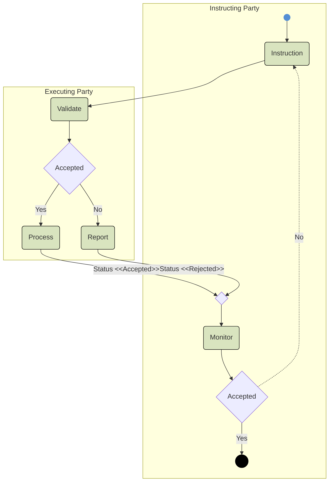

# Link creation and modification validation/retry activity

## Source evidence

[src-000365](../../../../../../../../evidence/omitted/e6546c5f64c53f963440988a.md) archive member `ISO20022_MDR_Target2Securities_August_2026_v1/Target2-Securities_LinkReferenceData_MessageSet/ISO20022_MDRPart1_Target2Securities_LinkReferenceData_v2.docx`; Description of BusinessActivities / Link Reference Data / Link Creation Process; direct-body paragraph P129; word/media/image7.emf. [Unchanged original figure](../../../../../../../../evidence/omitted/2409775dbf67fe9c67252fab.md).

[Complete source figure](../../../../../../../../evidence/omitted/a5626651966edea68388f04e.md)

## Mermaid reconstruction

## Roles, activities and alternatives

Instruction passes from Instructing Party to Executing Party Validate. Accepted leads to Process and an Accepted status; No leads to Report and a Rejected status. Both return through a merge to Monitor. The instructing-side Accepted decision ends on Yes and follows the dashed No loop back to Instruction. The table separately defines QUEUED when a valid instruction cannot yet be processed: it is resubmitted to validation after a specific event. No QUEUED branch is drawn in this activity, and that narrative path is retained explicitly. T11 checks novelty and whether the instruction is already handled; successful timely creation produces COMPLETED.

| Source-scoped role | Canonical reference |
| --- | --- |
| instructing party | [instructing party](../../../../../../../../shared/reference/participants/participant-src-000365-instructing-party.md) |
| executing servicing party | [executing servicing party](../../../../../../../../shared/reference/participants/participant-src-000365-executing-servicing-party.md) |
| authorised user | [authorised user](../../../../../../../../shared/reference/participants/participant-src-000365-authorised-user.md) |
| authorised party | [authorised party](../../../../../../../../shared/reference/participants/participant-src-000365-authorised-party.md) |
| issuer csd | [issuer csd](../../../../../../../../shared/reference/participants/participant-src-000365-issuer-csd.md) |
| investor csd | [investor csd](../../../../../../../../shared/reference/participants/participant-src-000365-investor-csd.md) |
| technical issuer | [technical issuer](../../../../../../../../shared/reference/participants/participant-src-000365-technical-issuer.md) |

Source responsibilities/conditions: [T8](../../documents/src-000365/tables/tbl-0008.md), [T11](../../documents/src-000365/tables/tbl-0011.md).

## Exact message evidence

| Source family | Exact supplied definition | Companion MDR Part2 locator |
| --- | --- | --- |
| reda.045 | [reda.045.001.01](../../../../../messages/reda.045.001.01/index.md) | src-000366; 2 reda.045.001.01 SecurityCSDLinkCreationRequestV01; file pages6-16 |
| reda.047 | [reda.047.001.01](../../../../../messages/reda.047.001.01/index.md) | src-000366; 4 reda.047.001.01 SecurityCSDLinkStatusAdviceV01; file pages25-34 |
| reda.049 | [reda.049.001.01](../../../../../messages/reda.049.001.01/index.md) | src-000366; 5 reda.049.001.01 AccountLinkCreationRequestV01; file pages35-40 |
| reda.051 | [reda.051.001.01](../../../../../messages/reda.051.001.01/index.md) | src-000366; 7 reda.051.001.01 AccountLinkStatusAdviceV01; file pages47-54 |

Reusable flows: [Link Creation Process](../../flows/flow-src-000365-p120-link-creation-process.md).

## Review evidence

See recorded visual review below.

## Modification context and second source occurrence

Original EMF bytes differ; complete Windows-rendered source preview PNGs are byte-identical, SHA256 0d16548f79590e374a0ab213299ff866720d3af0fc2f9332c5b388a761cdb840. Distinct creation/modification conditions and source occurrences remain separate.

Second original: [unchanged image8.emf](../../../../../../../../evidence/omitted/b99a65d383884cafb1692ef5.md); P133, Word16.

## Roles, activities and alternatives

Instruction passes from Instructing Party to Executing Party Validate. Accepted leads to Process and an Accepted status; No leads to Report and a Rejected status. Both return through a merge to Monitor. The instructing-side Accepted decision ends on Yes and follows the dashed No loop back to Instruction. The table separately defines QUEUED when a valid instruction cannot yet be processed: it is resubmitted to validation after a specific event. No QUEUED branch is drawn in this activity, and that narrative path is retained explicitly. T12 checks existence and whether the data can be updated; successful timely update produces COMPLETED.

| Source-scoped role | Canonical reference |
| --- | --- |
| instructing party | [instructing party](../../../../../../../../shared/reference/participants/participant-src-000365-instructing-party.md) |
| executing servicing party | [executing servicing party](../../../../../../../../shared/reference/participants/participant-src-000365-executing-servicing-party.md) |
| authorised user | [authorised user](../../../../../../../../shared/reference/participants/participant-src-000365-authorised-user.md) |
| authorised party | [authorised party](../../../../../../../../shared/reference/participants/participant-src-000365-authorised-party.md) |
| investor csd | [investor csd](../../../../../../../../shared/reference/participants/participant-src-000365-investor-csd.md) |

Source responsibilities/conditions: [T9](../../documents/src-000365/tables/tbl-0009.md), [T12](../../documents/src-000365/tables/tbl-0012.md).

## Exact message evidence

| Source family | Exact supplied definition | Companion MDR Part2 locator |
| --- | --- | --- |
| reda.046 | [reda.046.001.01](../../../../../messages/reda.046.001.01/index.md) | src-000366; 3 reda.046.001.01 SecurityCSDLinkMaintenanceRequestV01; file pages17-24 |
| reda.047 | [reda.047.001.01](../../../../../messages/reda.047.001.01/index.md) | src-000366; 4 reda.047.001.01 SecurityCSDLinkStatusAdviceV01; file pages25-34 |
| reda.050 | [reda.050.001.01](../../../../../messages/reda.050.001.01/index.md) | src-000366; 6 reda.050.001.01 AccountLinkMaintenanceRequestV01; file pages41-46 |
| reda.051 | [reda.051.001.01](../../../../../messages/reda.051.001.01/index.md) | src-000366; 7 reda.051.001.01 AccountLinkStatusAdviceV01; file pages47-54 |

Reusable flows: [Link Modification Process](../../flows/flow-src-000365-p122-link-modification-process.md).

## Recorded visual review

Compared all visible actor labels, business-role arrows, two overview activities, accepted/rejected decisions and retry path, three status messages, line styles and message directions with complete Word source pages. Identical complete activity previews have one canonical reconstruction while creation and modification rules remain distinct. Literal duplicate Instructing Party labels on modification sequences are preserved and qualified under issue-000049. Mermaid12.3.0 / Chromium156.0.8078.81 parse/render and visual comparison passed2026-11-09 Europe/Warsaw. [Compared reconstruction](../../../../../../../../evidence/omitted/9176e9c854ce0be14d9daf2f.md). Source pages: [Word14](../../../../../../../../evidence/omitted/4a1bee0b8440df855afe28f6.md), [Word16](../../../../../../../../evidence/omitted/bb3a982ef98322ddf8f295b7.md).
