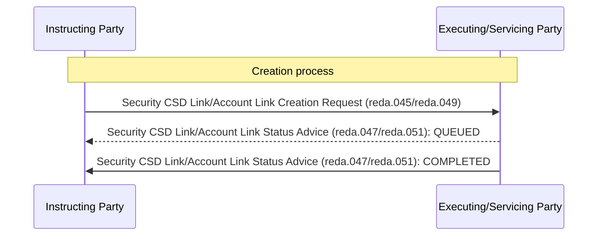

# Link creation confirmation sequence

## Source evidence

[src-000365](../../../../../../../../evidence/omitted/e6546c5f64c53f963440988a.md) archive member `ISO20022_MDR_Target2Securities_August_2026_v1/Target2-Securities_LinkReferenceData_MessageSet/ISO20022_MDRPart1_Target2Securities_LinkReferenceData_v2.docx`; BusinessTransactions / Creation Process / Confirmation Scenario; direct-body paragraph P142; word/media/image9.png. [Unchanged original figure](../../../../../../../../evidence/omitted/9667d0749634fc3b804deb05.md).

[Complete source figure](../../../../../../../../evidence/omitted/9667d0749634fc3b804deb05.md)

## Mermaid reconstruction

## Roles, activities and alternatives

The source shows the request left-to-right, an optional QUEUED advice right-to-left with a dashed line, and the final solid COMPLETED advice. The adjacent narrative says delayed processing might be reported, so QUEUED is not mandatory in every execution. Successful processing returns identification of the link.

| Source-scoped role | Canonical reference |
| --- | --- |
| instructing party | [instructing party](../../../../../../../../shared/reference/participants/participant-src-000365-instructing-party.md) |
| executing servicing party | [executing servicing party](../../../../../../../../shared/reference/participants/participant-src-000365-executing-servicing-party.md) |

## Exact message evidence

| Source family | Exact supplied definition | Companion MDR Part2 locator |
| --- | --- | --- |
| reda.045 | [reda.045.001.01](../../../../../messages/reda.045.001.01/index.md) | src-000366; 2 reda.045.001.01 SecurityCSDLinkCreationRequestV01; file pages6-16 |
| reda.047 | [reda.047.001.01](../../../../../messages/reda.047.001.01/index.md) | src-000366; 4 reda.047.001.01 SecurityCSDLinkStatusAdviceV01; file pages25-34 |
| reda.049 | [reda.049.001.01](../../../../../messages/reda.049.001.01/index.md) | src-000366; 5 reda.049.001.01 AccountLinkCreationRequestV01; file pages35-40 |
| reda.051 | [reda.051.001.01](../../../../../messages/reda.051.001.01/index.md) | src-000366; 7 reda.051.001.01 AccountLinkStatusAdviceV01; file pages47-54 |

Reusable flows: [Confirmation Scenario](../../flows/flow-src-000365-p139-confirmation-scenario.md).

## Review evidence

See recorded visual review below.

## Recorded visual review

Compared all visible actor labels, business-role arrows, two overview activities, accepted/rejected decisions and retry path, three status messages, line styles and message directions with complete Word source pages. Identical complete activity previews have one canonical reconstruction while creation and modification rules remain distinct. Literal duplicate Instructing Party labels on modification sequences are preserved and qualified under issue-000049. Mermaid12.3.0 / Chromium156.0.8078.81 parse/render and visual comparison passed2026-11-09 Europe/Warsaw. [Compared reconstruction](../../../../../../../../evidence/omitted/4b67701a69f724b7b3ae332e.md). Source pages: [Word18](../../../../../../../../evidence/omitted/36a7f8c05a20ea8b348d3604.md).
