# Party modification activity

[src-000368](../../../../../../../../evidence/omitted/e6546c5f64c53f963440988a.md) archive member `ISO20022_MDR_Target2Securities_August_2026_v1/Target2-Securities_PartyReferenceData_MessageSet/ISO20022_MDRPart1_Target2Securities_PartyReferenceData_2023_2024_v2.docx`; direct-body paragraph P138; Word-rendered file page 17. Complete Word-rendered page; figure identified by its heading, actor labels and message sequence. Parent work/docx-render/src-000368/document.pdf; file page 17.

[Complete original figure/context](../../../../../../../../evidence/omitted/ee5492ae0e04d7a26649c062.md) · [Business flow and conditional narrative](../../flows/flow-src-000368-p122-modify-party.md)

## Source reconstruction

```mermaid
flowchart TB
subgraph group0["Instructing Party"]
start(("#160;"))
instruction(["Instruction"])
merge{"#160;"}
monitor(["Monitor"])
acceptedIP{"Accepted"}
finish((("#160;")))
end
subgraph group1["Executing Party"]
validate(["Validate"])
acceptedEP{"Accepted"}
process(["Process"])
report(["Report"])
end
start --> instruction
instruction --> validate
validate --> acceptedEP
acceptedEP -->|"Yes"| process
acceptedEP -->|"No"| report
process -->|"Status &lt;&lt;Accepted&gt;&gt;"| merge
report -->|"Status &lt;&lt;Rejected&gt;&gt;"| merge
merge --> monitor
monitor --> acceptedIP
acceptedIP -.->|"No"| instruction
acceptedIP -->|"Yes"| finish
style start fill:#333,stroke:#333
```

## Participants

- [Instructing Party](../../../../../../../../shared/reference/participants/participant-src-000368-instructing-party.md)
- [Executing / Servicing Party](../../../../../../../../shared/reference/participants/participant-src-000368-executing-servicing-party.md)

## Entities and relationships

| Source | Destination | Condition or exchange | Line notation |
| --- | --- | --- | --- |
| start | Instruction | Unlabelled connector | --&gt; |
| Instruction | Validate | Unlabelled connector | --&gt; |
| Validate | Accepted | Unlabelled connector | --&gt; |
| Accepted | Process | Yes | --&gt; |
| Accepted | Report | No | --&gt; |
| Process | merge | Status &lt;&lt;Accepted&gt;&gt; | --&gt; |
| Report | merge | Status &lt;&lt;Rejected&gt;&gt; | --&gt; |
| merge | Monitor | Unlabelled connector | --&gt; |
| Monitor | Accepted | Unlabelled connector | --&gt; |
| Accepted | Instruction | No | -.-&gt; |
| Accepted | finish | Yes | --&gt; |

## Qualifications

- The source labels the servicing swimlane Executing Party; the corresponding activity table explicitly names Executing/Servicing Party. The scoped participant reference retains both supported labels.
- The dashed No path returns from the instructing-party Accepted decision to Instruction. The two status paths meet at the unlabelled diamond before Monitor.
- QUEUED and re-validation after a night-time cycle are defined by the corresponding activity table and transaction narrative, even though this activity picture only labels Accepted/Rejected.
- The complete Word page is retained because the diagram uses native Word objects and reused pictograms, or the standalone EMF preview is clipped. Individual embedded assets remain unchanged but are not treated as complete figures.

## Rendering and visual review

On 2026-11-09 this reconstruction parsed and rendered with Mermaid 12.3.0 / Mermaid browser API + Chromium 156.0.8078.81. The final rendering was directly compared with the complete source for labels, participants, connector endpoints/directions, decisions and line styles. All 47 Word pages were inspected for complete composition. **Visible-source fidelity: pass.** Source conflicts remain open where listed. Mermaid changes layout, actor glyphs, arrowhead styling and final-node centre fill; the original and textual relationship description preserve them.

[Rendered SVG](../../../../../../../../evidence/omitted/6a920cc28be215af7ec17209.md) · [Rendered PNG](../../../../../../../../evidence/omitted/4cb5d63c9a3ef0f6f39bb14b.md) · [Hash-bound review evidence](../../../../../../../../tracking/reviews/t2s-party-reference-data.json)
